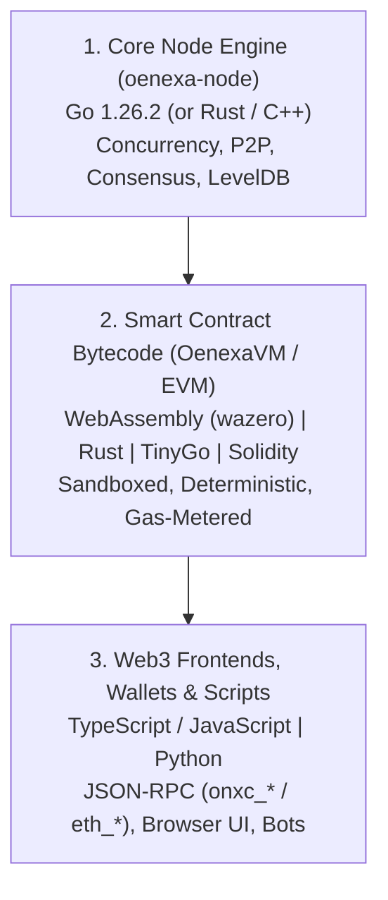

# Stage 1: Programming Languages In-Depth & How OENEXA Uses Go + WASM

> **Where You Are in the Blockchain Developer Path**
> **`[1. Programming Languages]`** $\to$ Cryptography $\to$ Bitcoin Basics $\to$ Ethereum $\to$ Solidity $\to$ Smart Contracts $\to$ Web3 Projects $\to$ Security $\to$ DeFi $\to$ Blockchain Core $\to$ Build Your Own Blockchain

---

## 1. Everyday Analogy: Why Different Parts of a Race Car Use Different Materials

You wouldn't build an engine block out of cardboard, and you wouldn't build the dashboard screen out of cast iron! Similarly, real-world blockchain engineering uses **different programming languages for different jobs**:



### Complete Language Map for Blockchain Developers

| Language                    | Primary Role in Web3                     | Why Engineers Choose It                                                                                                    | Role in OENEXA                                                                                                        |
|:----------------------------|:-----------------------------------------|:---------------------------------------------------------------------------------------------------------------------------|:----------------------------------------------------------------------------------------------------------------------|
| **Go (`Golang`)**           | Full Nodes, P2P, Consensus, RPC, CLIs    | Fast compilation, simple syntax, built-in `goroutines` + `channels`, static binaries, massive networking/crypto ecosystem. | **Primary core language** of `oenexa-node`, `oenexa-cli`, consensus, mempool, SMT, RPC, and Rosetta (`go 1.26.2`).    |
| **WebAssembly (`WASM`)**    | Portable Smart Contract Runtime          | Hardware-neutral binary target, strict memory sandbox, multi-language compilation.                                         | **`OenexaVM`** runs `.wasm` contracts inside pure-Go **`wazero v1.11.0`** (`internal/vm`).                            |
| **Solidity**                | EVM Smart Contracts                      | Dominant contract language for DeFi, tokens, DAOs, and governance across EVM-style apps.                                   | Teaches EVM contract patterns; bridges conceptually to OENEXA's storage/caller/value ABI + `eth_*` RPC compatibility. |
| **Rust / TinyGo**           | High-speed WASM contracts & crypto nodes | Zero garbage collection, compile-time memory safety, compiles cleanly to compact `.wasm`.                                  | Ideal for writing production smart contracts targeting `OenexaVM` `env.oen_*` host functions.                         |
| **JavaScript / TypeScript** | Web3 dApps, Browser Wallets, Explorers   | Runs in every browser, talks directly over HTTP/WebSocket JSON-RPC.                                                        | Powers our offline [`Visual Learning Studio`](../visual-lab/index.html) + Web3 wallet/frontend integrations.          |
| **Python**                  | Testing, Data Science, Oracles, Audits   | Rapid prototyping, clean `hashlib` / HTTP tooling, financial modeling.                                                     | Great for oracle price fetchers, security verification scripts, and supply audits.                                    |

---

## 2. Deep Dive: Why `oenexa-node` Is Built in Go (`go 1.26.2`)

Let's open up the real engineering reasons behind `oenexa-node`'s architecture (`go.mod`):

### Pillar A: Built-In Concurrency Without Thread Chaos (`Goroutines` & `Channels`)
A blockchain node does **six live jobs at the exact same second**:
1. Listen for incoming HTTP JSON-RPC requests (`:8545`)
2. Gossip transactions & votes across `libp2p` peers (`:8765`)
3. Export Prometheus metrics (`:9090`)
4. Run the 2-second BFT Consensus timer (`StepPropose` $\to$ `Commit`)
5. Run the 5-second `Syncer` catch-up loop
6. Poll `Upgrade` release manifests safely in the background

In Go, launching a concurrent background worker takes one keyword (`go fn()`) using lightweight **`goroutines`** (~2 KB initial stack vs. ~1+ MB per OS thread!), communicating safely through **`channels`** and guarded shared memory (`sync.RWMutex`).

#### Worked Example (`Node` Mutex vs. Atomic Reads)
Inside `internal/shielded/turnstile.go`:
- `Balances()` uses **`t.mu.RLock()`** (many readers can audit `TransparentSupply` and `ShieldedSupply` simultaneously!).
- `Shield(amount)` and `Unshield(amount)` use **`t.mu.Lock()`** (exclusive lock so two concurrent threads can *never* race and break `Transparent + Shielded == TotalSupply`).

---

### Pillar B: Determinism & Explicit Fixed-Width Integers (`uint64`)
In Python or JavaScript, numbers can silently switch between `int`, `BigInt`, or floating point (`0.1 + 0.2 = 0.30000000000000004`). In consensus code, even **1 bit** of divergence splits the blockchain!

Go forces explicit fixed-width types:
- **`uint64`**: Always exact `0` to `18,446,744,073,709,551,615` (`internal/core/types.go`: `OneONXC uint64 = 1_000_000_000`).
- **`[32]byte`**: Value-typed fixed arrays! Because `[32]byte` is a fixed value type (not a pointer!), it can be used **directly as a Go `map` key** (`map[[32]byte]*Account`) for ultra-fast account lookups by address or block hash!
- **`encoding/binary.BigEndian`**: Guarantees a laptop on Intel x86, an Apple M-series ARM Mac, and a Linux cloud server serialize a number like `Amount = 250_000_000_000` into the **exact same 8 bytes** before hashing (`SigningPayload()`).

---

### Pillar C: Clean Interfaces for Swappable Infrastructure (`mpt.Backend`)
Notice how Go uses **implicit interfaces** — any struct implementing the required methods automatically satisfies the contract!

Look at `internal/mpt/mpt.go`:
```go
type Backend interface {
    Put(key, value []byte) error
    Get(key []byte) ([]byte, error)
    NewBatch() Batch
}
```
- **In Production (`oenexa-node`)**: Backed by persistent **LevelDB** on disk (`github.com/syndtr/goleveldb`).
- **In Unit Tests (`go test`)**: Backed by an instant in-memory Go `mapBackend`! Tests run in milliseconds without touching disk, proving identical Merkle root math.

---

### Pillar D: Production Dependency Stack in `oenexa-node/go.mod`
Every major dependency inside `oenexa-node/go.mod` solves one specific layer cleanly in **pure Go (zero CGO C-compiler headaches)**:

| Real Package in `go.mod`                         | Layer                     | What It Powers in OENEXA                                                                |
|:-------------------------------------------------|:--------------------------|:----------------------------------------------------------------------------------------|
| `github.com/cloudflare/circl v1.6.3`             | Post-Quantum Cryptography | NIST FIPS 204 **`ML-DSA-65`** signatures & FIPS 203 **`ML-KEM-768`** note encryption.   |
| `golang.org/x/crypto v0.54.0`                    | Hashing & Key Hardening   | FIPS 202 **`SHA-3-256`**, **`Argon2id`** keystore KDF, ChaCha/AEAD primitives.          |
| `github.com/tetratelabs/wazero v1.11.0`          | Smart Contract Runtime    | Pure-Go **WebAssembly VM (`OenexaVM`)** executing `.wasm` safely with zero CGO.         |
| `github.com/libp2p/go-libp2p v0.50.0` + `pubsub` | P2P Networking            | Decentralized peer mesh, mDNS discovery, Noise/QUIC transport, gossip topics.           |
| `github.com/syndtr/goleveldb v1.0.0`             | Persistence               | Fast LSM-tree key-value database for blocks (`BlockStore`) & trie state (`StateStore`). |
| `github.com/spf13/cobra v1.10.2`                 | CLI Framework             | Ergonomic subcommands (`wallet new`, `query chain`, `tx send`).                         |
| `github.com/prometheus/client_golang v1.24.1`    | Observability             | Exposes live chain height, mempool depth, burned fees on `:9090/metrics`.               |

---

## 3. Deep Dive: How `OenexaVM` Executes Bytecode Inside Go (`internal/vm`)

How can a Go program safely run untrusted user-submitted smart contracts? Inside `internal/vm/contract.go` & `vm.go`, OENEXA embeds **`wazero` (WebAssembly)**:

1. **Developer writes contract logic** (in WAT, Rust, C, or TinyGo) importing OENEXA's 8 `"env"` functions (`oen_get`, `oen_set`, `oen_transfer`, `oen_balance`, `oen_log`, `oen_caller`, `oen_block_height`, `oen_value`).
2. **Compiler outputs raw `.wasm` binary bytecode** starting with the WASM magic header `\x00asm\x01\x00\x00\x00`.
3. **`TxDeploy` stores and hashes bytecode** (`SHA-3-256`), caching the compiled `wazero` module.
4. **`TxCall` instantiates a sandboxed execution context** (`ExecutionContext` tracking `GasLimit`, `GasUsed`, `ReadOnly`) and calls the exported WASM function (e.g., `increment()`).

```text
Go Host (oenexa-node)                         Sandboxed WASM Guest (.wasm)
-----------------------                       ------------------------------
Implements env.oen_get(0)  <--- Host Call --- i32.const 0 -> call $get
Reads StateDB Slot 0 = 5   --- Returns 5 ---> i64 on stack (5)
                                              i64.const 1 -> i64.add (6)
Implements env.oen_set(0,6)<--- Host Call --- i32.const 0, i64(6) -> call $set
Commits 6 to StateDB (or rolls back on Out-of-Gas!)
```

---

## 4. Language Checklist Before You Advance

To master the rest of this roadmap cleanly:
1. Learn **Go basics** (`struct`, `slice`, `[32]byte`, `error` returns, `interface`, `go` goroutines, `sync.Mutex`) to read and extend **`oenexa-node`** and build your own Layer-1 chain in Stage 11!
2. Learn **Solidity basics** (Stage 5) to write familiar EVM-style contracts & DeFi protocols.
3. Learn **JavaScript / Python basics** (Stage 7) to talk to JSON-RPC APIs and inspect transactions.

---

## Student Practice Exercises (With Answers)

1. **Exercise 1 (Types):** Why does `oenexa-node` define addresses as `[32]byte` instead of `string` or `[]byte`?  
   <details><summary>Show Answer</summary>
   `[32]byte` has a fixed, exact size (`32` bytes), avoids heap allocation/slicing bugs, hashes canonically, and works directly as a Go map key (`map[[32]byte]*Account`).
   </details>

2. **Exercise 2 (Zero-CGO WASM):** Why did OENEXA choose `tetratelabs/wazero` for `OenexaVM` instead of embedding a C/C++ virtual machine via CGO?  
   <details><summary>Show Answer</summary>
   `wazero` is 100% pure Go with zero CGO dependencies, meaning `oenexa-node` compiles into single static binaries cleanly across Windows, Linux, and macOS while sandboxing contracts from the host OS.
   </details>
