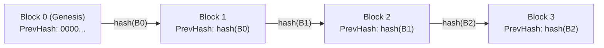

# Chapter 1: What Is a Blockchain & What Is OENEXA?

## 1. Starting From Zero: The Shared Notebook Analogy

Imagine five students share a small group expense fund. Instead of letting just **one** person hold the notebook (what if that person loses it, or secretly adds `+100` to their own page?), all **five students keep an identical copy** of the notebook.

Whenever Alice wants to pay Bob `10` coins:
1. Alice announces the payment to everyone and signs it with an unforgeable personal seal.
2. All five students check: *"Does Alice actually have `10` coins? Is her seal real?"*
3. Once a supermajority agrees, **every student writes the transaction onto the next numbered page** of their notebook at the same time.

That shared, tamper-proof notebook is a **blockchain**:
- **Block** = One numbered page of verified transactions.
- **Chain** = Each page includes a mathematical fingerprint (hash) of the *previous* page, linking every page together in order from Page `0` (Genesis) forward.

If a cheater tries to erase a number on Page `4`, Page `4`'s fingerprint changes — which breaks the link written at the top of Page `5`, Page `6`, and every page after it. Everyone immediately spots the forgery!

---

## 2. Why Do We Need Decentralized Networks?

In traditional digital money:
- A central bank or company database decides your balance.
- Servers can go offline, freeze accounts, or be hacked at a single point of failure.
- Cryptography in legacy systems also relies on math that future **quantum computers** could break.

**OENEXA** (*the blockchain platform*) solves this by creating a **sovereign Layer-1 blockchain** — meaning it does not borrow security from any other blockchain. Every node independently validates every transaction, block, smart contract, and supply rule.

---

## 3. Meet OENEXA's Key Design Goals

From the very first line of code (`internal/core/types.go`), OENEXA is engineered around five pillars:

| Pillar | What It Means for Beginners | How OENEXA Implements It |
| :--- | :--- | :--- |
| **Post-Quantum Safe** | Even a powerful future quantum computer cannot forge your wallet signature. | Uses NIST-standardized `ML-DSA-65` signatures and `ML-KEM-768` encryption from Block `0`. |
| **Fast Finality (2s)** | Payments confirm permanently in ~2 seconds with no waiting for "6 confirmations". | Byzantine Fault Tolerant (BFT) voting (`Prevote` + `Precommit`) eliminates forks. |
| **Ultra-Low Fees** | Sending money costs fractions of a millionth of a coin. | Standard transfer uses `21` gas at `10` nano-ONXC initial base fee = `210` nano-ONXC. |
| **Optional Privacy** | Use transparent accounts for public clarity, or shield funds privately when needed. | Native Dual-Pool architecture connected by a supply-verifying Turnstile. |
| **Clean Native Economy** | A strict, predictable money supply that never suffers runaway inflation. | Native coin **ONXC** with a hard cap of `100,000,000 ONXC`. |

---

## 4. What Does "Layer-1" Mean?

Think of internet infrastructure in layers:
- **Layer-1 (L1)**: The base highway and settlement court itself (**OENEXA** is a Layer-1). It has its own validators, its own consensus rules (`ChainID = 1`), its own database, and its own coin (**ONXC**).
- **Layer-2 (L2)**: Express lanes built *on top* of Layer-1 (like OENEXA's built-in rollup sequencer in `internal/rollup`) that bundle hundreds of off-chain transactions together and settle a compressed proof back onto Layer-1.

---

## 5. Anatomy of a Block in OENEXA

Every 2 seconds (`BlockIntervalSec = 2`), the active validator proposer constructs a block containing two parts:

```text
+-------------------------------------------------------------------+
| BLOCK HEADER (The Tamper-Proof Label)                             |
|  - Height        : Block number (0 = Genesis, 1, 2, 3, ...)       |
|  - PrevHash      : SHA-3-256 fingerprint of the previous block    |
|  - Timestamp     : Exact creation time                            |
|  - TxRoot        : Merkle fingerprint of all txs inside the block |
|  - StateRoot     : Root hash of all account balances after block  |
|  - BaseFee       : Dynamic fee price for this block               |
|  - GasUsed       : Total gas consumed by transactions here        |
|  - ValidatorAddr : Who proposed this block                        |
|  - Signature     : Proposer's ML-DSA-65 post-quantum signature    |
+-------------------------------------------------------------------+
| BLOCK BODY (The Transactions)                                     |
|  [Tx 1] Alice -> Bob: 250 ONXC                                    |
|  [Tx 2] Carol stakes 1,000 ONXC                                   |
|  [Tx 3] Dave deploys a WASM smart contract                        |
+-------------------------------------------------------------------+
```

Because `PrevHash` points backwards to Block `h - 1`, all blocks form an unbreakable chain back to **Block `0` (Genesis)**:



---

## 6. How All Node Subsystems Fit Together

When you run `oenexa-node`, you are running a complete sovereign computer node composed of clear, modular subsystems:

- `internal/crypto` & `internal/keystore`: Creates keys, signs transactions, hashes data.
- `internal/mempool`: Holds valid unconfirmed transactions waiting for the next block.
- `internal/consensus`: Elects block proposers and runs BFT voting so nodes agree on the next block.
- `internal/state` & `internal/mpt`: Executes transactions and updates account balances in a Sparse Merkle Trie.
- `internal/shielded`: Handles private note commitments, nullifiers, and supply checks.
- `internal/vm`: Executes WebAssembly smart contracts safely.
- `internal/storage`: Persists blocks and state permanently to LevelDB on disk.
- `internal/p2p` & `internal/sync`: Connects peers worldwide and downloads missing blocks.
- `internal/rpc` & `internal/rosetta`: Lets wallets, explorers, scripts, and exchanges talk to your node.

---

## Check Your Understanding

1. **Why can't someone quietly change a transaction inside an old block (say Block `10`) when the network is at Block `500`?**  
   *Answer:* Changing anything in Block `10` changes its `SHA-3-256` hash. Since Block `11`'s `PrevHash` stores Block `10`'s original hash, Block `11` and every block up to `500` would immediately fail verification unless the attacker controlled more than 2/3 of all validator stake and re-signed every single block.

2. **What is the difference between OENEXA and ONXC?**  
   *Answer:* **OENEXA** is the Layer-1 blockchain protocol and network (`ChainID = 1`, `ProtocolVersion = 1`). **ONXC** (*Open Network for the Next Generation Coin*) is the native coin used to pay fees, stake, and transfer value on OENEXA.
