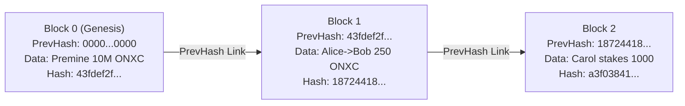
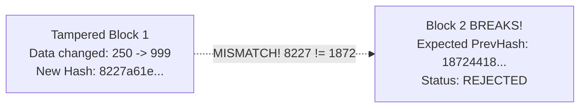
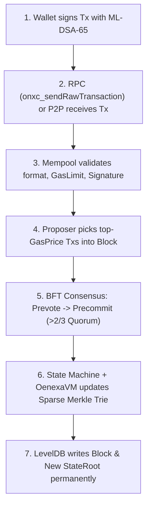

# Chapter 1: What Is a Blockchain & What Is OENEXA?

> **Learning Objectives**
> By the end of this chapter, you will be able to:
> - Explain what a blockchain is without technical jargon.
> - Show with a real hash example why tampering with an old block breaks the chain.
> - Distinguish **Layer-1 (`OENEXA`)**, **Native Currency (`ONXC`)**, and **Layer-2 (`Rollups`)**.
> - Trace how the major folders inside `oenexa-node` connect together.
>
> **Try It Visually:** Open [**Visual Lab Tab 1 — Blockchain & Hash Simulator**](../visual-lab/index.html#blockchain) while reading this chapter!

---

## 1. Everyday Analogy: The Shared Classroom Notebook

Imagine five students — Alice, Bob, Carol, Dave, and Eve — share a club fund of `1,000 ONXC`.

### Option A: The Centralized Notebook (Traditional Bank / Database)
Only **one student** holds the notebook at home.
- **Problem 1:** If that student loses the notebook or their house loses internet, nobody knows how much money anyone has.
- **Problem 2:** If that student is dishonest, they can erase `Alice: 200` and write `Alice: 50` while adding `+150` to themselves!

### Option B: The Blockchain Notebook (How OENEXA Works)
All **five students keep an identical copy** of the notebook. Whenever Alice pays Bob `10 ONXC`:
1. Alice announces *"Pay Bob 10 ONXC"* and locks it with her unforgeable digital signature.
2. Everyone checks: *"Does Alice really own 10 ONXC? Did she really sign this?"*
3. Once a supermajority (`> 2/3`) agrees, **every student writes the payment onto the exact same numbered page (a Block)** and stamps a mathematical fingerprint (`PrevHash`) of the previous page at the top!

---

## 2. Logic 1: How Block Chaining Prevents History Tampering



### Worked Example: Catching a Cheater in Block 1
Suppose Block 0, Block 1, and Block 2 have these genuine `SHA-3-256` fingerprints:

| Block | Stored `PrevHash` | Block Data | Computed `SHA-3-256` Hash | Chain Status |
| :--- | :--- | :--- | :--- | :--- |
| **Block 0** | `0000...0000` | `Genesis` | `43fdef2f90a2813b...` | Valid |
| **Block 1** | `43fdef2f90a2813b...` | `Alice->Bob:250` | `187244180b90c4a6...` | Valid |
| **Block 2** | `187244180b90c4a6...` | `Carol stakes 1000` | `a3f0384123db24c6...` | Valid |

Now suppose Alice tries to cheat **later** by editing Block 1 from `250` to `999` (`Alice->Bob:999`):
1. Recomputing Block 1's hash now yields **`8227a61e167ec44a...`** (completely different!).
2. Look at Block 2's header: Block 2 still says `PrevHash = 187244180b90c4a6...`!
3. Because **`8227a61e... != 18724418...`**, **Block 2 (and every block after it) immediately rejects Block 1 as forged!**



Try doing this exact edit live in [**Visual Lab Tab 1**](../visual-lab/index.html#blockchain)!

---

## 3. Logic 2: What Does "Layer-1" vs. "Layer-2" Mean?

Think of transportation:
- **Layer-1 (`OENEXA`)** = The sovereign national highway system and final supreme court.
  - Has its own validators (`consensus`), its own cryptography (`ML-DSA-65`, `SHA-3-256`), its own permanent database (`LevelDB`), and its own currency (`ONXC`).
  - Finalizes blocks directly every **2 seconds** (`BlockIntervalSec = 2`).
- **Layer-2 (`internal/rollup`)** = Express toll lanes built *on top* of Layer-1.
  - An L2 sequencer bundles hundreds or thousands of fast off-chain transactions into a single compressed batch (`PreRoot -> PostRoot`) and settles proof back onto OENEXA Layer-1.

| Feature | Legacy Classical Chains | OENEXA Layer-1 |
| :--- | :--- | :--- |
| **Quantum Resistance** | Vulnerable ECDSA / Ed25519 (can add later via hard fork) | Built-in Day 1 (`ML-DSA-65` + `ML-KEM-768` + `SHA-3-256`) |
| **Finality Speed** | Often probabilistic (wait 6+ blocks) | Instant 1-block finality (`~2s`) via BFT Precommits |
| **Native Transfer Fee** | Often `$0.01` to `$5.00+` | `21` gas × `10` nano-ONXC = `210 nano-ONXC` (`$0.00000021` at `$1`/ONXC) |
| **Privacy Support** | Fully public balances only | Dual-Pool (Public + Shielded Notes + Supply Turnstile) |
| **Monetary Cap** | Varies (some unlimited) | Strict `100,000,000 ONXC` mathematical hard cap |

---

## 4. Logic 3: Anatomy of Every OENEXA Block

Every `2 seconds`, the active validator packages waiting transactions into a `Block`:

```text
+------------------------------------------------------------------------+
| BLOCK HEADER (Signed by Proposer with ML-DSA-65)                       |
|  - Height        : 1, 2, 3... (0 = Genesis)                            |
|  - PrevHash      : SHA-3-256 hash of Block (Height - 1)                |
|  - Timestamp     : Creation time (nanoseconds)                         |
|  - TxRoot        : Merkle root summarizing every tx in the Body        |
|  - StateRoot     : 256-bit Sparse Merkle Trie root of ALL balances     |
|  - BaseFee       : EIP-1559 fee price per gas for this block           |
|  - GasUsed       : Sum of gas consumed (must be <= 500,000,000)        |
|  - ValidatorAddr : 32-byte address of the proposing validator          |
|  - Signature     : 3,309-byte post-quantum ML-DSA-65 signature         |
+------------------------------------------------------------------------+
| BLOCK BODY (Up to MaxTxPerBlock = 10,000 verified transactions)        |
|  [Tx 0] Alice -> Bob : 250 ONXC (Nonce 0, Fee 210 nano-ONXC)           |
|  [Tx 1] Carol stakes : 1,000 ONXC (TxStake)                            |
|  [Tx 2] Dave deploys : WASM Smart Contract (TxDeploy)                  |
+------------------------------------------------------------------------+
```

Notice how **`TxRoot`** protects the transactions inside the block, **`StateRoot`** proves the final balances after running those transactions, and **`PrevHash`** locks the block to all history before it!

---

## 5. How a Node Processes One User Action (Subsystem Visual)



---

## Student Practice Exercises (With Answers)

1. **Exercise 1 (Tamper Detection):** Block `49` has hash `aaaa...`, and Block `50` stores `PrevHash: aaaa...`. A hacker edits 1 digit of a payment inside Block `48`. Which blocks become invalid (`BROKEN`)?  
   <details><summary>Show Answer</summary>
   Blocks **48, 49, 50, and every block after 48**. Changing Block 48 alters Block 48's hash, breaking Block 49's `PrevHash`, which forces Block 49's hash to change, breaking Block 50's `PrevHash` in a domino effect.
   </details>

2. **Exercise 2 (Naming Clarity):** Suppose a friend asks: *"Is ONXC the blockchain and OENEXA the coin, or vice versa?"* How do you answer clearly?  
   <details><summary>Show Answer</summary>
   **OENEXA** is the Layer-1 blockchain platform/network (`ChainID = 1`). **ONXC** (*Open Network for the Next Generation Coin*) is the native currency used to pay gas fees, stake, and transfer value on OENEXA.
   </details>
