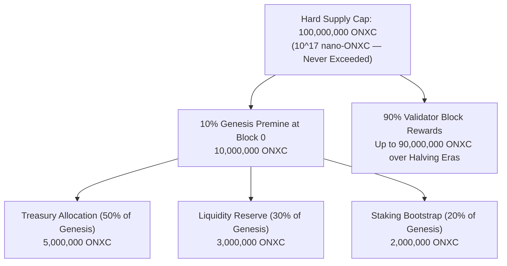

# Chapter 2: What Is ONXC Coin & Tokenomics?

> **Learning Objectives**
> By the end of this chapter, you will be able to:
> - Convert seamlessly between **`ONXC`** and **`nano-ONXC`** (`10^9` atomic units).
> - Explain with a concrete bug example why blockchains use integers instead of decimal floats.
> - Calculate the **Block Reward** and **Halving Era** at any block height `h`.
> - Walk through the geometric-series proof showing supply can **never exceed `100,000,000 ONXC`**.
> - Compute **Base Fee burns** and **Estimated Staking APY** from real numbers.
>
> **Try It Visually:** Open [**Visual Lab Tab 2 — ONXC Tokenomics Explorer**](../visual-lab/index.html#tokenomics) to drag the block height slider yourself!

---

## 1. Logic 1: Currency Units (`ONXC` and `nano-ONXC`)

Every dollar splits into `100` cents. Every **ONXC** splits into **`1,000,000,000` (`10^9`)** indivisible units called **`nano-ONXC`** (`internal/core/types.go`):

| Unit | Constant in Code | Exact Integer Value | Real-World Comparison |
| :--- | :--- | :--- | :--- |
| **`nano-ONXC`** | `NanoONXC = 1` | `1` (`0.000000001 ONXC`) | Like 1 millimeter — the exact internal unit stored in `StateDB`. |
| **`ONXC`** | `OneONXC = 1_000_000_000` | `1,000,000,000` (`10^9`) | The human-friendly coin shown in wallets and explorers. |

### Worked Example: Converting Back and Forth
- Alice has `2.5 ONXC` $\implies 2.5 \times 1,000,000,000 = \mathbf{2,500,000,000\text{ nano-ONXC}}$.
- Bob pays a tiny transfer fee of `210 nano-ONXC` $\implies 210 \div 1,000,000,000 = \mathbf{0.000000210\text{ ONXC}}$.
- Can `MaxSupply` fit inside a single 64-bit unsigned integer (`uint64`) without overflow libraries?
  $$\text{MaxSupply} = 100,000,000 \times 10^9 = 10^{17}\text{ nano-ONXC}$$
  Since `uint64` holds up to $1.844 \times 10^{19}$, $10^{17}$ fits easily with over **180x safety headroom**!

### Why Never Store Decimal Floats? (Concrete Failure Example)
In standard computer floating-point math (`float64`), `0.1 + 0.2` evaluates to `0.30000000000000004`! If two different CPUs rounded tiny fees slightly differently, their `StateRoot` hashes would diverge and halt consensus. By storing strictly integer **`uint64` `nano-ONXC`**, every computer on Earth gets the **exact same bit-for-bit balance**.

---

## 2. Logic 2: Where Coins Come From (Genesis + Future Emission)

When OENEXA launches at **Block `0` (Genesis)**, only **`10%`** (`10,000,000 ONXC`) exists initially. The remaining **`90%`** (`90,000,000 ONXC`) is earned block by block by validators securing the network (`internal/core/tokenomics.go`).



---

## 3. Logic 3: Block Rewards & Halvings (`BlockReward(height)`)

Every `2 seconds` (`BlockIntervalSec = 2`), a finalized block mints new ONXC for the active validator pool using this exact rule from `internal/core/tokenomics.go`:

```go
func BlockReward(height uint64) uint64 {
    if height == 0 {
        return 0
    }
    era := (height - 1) / HalvingInterval // HalvingInterval = 1,000,000 blocks
    if era >= 32 {
        return 0
    }
    return InitialBlockReward >> era       // InitialBlockReward = 45 * OneONXC
}
```

### How Does `>> era` (Bit-Shifting Right) Work?
Think of `>> 1` as **"cut in half and drop any sub-nano remainder"**.
- `>> 0`: divide by `1` (`45 ONXC`)
- `>> 1`: divide by `2` (`22.5 ONXC`)
- `>> 2`: divide by `4` (`11.25 ONXC`)
- `>> 3`: divide by `8` (`5.625 ONXC`)

One Halving Era lasts:
$$1,000,000\text{ blocks} \times 2\text{ seconds/block} = 2,000,000\text{ seconds} \approx 23.15\text{ days}$$

### Worked Examples Across 5 Different Block Heights

| Height `h` | Formula `(h - 1) / 1,000,000` | Era | Calculation | Exact Reward (`ONXC` & `nano-ONXC`) |
| :--- | :--- | :--- | :--- | :--- |
| **`0`** (Genesis) | guarded `height == 0` | — | `0` | **`0 ONXC`** (Genesis allocates `10M` premine) |
| **`1`** (First live block) | `(1 - 1) / 1,000,000 = 0` | `0` | `45 >> 0` | **`45.000000000 ONXC`** (`45,000,000,000`) |
| **`1,000,000`** (Last of Era 0) | `(999,999) / 1,000,000 = 0` | `0` | `45 >> 0` | **`45.000000000 ONXC`** (`45,000,000,000`) |
| **`1,000,001`** (First of Era 1) | `(1,000,000) / 1,000,000 = 1` | `1` | `45 >> 1` | **`22.500000000 ONXC`** (`22,500,000,000`) |
| **`2,500,000`** (Mid Era 2) | `(2,499,999) / 1,000,000 = 2` | `2` | `45 >> 2` | **`11.250000000 ONXC`** (`11,250,000,000`) |
| **`32,000,001`** (Era 32+) | `(32,000,000) / 1,000,000 = 32` | `32` | `era >= 32 -> 0` | **`0 ONXC`** (Minting finished forever!) |

---

## 4. Logic 4: Mathematical Proof of the `100,000,000 ONXC` Hard Cap

Imagine walking toward a wall 2 meters away:
- Step 1: walk `1.0` meter (total `1.0`)
- Step 2: walk half as far, `0.5` meter (total `1.5`)
- Step 3: walk half again, `0.25` meter (total `1.75`)
- Step 4: walk `0.125` meter (total `1.875`)

Even if you take infinitely many steps, **$1 + \frac{1}{2} + \frac{1}{4} + \frac{1}{8} + \dots = 2$** — you **never** cross `2.0` meters!

Now plug in OENEXA's numbers:
- In Era 0 (`1,000,000` blocks × `45 ONXC`), emission is **`45,000,000 ONXC`** (that is Step 1!).
- In Era 1, emission cuts in half to **`22,500,000 ONXC`** (Step 2).
- In Era 2, emission cuts in half to **`11,250,000 ONXC`** (Step 3).
- Across all eras combined:
$$\text{Total Minted Rewards} < 45,000,000 \times \left(1 + \frac{1}{2} + \frac{1}{4} + \dots\right) = 45,000,000 \times 2 = 90,000,000\text{ ONXC}$$

Add the `10,000,000 ONXC` Genesis Premine:
$$\text{Total Supply} \le 10,000,000 + 90,000,000 = \mathbf{100,000,000\text{ ONXC}}$$

### Worked Trace of `CirculatingSupply(height)`
- At `height = 0`: `10,000,000 + 0 = 10,000,000 ONXC` (`10%` of cap)
- At `height = 1,000,000`: `10,000,000 + 45,000,000 = 55,000,000 ONXC` (`55%` of cap)
- At `height = 2,000,000`: `55,000,000 + 22,500,000 = 77,500,000 ONXC` (`77.5%` of cap)
- At `height = 3,000,000`: `77,500,000 + 11,250,000 = 88,750,000 ONXC` (`88.75%` of cap)

---

## 5. Logic 5: Fee Burning vs. Priority Tips & Staking Yield

Every transaction pays two parts:
1. **`BaseFee × GasUsed`** $\implies$ **BURNED** (destroyed forever, removing ONXC from supply).
2. **`PriorityTip × GasUsed`** $\implies$ **PAID TO VALIDATOR** (no supply change).

### Worked Example: Net Supply During High Activity
Suppose in a single busy block in Era 2 (`BlockReward = 11.25 ONXC`), heavy contract usage burns `2.00 ONXC` of `BaseFee`.
- Gross minted: `+11.25 ONXC`
- Burned: `-2.00 ONXC`
- **Net new supply added by that block**: `+9.25 ONXC` (slower supply growth, and if burned > minted in late eras, supply becomes **net deflationary**!).

### Worked Example: `StakingYieldEstimate`
How is estimated staking APY computed (`internal/core/tokenomics.go`)?
- $\text{BlocksPerYear} = \frac{365.25 \times 86,400}{2} = \mathbf{15,778,800\text{ blocks/year}}$.
- At height `1,500,000` (Era 1):
  - `BlockReward = 22.5 ONXC`
  - `AnnualEmission = 22.5 * 15,778,800 = 355,023,000 ONXC/year` (capped against remaining supply) — wait: more generally:
  $$\text{Estimated APY (\%)} = \frac{\text{BlockReward}(h) \times 15,778,800}{\text{CirculatingSupply}(h) \times r} \times 100$$
  where `r` is the fraction of supply staked (e.g., `r = 0.67` for the `67%` target bonded ratio reported by `onxc_getStakingInfo`).

Test any height and any staked percentage live in [**Visual Lab Tab 2**](../visual-lab/index.html#tokenomics)!

---

## Student Practice Exercises (With Answers)

1. **Exercise 1 (Unit Conversion):** You send `0.004 ONXC` to a classmate. How many `nano-ONXC` should you put in `--amount`?  
   <details><summary>Show Answer</summary>
   `0.004 * 1,000,000,000 = 4,000,000 nano-ONXC`.
   </details>

2. **Exercise 2 (Halving Check):** At block height `3,000,001`, what is the Era and what is the exact `BlockReward`?  
   <details><summary>Show Answer</summary>
   `era = (3,000,001 - 1) / 1,000,000 = 3`. `reward = 45 ONXC >> 3 = 5.625 ONXC` (`5,625,000,000 nano-ONXC`).
   </details>
