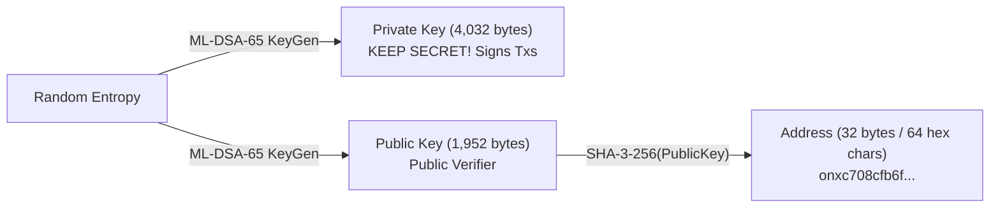
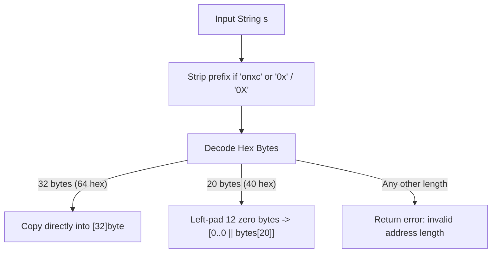

# Chapter 3: Digital Fingerprints (`SHA-3-256`) & Wallet Addresses

> **Learning Objectives**
> By the end of this chapter, you will be able to:
> - Understand why a cryptographic hash is a one-way digital fingerprint.
> - See the **Avalanche Effect** with a real `53.1%` bit-flip example.
> - Trace how an OENEXA wallet address is derived from a public key.
> - Convert between `onxc...`, `0x...`, bare 64-hex, and 20-byte addresses using `HexToAddress` rules.
>
> **Try It Visually:** Open [**Visual Lab Tab 1 — Avalanche & Address Deriver**](../visual-lab/index.html#blockchain) to test any text live!

---

## 1. Everyday Analogy: The Un-Unblendable Fruit Blender

Imagine a magical blender:
- Toss in **one grape** OR toss in an **entire 500-page encyclopedia** — out pours **exactly one 32-ounce cup of juice**.
- Every time you toss in the **exact same mango**, you get the **exact same shade of juice down to every molecule** (**Determinism**).
- Add **one tiny grain of salt** to the mango, and the juice suddenly turns electric purple (**Avalanche Effect**).
- Hand someone only the glass of juice, and they can **never** figure out what fruit you blended (**One-Way Preimage Resistance**).

In cryptography, that blender is **FIPS 202 `SHA-3-256`**, implemented in `internal/crypto/hash.go`:
- Input: any length of bytes (`0` bytes up to gigabytes).
- Output: fixed **`HashSize = 32` bytes** (`256` bits = `64` hex characters).
- Two helpers exist in `internal/crypto/hash.go`:
  - `Hash256(data []byte) [32]byte`: hashes one byte slice.
  - `HashMany(parts ...[]byte) [32]byte`: feeds multiple parts cleanly without extra RAM copying.

---

## 2. Logic 1: The Avalanche Effect (Real `SHA-3-256` Example)

Let's change just **1 digit** (`250` $\to$ `251`) in a payment string and hash both with `SHA-3-256`:

- **Input A:** `"Alice -> Bob: 250 ONXC"`
  - `SHA-3-256`: `94198c9adef2f246502addabb7c5257b75af7ec5474d0f2bc29ee26ac1cf605a`
- **Input B:** `"Alice -> Bob: 251 ONXC"`
  - `SHA-3-256`: `cc73baf4da8d2b35a63ee7d05cfe693849a5d6f578c2f0eea8540fc35d84c3c8`

Result: Changing **1 character** flipped **`136` out of `256` bits (`53.1%`)**! You cannot "nudge" an input slightly to guess a matching hash.

### Why Does `HashMany` Matter? (Domain / Field Separation)
Suppose Alice wants to hash two separate fields (`"AB"` and `"C"`) vs. (`"A"` and `"BC"`). Naive string concatenation gives `"ABC"` for both! Notice how OENEXA avoids accidental collisions in sensitive places (like shielded notes and nullifiers) by putting fixed-length tags and Big-Endian integer widths (`"OENEXA_NOTE_CM"`, `"OENEXA_NULLIFIER"`) inside `HashMany(...)`.

---

## 3. Logic 2: How a Wallet Address Is Created

Important beginner insight: **Your wallet does NOT hold coins inside a folder on your laptop!** Coins live on the shared global ledger (`StateDB`). Your wallet simply holds the **keys** proving you own an address.

### Worked Example: Deriving Alice's Address
1. Alice generates her `ML-DSA-65` keypair (`1,952`-byte Public Key, `4,032`-byte Private Key).
2. `internal/crypto/wallet.go` runs `Hash256(pubBytes)`. (To try a short reproducible example: `SHA-3-256("AlicePubKey1952")` = `708cfb6ffefe63cf93827aa41f1d0ca9db2f1955f6538ae3a1ceb4a1b7662740`).
3. Canonical ONXC display address:
   `onxc708cfb6ffefe63cf93827aa41f1d0ca9db2f1955f6538ae3a1ceb4a1b7662740`

Notice the security trick: **Until Alice spends coins, the public ledger ONLY sees her 32-byte `SHA-3-256` hash (`Address`), not even her Public Key!** And once she broadcasts a signed transaction (`TxTransfer`), everyone can verify `SHA-3-256(tx.PublicKey) == tx.From` before even trusting her signature.

---

## 4. Logic 3: Address Parsing & Normalization (`HexToAddress`)

Users and tools pass addresses in several formats. Here is how `HexToAddress` in `internal/crypto/hash.go` normalizes every input into `[32]byte`:

### Worked Parsing Examples
1. `"onxcaabbcc..."` (68 chars) $\implies$ strips `"onxc"`, decodes `32` bytes $\implies$ **Valid `[32]byte`!**
2. `"0xaabbcc..."` (66 chars) $\implies$ strips `"0x"`, decodes `32` bytes $\implies$ **Valid `[32]byte`!**
3. `"aabbcc..."` (64 chars) $\implies$ bare hex, decodes `32` bytes $\implies$ **Valid `[32]byte`!**
4. `"0x1122...3344"` (40 hex = `20` bytes) $\implies$ right-aligned into bytes `[12:32]` (`0000000000000000000000001122...3344`) for Web3 client compatibility!
5. `"onxc1234"` (`2` bytes) $\implies$ **Rejected!** Error: `invalid address length`.

---

## Student Practice Exercises (With Answers)

1. **Exercise 1 (Reversibility):** If your friend sends you their OENEXA address `onxc708cfb...`, can you compute their `1,952`-byte Public Key from that address?  
   

Show Answer

   No! `SHA-3-256` is one-way. You only learn their Public Key after they attach it inside an outgoing transaction (`tx.PublicKey`), at which point your node checks `SHA-3-256(tx.PublicKey) == tx.From`.
   

2. **Exercise 2 (Address Lengths):** What happens if you call `HexToAddress` with a `40`-character hex string (without `0x`)?  
   

Show Answer

   It decodes cleanly to `20` bytes and right-aligns those `20` bytes into the lower 20 bytes (`addr[12:32]`) of the `32`-byte OENEXA address.
   

