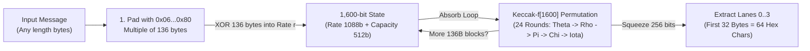

# Chapter 3: Cryptographic Hashing (`SHA-3-256` Keccak Sponge) & Addresses

> **Learning Objectives**
> By the end of this chapter, you will deeply understand:
> - The fundamental binary building blocks (`XOR`, `AND`, `NOT`, `64-bit Left Rotate`) used inside cryptographic hashes.
> - **How `SHA-3-256` actually works inside (`Keccak-f[1600]` Sponge)**: `5 × 5` state matrix, `Rate (136 B)` vs. `Capacity (64 B)`, `pad10*1` (`0x06 ... 0x80`), Absorbing, the **5 round steps (`Theta, Rho, Pi, Chi, Iota`)**, and Squeezing.
> - **Why you CANNOT reverse a hash** (non-linear `Chi` step + discarded `512`-bit hidden capacity).
> - How `SHA-3-256` connects **every single layer** of OENEXA — from addresses (`HexToAddress`), transactions, and blocks to Sparse Merkle Tries and privacy nullifiers.
>
> **Try It Visually:** Open [**Visual Lab Tab 1 — Blockchain, Sponge & Avalanche Lab**](../visual-lab/index.html#blockchain) to watch the `SHA-3-256` sponge pad bytes and compute avalanche bit-flips live!

---

## 1. Bitwise Primer: The 4 Simple Tools Inside Every Hash Engine

Before opening `SHA-3-256`, let's meet the 4 CPU operations every hash function uses millions of times per second:

1. **XOR (`^`) — "Are the bits different?"**
   - `0 ^ 0 = 0`, `1 ^ 1 = 0`, `0 ^ 1 = 1`, `1 ^ 0 = 1`.
   - *Key superpower:* Flipping even 1 input bit immediately flips an output bit (`x ^ 1 = ~x`).
2. **AND (`&`) — "Are BOTH bits `1`?"**
   - `1 & 1 = 1`; all other pairs give `0`.
   - *Key superpower:* Unlike XOR (which is linear), **AND destroys linearity** — knowing output `0` could mean inputs `(0,0)`, `(0,1)`, or `(1,0)`! That makes algebra backward practically impossible.
3. **NOT (`~`) — "Flip every bit"** (`0 -> 1`, `1 -> 0`).
4. **Circular Left Rotation (`rotl64(x, n)`) — "Shift bits left and wrap the spilled top bits onto the right"**
   - *Example (8-bit rotate left by 2)*: `1101_0001` $\to$ `0100_0111`. Nothing gets lost; bits spread rapidly into completely new columns!

---

## 2. How `SHA-3-256` Works Step-by-Step Inside (`Keccak-f[1600]` Sponge)

Unlike older MD/SHA-2 families that use fixed compression blocks, **NIST FIPS 202 `SHA-3-256`** uses a **Cryptographic Sponge** (`visual-lab/sha3.js` and `golang.org/x/crypto/sha3`).

Imagine holding a **1,600-bit wet sponge** arranged as a **`5 × 5` grid of `64`-bit lanes** ($5 \times 5 \times 64 = 1,600$ bits = `200` bytes), all starting as zeros:

```text
   1,600-BIT KECCAK STATE = 25 LANES (Each Lane = 1 uint64 = 64 bits)
  +-------------------------------------------------------------------+
  | Lanes 0..16  = RATE r = 1,088 bits (136 bytes)  <-- Data IN / OUT |
  +-------------------------------------------------------------------+
  | Lanes 17..24 = CAPACITY c = 512 bits (64 bytes) <-- NEVER TOUCHED |
  +-------------------------------------------------------------------+
```



### Step 1: Domain Padding (`0x06 ... 0x80`)
`SHA-3-256` requires the input to fill an exact multiple of the **`136`-byte Rate**.
- *Worked Padding Example for `"ONXC"` (`4` bytes: `0x4F 0x4E 0x58 0x43`):*
  1. Write the 4 message bytes: `[0x4F, 0x4E, 0x58, 0x43]`
  2. Immediately append the FIPS 202 `SHA-3` domain byte **`0x06`**: `[..., 0x06, ...]`
  3. Fill bytes `5..134` with **`0x00`** zeros.
  4. Set the final bit (`byte 135`) with **`0x80`** (`10000000` binary).
  - Total length = **`136` bytes = `1` full Rate block!** (If you hash exactly `135` bytes, byte `135` combines `0x06 | 0x80 = 0x86`!)

### Step 2: Absorbing Phase (`XOR` into Rate)
For each `136`-byte chunk:
- **XOR** those `136` bytes cleanly into **Lanes `0..16`** (never touching the **`512`-bit Capacity** in Lanes `17..24`!).
- Immediately run **`Keccak-f[1600]` (24 permutation rounds)** to thoroughly mix Rate and Capacity together!

### Step 3: Inside Each of the 24 Keccak Rounds ($\theta, \rho, \pi, \chi, \iota$)

Every single round runs **5 mechanical steps** over the `5 × 5` lane grid (`state[x + 5*y]`):

1. **$\theta$ (Theta — Column Mixing):**
   - Computes XOR parity `C[x]` of all 5 lanes in every column `x`, combines left/rotated-right column parities (`D[x] = C[x-1] ^ rotl64(C[x+1], 1)`), and XORs `D[x]` into every lane in column `x`.
   - *Purpose:* **Global diffusion!** Flipping just 1 bit inside Lane `(0,0)` immediately spreads to an entire column and neighbors.
2. **$\rho$ (Rho — Intra-Lane Bit Rotation):**
   - Rotates each of the 25 lanes left by a different prime-like triangular offset (`0, 1, 62, 28, 27, 36, 44, 6...`).
   - *Purpose:* **Breaks vertical bit alignment** so bit `0` in one lane travels to bit `36`, `44`, `62` in others!
3. **$\pi$ (Pi — Lane Coordinate Scrambling):**
   - Moves lane `(x, y)` to `(y, (2x + 3y) mod 5)` across the `5 × 5` matrix.
   - *Purpose:* Rows disperse into diagonals so data from Rate Lanes `0..16` physically migrates deep into hidden Capacity Lanes `17..24`!
4. **$\chi$ (Chi — Non-Linear Bitwise Gate):**
   - Operates along each 5-lane row:
     $$\text{new}[x] = a[x] \oplus \Big(\big(\neg b[x+1]\big) \land c[x+2]\Big)$$
   - *Purpose:* **The one-way lock!** Because `~b & c` uses bitwise **AND**, multiple distinct input patterns produce identical outputs — destroying linear algebra and making backward inversion mathematically intractable!
5. **$\iota$ (Iota — Asymmetry Round Constant):**
   - XORs a round-specific `64`-bit constant `RC[round]` (`RC[0] = 0x0000000000000001`, ..., `RC[23] = 0x8000000080008008`) into `state[0]`.
   - *Purpose:* Prevents all `24` rounds from behaving symmetrically or cancelling out against fixed-point attacks!

### Step 4: Squeezing Phase (`32` Bytes Output)
Once every input block has been absorbed and permuted 24 rounds, read ONLY the first **`4` lanes** (`4 × 64 = 256 bits = 32 bytes = 64 hex chars`) out as the digest!
- Notice: **512 bits of Capacity remain hidden inside the sponge and are thrown away!** Even if someone saw all `256` output bits, they are missing `1,344` internal bits AND cannot invert 24 non-linear $\chi$ rounds!

---

## 3. Why `SHA-3-256` Defeats Forgers: 3 Cryptographic Properties

| Security Property | Plain Definition | Quantum Resistance of `SHA-3-256` |
| :--- | :--- | :--- |
| **Preimage Resistance** (One-Way) | Given digest $H$, you cannot find ANY message $M$ where $\text{SHA3}(M) = H$. | Classical: $2^{256}$ tries; Quantum (Grover): $2^{128}$ tries — still physically impossible! |
| **Second-Preimage Resistance** | Given Alice's message $M_1$, you cannot find a fake $M_2 \neq M_1$ with the same hash. | Classical: $2^{256}$; Quantum: $2^{128}$. |
| **Collision Resistance** | Cannot find *any* two inputs $(M_1, M_2)$ sharing the same hash (`Birthday Bound`). | Classical: $2^{128}$; Quantum: $\approx 2^{85}\text{–}2^{128}$ (NIST Category 3 safe!). |

### Real Avalanche Worked Example (`136 / 256` Bits Flipped!)
Changing **1 single character** (`250` $\to$ `251`):
- `SHA-3-256("Alice -> Bob: 250 ONXC")` = `94198c9adef2f246502addabb7c5257b75af7ec5474d0f2bc29ee26ac1cf605a`
- `SHA-3-256("Alice -> Bob: 251 ONXC")` = `cc73baf4da8d2b35a63ee7d05cfe693849a5d6f578c2f0eea8540fc35d84c3c8`
- Exactly **`136` out of `256` bits (`53.1%`)** flipped randomly!

---

## 4. How `SHA-3-256` Powers Wallet Addresses & Every OENEXA Subsystem

In `internal/crypto/wallet.go` and `hash.go`:
- **`DeriveAddress(pubKeyBytes)`**: Computes `Hash256(pubKeyBytes)` $\implies$ `32` bytes (`64` hex chars).
  - Example: `SHA-3-256("AlicePubKey1952")` = `708cfb6ffefe63cf93827aa41f1d0ca9db2f1955f6538ae3a1ceb4a1b7662740` $\implies$ **`onxc708cfb6ffefe63cf93827aa41f1d0ca9db2f1955f6538ae3a1ceb4a1b7662740`**.
- **`HexToAddress(s)`**: Strips `"onxc"` or `"0x"`, decodes hex, accepts `32`-byte canonical addresses directly OR right-aligns `20`-byte Web3 addresses into `[12:32]`.
- **`HashMany(parts...)`**: Streams distinct fields sequentially into one `sha3.New256()` sponge without copying buffers — used across:
  - `Tx.Hash()` & `Block.Hash()`
  - Sparse Merkle Trie nodes (`0x01 || addr || valHash` and `0x02 || left || right`)
  - Shielded Note Commitments (`"OENEXA_NOTE_CM"`) & Nullifiers (`"OENEXA_NULLIFIER"`)
  - Upgrade binary checksums (`ComputeFileHash`).

---

## Student Practice Exercises (With Answers)

1. **Exercise 1 (Padding Length):** If you feed a `135`-byte message into `SHA-3-256`, how many `136`-byte Rate blocks does the Sponge process? What if the message is `136` bytes?  
   <details><summary>Show Answer</summary>
   - `135` bytes: adds byte `0x86` (`0x06 | 0x80`) into byte index `135` $\implies$ **1 block** (`136` bytes)!
   - `136` bytes: Rate block #1 holds the 136 message bytes, so `0x06 ... 0x80` must start a **second `136`-byte block** (`2` blocks total)!
   </details>

2. **Exercise 2 (Sponge Capacity):** If Keccak's `State` is `1,600` bits and the Rate `r` is `1,088` bits, how many Capacity `c` bits stay unexposed to input/output, and why?  
   <details><summary>Show Answer</summary>
   `1,600 - 1,088 = 512` Capacity bits. Keeping those `512` internal bits un-XORed and un-squeezed ensures nobody can solve backward from the 256-bit output to recover the full internal state!
   </details>
