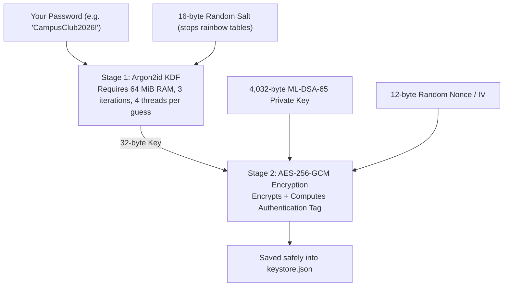

# Chapter 4: Post-Quantum Signatures (`ML-DSA-65`) & Encrypted Keystores

> **Learning Objectives**
> By the end of this chapter, you will be able to:
> - Explain why a future quantum computer breaks classical wallets and how **lattices** protect OENEXA.
> - Quote the exact sizes (`1,952 B`, `4,032 B`, `3,309 B`) and verify speed (`~0.077 ms`) of `ML-DSA-65`.
> - Calculate block bandwidth/storage budgets using real post-quantum transaction sizes.
> - Trace how **`Argon2id` + `AES-256-GCM`** protect `keystore.json` on disk and why `Wallet.Zeroize()` clears RAM.

---

## 1. Everyday Analogy: Unbreakable Wax Seal + Maze on a Million-Axis Grid

In traditional banking, you sign a check with ink. Anyone can verify it looks like your signature, though a skilled forger might try to copy it.

On older blockchains, signatures rely on **Elliptic Curve math** (easy to multiply points one way, nearly impossible on a classical laptop to run backward). **The catch:** In 1994, Peter Shor proved a sufficiently powerful **quantum computer** running **Shor's Algorithm** *can* run elliptic curves backward in hours and steal Private Keys directly from Public Keys!

### How `ML-DSA-65` Solves This (Module Lattices)
Imagine hiding a secret key inside a **noisy geometric maze spanning hundreds of dimensions** (**Module-LWE** and **Module-SIS** lattice problems):
- Knowing the secret trapdoor lets you sign a message cleanly in milliseconds (`Sign`).
- Checking your signature takes only **`~77 microseconds`** (`Verify`).
- Even with a full-scale quantum computer, there is **no known fast algorithm** to undo the high-dimensional lattice noise!

OENEXA uses **NIST FIPS 204 `ML-DSA-65`** (Category 3 quantum security, implemented with Cloudflare's `circl/sign/mldsa/mldsa65`).

---

## 2. Logic 1: Exact Key & Signature Sizes + Block Capacity Math

Because post-quantum security protects against exponential attacks, keys and signatures are larger than legacy 32/64-byte schemes:

| Component | Exact Constant in `internal/crypto/wallet.go` | Size in Bytes | Role |
| :--- | :--- | :--- | :--- |
| **Address** | `AddressSize` | `32` bytes | `SHA-3-256(PublicKey)` receiving ID |
| **Public Key** | `PublicKeySize` | `1,952` bytes | Verifier attached to transaction |
| **Private Key** | `PrivateKeySize` | `4,032` bytes | Signing secret (never leaves keystore/RAM) |
| **Signature** | `SignatureSize` | `3,309` bytes | Unforgeable authorization stamp |

### Worked Example: Transaction Size & Verification Time
Suppose Alice sends a standard `TxTransfer`:
- Metadata (`Version`, `Type`, `Nonce`, `From`, `To`, `Amount`, `GasLimit`, `GasPrice`, `Timestamp`): `~128` bytes
- `PublicKey` (`1,952` B) + `Signature` (`3,309` B) = `5,261` bytes
- **Total transaction size**: **`~5.4 KB`**
- **Time for a validator to verify `1,000` transactions in 1 block**:
  $$1,000 \times 0.077\text{ ms} = \mathbf{77\text{ ms}} \quad (< 4\%\text{ of OENEXA's } 2,000\text{ ms block interval!})$$

### Error Example: Signature / Key Tampering
If an attacker flips even 1 bit of a `3,309`-byte `Signature` or swaps a wrong `1,952`-byte `PublicKey`:
- Either `len(sig) != SignatureSize` (rejected immediately),
- Or `SHA-3-256(pubKey) != tx.From` (rejected immediately),
- Or `mldsa65.Verify(...) == false` (transaction dropped before ever reaching Mempool).

---

## 3. Logic 2: Locking Your Key on Disk (`keystore.json`)

Leaving a `4,032`-byte Private Key in plain text on disk means malware or an accidental cloud backup steals every coin. Instead, `internal/keystore` builds a two-stage cryptographic vault:



### Why BOTH `Argon2id` AND `AES-256-GCM`? (Worked Attack Math)
Suppose a thief steals your `keystore.json` file and tries guessing passwords:
- Without `Argon2id` (using fast plain hashing): a single gaming GPU can try **billions** of passwords per second.
- With OENEXA's **`Argon2id` (`memory = 65536 KiB = 64 MiB`, `time = 3`, `threads = 4`)**: *every single password guess* needs `64 MiB` of fast RAM! A hacker's cracking speed drops by orders of magnitude.
- Meanwhile, **`AES-256-GCM`** adds two guarantees:
  1. **Confidentiality**: Even a quantum computer running Grover's search on AES-256 still faces $2^{128}$ security (infeasible).
  2. **Integrity**: Flipping even 1 bit of `ciphertext` inside `keystore.json` invalidates the GCM authentication tag and aborts decryption (`cipher: message authentication failed`).

### Annotated `keystore.json` Layout
```json
{
  "version": 1,
  "address": "708cfb6ffefe63cf93827aa41f1d0ca9db2f1955f6538ae3a1ceb4a1b7662740",
  "kdf": "argon2id",
  "kdf_params": { "memory": 65536, "time": 3, "threads": 4, "salt": "<base64 16B>" },
  "cipher": "aes256gcm",
  "cipher_params": { "iv": "<base64 12B>", "ciphertext": "<base64 encrypted privKey + 16B tag>" },
  "public_key": "<base64 1952B ML-DSA-65 pubKey>"
}
```
Notice `"address"` and `"public_key"` stay unencrypted so `oenexa-node wallet show` can display your deposit address **without ever asking for your password or unlocking your secret key!**

---

## 4. Logic 3: Memory Zeroization (`Wallet.Zeroize()`)

Even after unlocking a key in memory to sign a transaction, leaving `4,032` secret bytes sitting in RAM risks leaking them into OS crash dumps or swap files. Calling `wallet.Zeroize()` actively overwrites the private key byte slice in RAM with `0x00` bytes as soon as signing completes or the CLI exits.

---

## Student Practice Exercises (With Answers)

1. **Exercise 1:** A friend copies your `keystore.json` onto a USB drive AND swaps two letters inside `"salt"`. When they type the *correct* password, what happens?  
   <details><summary>Show Answer</summary>
   Changing `"salt"` causes `Argon2id` to derive a completely different 32-byte AES key, so `AES-256-GCM` decryption fails the integrity tag check (`message authentication failed`).
   </details>

2. **Exercise 2:** How many bytes are required just for the public key + signature inside a single ONXC transaction?  
   <details><summary>Show Answer</summary>
   `1,952 bytes` (PublicKey) + `3,309 bytes` (Signature) = **`5,261 bytes`**.
   </details>
