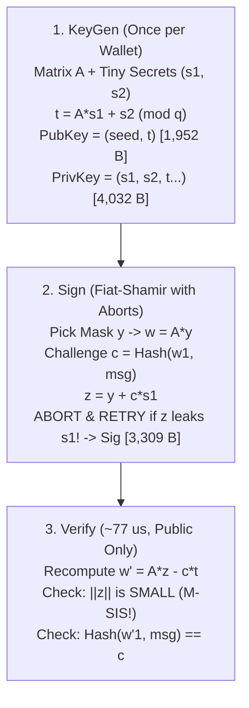

# Chapter 4: Post-Quantum Signatures (`ML-DSA-65`) — Full Internal Mechanics

> **Learning Objectives**
> By the end of this chapter, you will deeply understand:
> - **How classical signatures (`ECC`/`RSA`) work** vs. **how Shor's quantum algorithm breaks them**.
> - Why **Grover's algorithm** does NOT break `SHA-3-256` or `AES-256`.
> - **How Lattice Cryptography works intuitively** (`M-LWE` and `M-SIS` over ring $R_q = \mathbb{Z}_q[X]/(X^{256}+1)$).
> - **Every step inside `ML-DSA-65` (`KeyGen` $\to$ `Sign` + Fiat-Shamir Rejection Sampling $\to$ `Verify`)** traced with a **real pencil-and-paper numeric example**!
> - Why `SignatureSize = 3,309 B`, `PublicKeySize = 1,952 B`, `PrivateKeySize = 4,032 B`, and why `Verify` finishes in `~77 µs`.
>
> **Try It Visually:** Open [**Visual Lab Tab 1 — Interactive Lattice Sign/Verify Calculator**](../visual-lab/index.html#blockchain) to test matrix vectors $\mathbf{A}, \mathbf{s}_1, \mathbf{s}_2, \mathbf{y}$ and see Rejection Sampling + Verification equations live!

---

## 1. Classical Trapdoors vs. The Quantum Computer Threat

Every digital signature proves one thing mathematically:
> *"Whoever produced this signature knows the secret **Private Key** matching this public **Public Key**, AND approved this exact message — without ever revealing the Private Key."*

### How Legacy Blockchains Do It (And Why Quantum Breaks Them)
Legacy chains use **Elliptic Curve (`ECDSA` / `Ed25519`)** or **RSA**. Let's see the core idea using tiny numbers (**Discrete Logarithm** mod $p = 17$, generator $g = 3$):
- **Forward (Easy):** Pick secret $x = 6$. Compute public key $y = 3^6 \bmod 17 = 729 \bmod 17 = \mathbf{15}$. Takes 1 millisecond!
- **Backward Classically (Hard for 256-bit numbers):** Given $y = 15$, find $x$ such that $3^x \equiv 15 \pmod{17}$. Classically, for real 256-bit primes, no fast shortcut exists (~$2^{128}$ steps).

**Why Shor's Quantum Algorithm Shatters Legacy Wallets:**
Notice that $f(x) = g^x \bmod p$ **repeats in a hidden mathematical rhythm (a period $r$)**!
1. A classical computer checks one input $x$ at a time.
2. A quantum computer puts **all possible $x$ values into quantum superposition at once**, evaluates $g^x \bmod p$, and applies the **Quantum Fourier Transform (QFT)** — making waves with the wrong rhythm cancel out while the hidden period $r$ spikes in amplitude!
3. Once Shor's algorithm reads that period in $O((\log N)^3)$ polynomial time, it extracts the user's **Private Key directly from their Public Key**!

### What About Grover's Quantum Search Algorithm?
For symmetric ciphers (`AES-256`) and hashes (`SHA-3-256`), there is **no hidden algebraic period** for Shor's algorithm to exploit! The best quantum attack is **Grover's Search**, which only cuts brute-force exponent in half ($\sqrt{N}$ instead of $N$):
- `AES-256` keeps **$2^{128}$ quantum security** (completely unbreakable).
- `SHA-3-256` keeps **$2^{128}$ preimage security** (completely unbreakable).
- `ML-DSA-65` (NIST Category 3) achieves **192-bit security** against both classical & known quantum attacks (`internal/crypto/wallet.go`)!

---

## 2. How Lattice Math Works (Intuition First!)

Imagine a giant infinite chessboard / crystal grid of intersections in **2D** generated by two simple perpendicular arrows: `East (1, 0)` and `North (0, 1)`. Finding the grid corner closest to any point `(3.1, 4.9)` is easy: just round `(3, 5)`!

Now suppose someone generates the **exact same infinite grid** using two **horribly long, nearly parallel, tilted arrows** like `(1003, 712)` and `(1409, 1000)` — and extends it from 2 dimensions into **1,280+ dimensions**!
- Trying to find the closest grid corner (**Closest Vector Problem / CVP**) or shortest non-zero vector (**Shortest Vector Problem / SVP**) using that ugly tilted basis is **exponentially hard — even for quantum computers** (no helpful cyclic period exists!).

### Turning Geometry Into Fast Algebra: The Polynomial Ring $R_q$
Instead of storing huge unstructured random matrices in megabytes of RAM, `ML-DSA-65` works over **polynomials** (`internal/crypto/wallet.go`):
$$R_q = \mathbb{Z}_q[X] / (X^{256} + 1), \quad q = 8,380,417$$
- One polynomial holds **256 small integers** modulo $8,380,417$.
- For **`ML-DSA-65`**, the public matrix $\mathbf{A}$ has dimensions **$k \times l = 6 \times 5$** polynomials ($6 \times 5 \times 256 = 7,680$ coefficients, derived deterministically on the fly from a tiny 32-byte seed $\rho$!).
- Security rests on two sister lattice problems:
  1. **M-LWE (Module Learning With Errors):** Given $(\mathbf{A}, \mathbf{t} = \mathbf{A}\mathbf{s}_1 + \mathbf{s}_2)$ where $\mathbf{s}_1, \mathbf{s}_2$ have tiny entries (like `{-4..+4}`), recovering $(\mathbf{s}_1, \mathbf{s}_2)$ is infeasible!
  2. **M-SIS (Module Short Integer Solution):** Without knowing $(\mathbf{s}_1, \mathbf{s}_2)$, you cannot forge a small vector $\mathbf{z}$ satisfying $\mathbf{A}\mathbf{z} - c\mathbf{t} \approx \text{target}$!

---

## 3. Complete Internal Working Process of `ML-DSA-65` (Step-by-Step + Real Math!)

Let's walk through all 3 algorithms — **KeyGen**, **Sign**, and **Verify** — using a **100% authentic small-integer (`q = 23`, `2×2` matrix) worked example** right alongside the exact `ML-DSA-65` production mechanics!

### Phase 1: `KeyGen` (Creating Your Wallet Keypair)
1. **Entropy (`crypto/rand`):** Sample a random `32`-byte seed. Expand seed $\rho$ into matrix $\mathbf{A} \in R_q^{6 \times 5}$.
2. **Sample Tiny Secrets:** Sample small secret vectors $\mathbf{s}_1 \in R_q^5$ and noise vector $\mathbf{s}_2 \in R_q^6$ with tiny coefficients (`[-4, 4]`).
3. **Compute Public Key:**
   $$\mathbf{t} = \mathbf{A}\mathbf{s}_1 + \mathbf{s}_2 \pmod{q}$$
   Notice $\mathbf{s}_2$ adds just enough noise so Gaussian elimination **cannot** invert $\mathbf{t}$ back into $\mathbf{s}_1$!

**Pencil-and-Paper Worked Example (`q = 23`):**
- Public Matrix $\mathbf{A} = \begin{bmatrix} 4 & 7 \\ 9 & 2 \end{bmatrix}$
- Tiny Secrets $\mathbf{s}_1 = \begin{bmatrix} 1 \\ -1 \end{bmatrix}$, $\mathbf{s}_2 = \begin{bmatrix} 0 \\ 1 \end{bmatrix}$
- Multiply & add noise modulo `23`:
  - Top entry: $4(1) + 7(-1) + 0 = -3 \equiv \mathbf{20} \pmod{23}$
  - Bottom entry: $9(1) + 2(-1) + 1 = 8 \equiv \mathbf{8} \pmod{23}$
- **Result:** Public Key is **`t = [20, 8]`**. Secret Key holds **`s1 = [1, -1], s2 = [0, 1]`**!

---

### Phase 2: `Sign` (Signing a Transaction Using *Fiat-Shamir With Aborts*)
Alice wants to sign transaction payload $\mu = \text{SHA3}(\text{tr} \parallel \text{SigningPayload})$.
1. **Pick Random Masking Vector $\mathbf{y}$:** Sample fresh random medium-sized mask $\mathbf{y}$ (e.g., **`y = [3, 4]`**).
2. **Commit to Mask:** Compute $\mathbf{w} = \mathbf{A}\mathbf{y} \pmod{q}$:
   - Top: $4(3) + 7(4) = 40 \equiv \mathbf{17} \pmod{23}$
   - Bottom: $9(3) + 2(4) = 35 \equiv \mathbf{12} \pmod{23}$
   - So **`w = [17, 12]`** (keeps high-order bits $\mathbf{w}_1$).
3. **Create Challenge ($c$):** Hash commitment + message: $c = H(\mathbf{w}_1 \parallel \mu)$ (a sparse small challenge polynomial/scalar — let's say **`c = 1`**).
4. **Compute Response ($\mathbf{z}$):**
   $$\mathbf{z} = \mathbf{y} + c\mathbf{s}_1 = \begin{bmatrix} 3 \\ 4 \end{bmatrix} + 1 \cdot \begin{bmatrix} 1 \\ -1 \end{bmatrix} = \begin{bmatrix} \mathbf{4} \\ \mathbf{3} \end{bmatrix}$$
5. **CRITICAL SECURITY CHECK — Rejection Sampling ("Abort Loop")!**
   *Wait — why can't we just output any $\mathbf{z}$ unconditionally?!*
   Think like a statistician: suppose $\mathbf{y}$ must lie in `[-10, 10]` and $c\mathbf{s}_1 = +4$. If $\mathbf{z} = 14$, ANY attacker immediately deduces: *"Aha! $y \le 10$, so $c\mathbf{s}_1$ MUST be positive!"* Collecting 1,000 signatures would statistically leak $\mathbf{s}_1$!
   **The Genius Fix:** If $\mathbf{z}$ lands near the border (exceeds safe bound $\gamma_1 - \beta$) OR $\mathbf{w} - c\mathbf{s}_2$ shifts low bits awkwardly, **THROW AWAY (`ABORT`) that attempt and retry Step 1 with a fresh random $\mathbf{y}$!** Every accepted signature $\mathbf{z}$ falls strictly inside a uniform inner safe box that carries **ZERO statistical information about $\mathbf{s}_1$**! (In `ML-DSA-65`, signing takes ~4 average loops and produces compact **`3,309`-byte** signature `(c_tilde, z, hint)`.)

---

### Phase 3: `Verify` (Validating in `~77 µs` Without Knowing `s1`, `s2`, or `y`!)
Every OENEXA validator node receives `msg`, `PublicKey = (A, t)`, and `Signature = (c, z, h)` and performs **two exact checks**:

1. **Check 1 — Shortness Check (Stops M-SIS Forgery):** Verify every coordinate of `z` is strictly smaller than the bound! (Without `s1`, guessing `z` directly via linear algebra almost always yields giant wrap-around numbers modulo $q$ — or fails Check 2!)
2. **Check 2 — Algebraic Consistency Check:** Compute $\mathbf{w}' = \mathbf{A}\mathbf{z} - c\mathbf{t} \pmod{q}$!
   Look at the **exact cancellation algebra** using our toy numbers (`A=[[4,7],[9,2]]`, `t=[20,8]`, `z=[4,3]`, `c=1`):
   - First compute $\mathbf{A}\mathbf{z} \pmod{23}$:
     - Top: $4(4) + 7(3) = 16 + 21 = 37 \equiv \mathbf{14} \pmod{23}$
     - Bottom: $9(4) + 2(3) = 36 + 6 = 42 \equiv \mathbf{19} \pmod{23}$
   - Subtract $c\mathbf{t} = 1 \cdot [20, 8]$ modulo `23`:
     - Top: $14 - 20 = -6 \equiv \mathbf{17} \pmod{23}$
     - Bottom: $19 - 8 = \mathbf{11} \pmod{23}$
   - **Compare Verifier's $\mathbf{w}' = [17, 11]$ vs. Signer's original $\mathbf{w} = [17, 12]$!**
     Notice the magic algebraic identity:
     $$\mathbf{A}\mathbf{z} - c\mathbf{t} = \mathbf{A}(\mathbf{y} + c\mathbf{s}_1) - c(\mathbf{A}\mathbf{s}_1 + \mathbf{s}_2) = \mathbf{A}\mathbf{y} - c\mathbf{s}_2 = \mathbf{w} - c\mathbf{s}_2$$
     Because $\mathbf{s}_2 = [0, 1]$ is **tiny noise**, $\mathbf{w}' = [17, 11]$ equals $\mathbf{w} = [17, 12]$ shifted by ONLY `[0, -1]`! Using the tiny compressed hint **`h`** inside the signature, the verifier recovers the **exact high bits $\mathbf{w}_1$**, recomputes $H(\mathbf{w}_1 \parallel \mu)$, and checks **$== c$**!

### Why Verification Is So Fast (`~77 Microseconds`)
Polynomial multiplications in $R_q = \mathbb{Z}_q[X]/(X^{256}+1)$ run via the **Number Theoretic Transform (`NTT`)** — an integer Fast Fourier Transform (`FFT`) turning $O(n^2)$ polynomial products into blazing-fast $O(n \log n)$ operations inside `circl/sign/mldsa/mldsa65`!

---

## 4. Exact Production Wallet Specs (`internal/crypto/wallet.go`)

| Constant / Method | Exact Value / Behavior | Security Purpose |
| :--- | :--- | :--- |
| `PublicKeySize` | `1,952` bytes | Holds compressed $(\rho, \mathbf{t}_1)$ polynomial bits |
| `PrivateKeySize` | `4,032` bytes | Holds $(\rho, K, tr, \mathbf{s}_1, \mathbf{s}_2, \mathbf{t}_0)$ |
| `SignatureSize` | `3,309` bytes | Holds $(\tilde{c}, \mathbf{z}, \mathbf{h})$ |
| `AddressSize` | `32` bytes | `DeriveAddress(pubKey) = SHA-3-256(pubKey)` |
| `Wallet.Zeroize()` | Loops `w.PrivateKey[i] = 0` | Wipes `4,032` secret bytes from RAM immediately after use |

---

## Student Practice Exercises (With Answers)

1. **Exercise 1 (Why Rejection Sampling Exists):** What breaks in `ML-DSA-65` if a buggy wallet library skips the abort loop and always outputs $\mathbf{z} = \mathbf{y} + c\mathbf{s}_1$ on try #1?  
   

Show Answer

   Coefficients near the outer range of $\mathbf{y} + c\mathbf{s}_1$ reveal correlation with the sign and magnitude of secret $\mathbf{s}_1$. Collecting many signatures would statistically leak the private key!
   

2. **Exercise 2 (Verifier Identity):** Verify by hand: if $c = 2$ instead of $c = 1$ with the same $\mathbf{A}, \mathbf{s}_1, \mathbf{s}_2, \mathbf{y}$, what does $\mathbf{A}\mathbf{z} - c\mathbf{t}$ simplify to algebraically?  
   

Show Answer

   $\mathbf{A}(\mathbf{y} + 2\mathbf{s}_1) - 2(\mathbf{A}\mathbf{s}_1 + \mathbf{s}_2) = \mathbf{A}\mathbf{y} - 2\mathbf{s}_2 = \mathbf{w} - 2\mathbf{s}_2$. Since $2\mathbf{s}_2$ is still tiny compared to $q = 8,380,417$, the high bits $\mathbf{w}_1$ still match cleanly!
   

