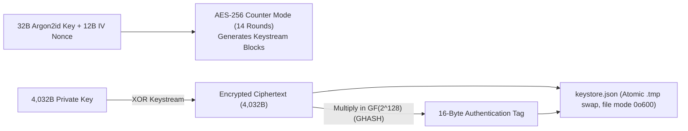
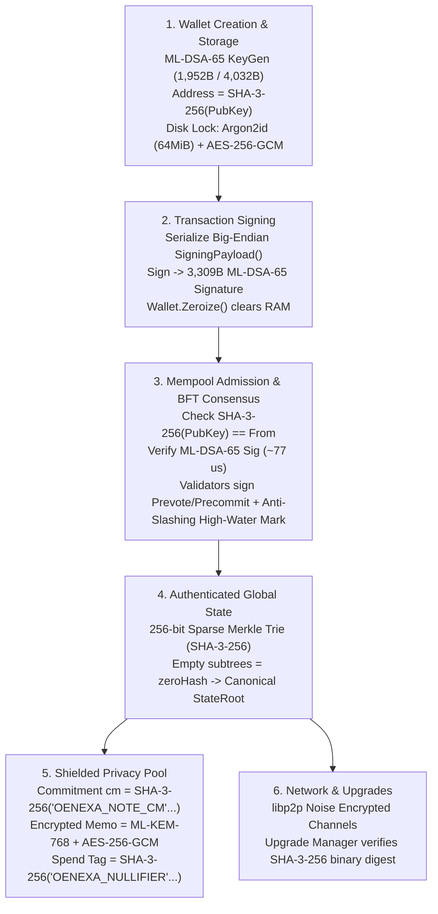

# Chapter 4B: `ML-KEM-768`, Encrypted Keystores (`Argon2id` + `AES-256-GCM`) & Whole-System Crypto Map

> **Learning Objectives**
> By the end of this chapter, you will deeply understand:
> - How **`ML-KEM-768` (NIST FIPS 203)** hides encrypted Shielded Pool notes using lattice Key Encapsulation (traced with a concrete LWE numeric example!).
> - How **`Argon2id`** fills a `64 MiB` memory grid across `3` passes & `4` threads to make GPU password cracking uneconomical.
> - How **`AES-256-GCM`** combines **Counter Mode (CTR)** encryption + **GHASH** integrity tags in `internal/keystore/keystore.go`.
> - **How every cryptographic tool interlocks across the entire OENEXA blockchain system** from wallet creation to block finalization and upgrades!

---

## 1. Post-Quantum Privacy Encryption: How `ML-KEM-768` Works (`internal/shielded/note.go`)

Signatures (`ML-DSA-65`) prove **authenticity** (*"Alice sent this"*). What about **secrecy** (*"Only Bob can read the `250 ONXC` amount and memo inside a Shielded Pool note"*)?

In `internal/shielded/note.go`, OENEXA encrypts private notes using **NIST FIPS 203 `ML-KEM-768`** (formerly CRYSTALS-Kyber, Category 3 lattice Key Encapsulation Mechanism) paired with **`AES-256-GCM`**.

### Step-by-Step Working Process (With Concrete Small-Number LWE Example)
How can Alice send Bob a secret `32`-byte AES key without ever meeting him offline, in a way even a quantum computer cannot intercept?

Let's trace the exact M-LWE Key Encapsulation algebra using tiny integers ($q = 23$, encoding secret bit $m \in \{0, 1\}$ scaled by half the modulus $\lfloor 23/2 \rceil = 12$):
1. **Bob's KeyGen (`t = a·s + e mod q`):**
   - Public random value $a = 7$, Bob's small secret $s = 2$, tiny secret noise $e = -1$.
   - Bob publishes Public Key: **`t = 7(2) + (-1) = 13`**.
2. **Alice Encapsulates Secret `m = 1` (`Note.Encrypt` calls `mlkem768.Scheme().Encapsulate(pubKEM)`):**
   - Alice samples small random $r = 1$ and tiny noises $e_1 = 1, e_2 = 0$, and hides `m = 1` by scaling it to **`12` (`m * 12`)**:
     - $u = a \cdot r + e_1 = 7(1) + 1 = \mathbf{8}$
     - $v = t \cdot r + e_2 + 12m = 13(1) + 0 + 12 = 25 \equiv \mathbf{2} \pmod{23}$
   - Alice hashes the secret + ciphertext into a shared `32`-byte AES key `ss`, and posts **`KEM CT = (u=8, v=2)`** on-chain!
3. **Bob Decapsulates Using His Secret `s = 2`:**
   - Bob computes: $v - s \cdot u = 2 - 2(8) = -14 \equiv \mathbf{9} \pmod{23}$.
   - Why is `9` NOT equal to `12`, yet still decodes cleanly to `1`? Look at the algebra:
     $$v - s u = (a s + e) r + e_2 + 12 m - s(a r + e_1) = 12 m + \underbrace{(e r + e_2 - s e_1)}_{\text{tiny combined noise } = -3} = 12 - 3 = \mathbf{9}$$
   - `9` is distance **`3`** from `12` (`m = 1`), vs. distance **`9`** from `0` (`m = 0`)! Bob rounds off the small lattice noise and recovers the exact secret **`m = 1`** $\implies$ identical **`32`-byte AES key `ss`**!

### Exact Wire Format Written by `Note.Encrypt` (`internal/shielded/note.go`)
```text
+--------------------+--------------+-------------------+----------------------+
| 4B Big-Endian Len  | ML-KEM-768   | 12B Random IV     | AES-256-GCM Encrypted|
| of KEM Ciphertext  | Ciphertext   | Nonce (crypto/rand| Serialized Note +    |
|                    | (outputs ss) |  reads 12 bytes)  | 16B Integrity Tag    |
+--------------------+--------------+-------------------+----------------------+
```
Because `Rho` (`32 B`) and `Rcm` (`32 B`) sit encrypted inside `GCM Ciphertext`, ONLY Bob (who decapsulates `ss`) learns the note's `Value`, `Memo`, and trapdoors!

---

## 2. Protecting Your Keys on Disk: Inside `Argon2id` + `AES-256-GCM` (`internal/keystore`)

### Stage A: Inside `Argon2id` (`Memory = 64 MiB`, `Time = 3`, `Threads = 4`)
Why not just run `SHA-3-256(password)` directly to make the `32`-byte encryption key? Because an attacker with a GPU rig can hash billions of weak passwords per second!

**How `Argon2id` stops BOTH hardware brute-force AND timing side channels:**
1. **`salt` (16 random bytes):** Mixed in so two students picking `"Password123!"` produce totally different hashes (defeats precomputed rainbow tables!).
2. **`64 MiB` (`65,536 KiB`) Memory Matrix:** Allocates `64 MiB` of RAM split across **`4` parallel lanes** and runs **`3` full passes** filling every 1-KB block using `Blake2b`-based compression of earlier blocks:
   - **First pass (first half): `Argon2i` mode** — chooses reference memory indices *independently* of password bytes, preventing cache-timing side-channel leaks!
   - **Remaining passes: `Argon2d` mode** — computes next memory indices *directly from previous memory data*, forcing attackers to physically allocate fast RAM instead of computing cheaply on GPU/ASIC cores (**Time-Memory Trade-Off defense**!).

### Stage B: Inside `AES-256-GCM` (`aesgcmSealFunc`)
Once `Argon2id` outputs the `32`-byte key, `AES-256-GCM` locks your `4,032`-byte `ML-DSA-65` private key (`keystore.json`):



1. **Encryption (`CTR` Mode):** Runs `AES-256` (`14` rounds of `SubBytes` S-box, `ShiftRows`, `MixColumns`, `AddRoundKey`) on incrementing counters `[IV || counter=2, 3, ...]` and XORs keystream blocks with the `4,032`-byte Private Key.
2. **Integrity (`GHASH` Tag):** Multiplies ciphertext blocks over finite field $\text{GF}(2^{128})$ with secret hash subkey $H = \text{AES}_K(0^{128})$ to append a `16`-byte integrity tag. Modifying **1 single bit** of `keystore.json` causes tag verification to fail before returning any secret bytes!
3. **Filesystem Safety:** `Encrypt` creates `path + ".tmp"` with strict `0o600` (owner read/write only) permissions and atomically renames it over `keystore.json`.

---

## 3. Whole-System Cryptographic Map: How Every Layer Connects

See how **all 5 cryptographic engines** inside `oenexa-node` interlock across the complete lifecycle of one user, transaction, block, private note, and node upgrade:



| Cryptographic Engine | NIST / Standard | Where in `oenexa-node` | Security Problem Solved |
| :--- | :--- | :--- | :--- |
| **`SHA-3-256`** | FIPS 202 (Keccak) | `internal/crypto/hash.go`, `mpt`, `core`, `shielded`, `upgrade` | Tamper-proof block links, addresses, Merkle proofs, nullifiers, binary digests |
| **`ML-DSA-65`** | FIPS 204 (Lattice) | `internal/crypto/wallet.go`, `core`, `consensus`, `multisig` | Quantum-safe unforgeable signatures for transactions, BFT votes & multisigs |
| **`ML-KEM-768`** | FIPS 203 (Lattice) | `internal/shielded/note.go` | Quantum-safe confidential key exchange for private Shielded Pool notes |
| **`Argon2id`** | RFC 9106 (Memory-Hard) | `internal/keystore/keystore.go` | Defeats GPU/ASIC offline password brute-force + timing side channels |
| **`AES-256-GCM`** | FIPS 197 + SP 800-38D | `internal/keystore/keystore.go`, `internal/shielded/note.go` | Quantum-resistant symmetric encryption + tamper detection (`16`-byte tag) |

---

## Student Practice Exercises (With Answers)

1. **Exercise 1 (`ML-KEM` Decapsulation Algebra):** Why does Bob subtract $s \cdot u$ from $v$ in LWE encryption, and why can he still decode the message even though noise $e r + e_2 - s e_1 \neq 0$?  
   <details><summary>Show Answer</summary>
   Because $v - s u = \lfloor q/2 \rceil m + (e r + e_2 - s e_1)$. Since the noise factors $(e, r, e_1, e_2, s)$ are tiny integers while $m \in \{0,1\}$ was scaled up to half the modulus ($12$ when $q=23$), the small leftover noise never crosses the rounding boundary, so Bob recovers the exact bit $m$!
   </details>

2. **Exercise 2 (`Argon2id` + `AES-GCM` Ordering):** Why can't `oenexa-node` protect `keystore.json` using *only* `AES-256-GCM` with your typed password directly padded to 32 bytes (skipping `Argon2id`)?  
   <details><summary>Show Answer</summary>
   Human passwords are short and guessable. Without `Argon2id`'s `64 MiB` RAM requirement and `16`-byte salt per guess, an attacker with a fast GPU could test millions/billions of candidate AES keys per second against your stolen `keystore.json`!
   </details>
