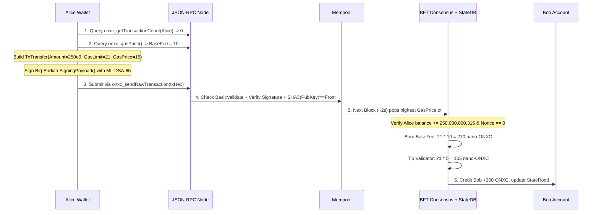

# Chapter 5: How Transactions Work Step-by-Step

> **Learning Objectives**
> By the end of this chapter, you will be able to:
> - Inspect every field inside an OENEXA `Transaction` (`internal/core/transaction.go`).
> - Recognize all **8 native transaction types (`0x01`–`0x08`)** with concrete real-life examples for each one.
> - Explain **Nonces** with both a replay-attack example and an out-of-order queue example.
> - Trace how `SigningPayload()` stops attackers from modifying amount or recipient fields.
> - Follow a **`250 ONXC`** payment from CLI click to finalized StateDB update.
>
> **Try It Visually:** Open [**Visual Lab Tab 3 — Mempool & Gas Lab**](../visual-lab/index.html#fees) to watch transactions enter the queue and get packed into blocks!

---

## 1. Everyday Analogy: A Certified Signed Instruction Envelope

Think of a transaction as a **tamper-proof signed bank check with a numbered serial line**:
- Only **Alice** has the magical wax stamp (`ML-DSA-65 PrivateKey`) that creates a valid signature for Alice's address.
- Everyone can verify who wrote the check, who receives it, how much `nano-ONXC` moves, and its sequential serial number (`Nonce`).
- If even **one digit** of the amount or recipient changes after Alice stamps it, the wax seal breaks instantly!

### Anatomy of a `Transaction` (`internal/core/transaction.go`)

```text
+-------------------------------------------------------------------+
| SIGNED DATA FIELDS (Fed into SigningPayload() before signing!)    |
|  - Version   : uint8   -> Protocol version (1)                    |
|  - Type      : uint8   -> Operation code (0x01 to 0x08)           |
|  - Nonce     : uint64  -> Sequential sender counter (0, 1, 2...)  |
|  - From      : [32]B   -> Sender address = SHA-3-256(PublicKey)   |
|  - To        : [32]B   -> Recipient or contract address           |
|  - Amount    : uint64  -> Value in nano-ONXC (1 ONXC = 10^9)      |
|  - GasLimit  : uint64  -> Max compute gas sender agrees to pay    |
|  - GasPrice  : uint64  -> Nano-ONXC offered per unit of gas       |
|  - Timestamp : int64   -> Unix nanoseconds when created           |
|  - Data      : []byte  -> Extra payload (max 1 MiB = 1,048,576 B) |
+-------------------------------------------------------------------+
| AUTHORIZATION & RECEIPT FIELDS                                    |
|  - PublicKey : [1952]B -> Sender's ML-DSA-65 public key           |
|  - Signature : [3309]B -> Signature over SigningPayload()         |
|  - Hash      : [32]B   -> Unique SHA-3-256 transaction ID         |
+-------------------------------------------------------------------+
```

---

## 2. Logic 1: All 8 Native Transaction Types (With Examples)

Instead of needing external wrapper contracts for basic chain features, OENEXA supports **8 native `TxType` operations** (`internal/core/types.go`):

| Code | Constant | Gas Constant | Concrete Student Example |
| :--- | :--- | :--- | :--- |
| `0x01` | `TxTransfer` | `GasTransfer = 21` | Alice sends `250 ONXC` to Bob's public address. |
| `0x02` | `TxDeploy` | `GasDeploy = 5,000` | Student club uploads compiled `.wasm` bytecode (`Data`) to create a new Treasury smart contract. |
| `0x03` | `TxCall` | `GasCall = 500` | Alice sends `Data = "vote:yes"` to contract address `To` to execute a WASM function. |
| `0x04` | `TxStake` | — | Bob locks `5,000 ONXC` (`Amount = 5,000 * 10^9`) onto a Validator to start earning block rewards. |
| `0x05` | `TxUnstake` | — | Bob requests withdrawal of `2,000 ONXC` from a validator (starts the unbonding countdown). |
| `0x06` | `TxShield` | `GasShield = 50` | Alice moves `100 ONXC` from her public account into a sealed private Note inside the **Shielded Pool**. |
| `0x07` | `TxUnshield` | `GasUnshield = 100` | Carol withdraws `40 ONXC` from a private Note back to a public address (Turnstile enforces supply conservation!). |
| `0x08` | `TxShieldedTransfer` | `GasShieldedTransfer = 150` | Alice spends a private note and creates a new private note for Bob inside the Shielded Pool — amount & recipient stay private! |

---

## 3. Logic 2: Why `Nonce` Stops Replay Attacks

### Attack Scenario Without Nonces
Suppose Alice pays Bob `10 ONXC` by broadcasting a valid signed message. Without a sequential counter, Bob could save a copy of Alice's exact bytes and re-submit that exact valid signature **50 times** until Alice's balance drops by `500 ONXC`!

### How OENEXA Stops It (`account.Nonce`)
1. Every new account starts in StateDB with **`Nonce = 0`**.
2. Alice's first transaction **must** say `Nonce = 0`. When Block `1` executes it, StateDB advances Alice's stored nonce to **`1`**.
3. Bob tries re-broadcasting Alice's saved `Nonce = 0` bytes. Every node rejects it: **`tx.Nonce (0) != state.Nonce (1)`**!

### Out-of-Order Nonce Example (Gap Case)
Suppose Alice's StateDB nonce is currently `4`, and she accidentally broadcasts two transactions with `Nonce = 4` and `Nonce = 6` (missing `5`):
- `Nonce = 4` executes immediately (`account.Nonce` becomes `5`).
- `Nonce = 6` **cannot execute yet** (`6 != 5`) until Alice submits the missing `Nonce = 5` transaction! Transactions from a single sender always execute strictly in sequence `0, 1, 2, 3, ...`.

---

## 4. Logic 3: End-to-End Walkthrough (`Alice -> Bob: 250 ONXC`)

Let's follow every message and exact `nano-ONXC` calculation when Alice (starting balance `1,000 ONXC`, `Nonce = 0`) sends **`250 ONXC`** to Bob (starting balance `10 ONXC`) while `BaseFee = 10`, `PriorityTip = 5` (`GasPrice = 15`):



### Exact Before & After Balance Ledger
| Field             | Before Block           | Change                                                  | After Block              |
|:------------------|:-----------------------|:--------------------------------------------------------|:-------------------------|
| **Alice Balance** | `1,000.000000000 ONXC` | `-250.000000315 ONXC` (`250 ONXC + 210 burn + 105 tip`) | **`749.999999685 ONXC`** |
| **Alice Nonce**   | `0`                    | `+1`                                                    | **`1`**                  |
| **Bob Balance**   | `10.000000000 ONXC`    | `+250.000000000 ONXC`                                   | **`260.000000000 ONXC`** |
| **Validator Tip** | `0`                    | `+105 nano-ONXC` (`21 * 5`)                             | **`+105 nano-ONXC`**     |
| **Supply Burned** | —                      | `-210 nano-ONXC` (`21 * 10`)                            | **Burned Forever!**      |

---

## 5. Logic 4: How `SigningPayload()` Stops Field Tampering

Inside `internal/core/transaction.go`, `SigningPayload()` serializes fields into deterministic **Big-Endian** binary bytes:
`Version (1B) || Type (1B) || Nonce (8B) || From (32B) || To (32B) || Amount (8B) || GasLimit (8B) || GasPrice (8B) || Timestamp (8B) || Data`

### Tampered Check Example
Suppose a hacker intercepts Alice's network packet and tries changing just **`To`** from Bob's address to Hacker's address (keeping Alice's valid `Signature`):
1. Receiving node recomputes `SigningPayload()` with the hacker's **`To`**.
2. Even though every other field is identical, the payload bytes differ!
3. `crypto.Verify(tx.PublicKey, payload, tx.Signature)` returns **`false`**, so the tampered transaction is dropped immediately.

---

## Student Practice Exercises (With Answers)

1. **Exercise 1 (Fee Deduction):** Suppose Alice has **exactly** `250.000000000 ONXC` in her wallet (`0` spare nano-ONXC), and tries to send `250.000000000 ONXC` with `GasLimit = 21`, `GasPrice = 10`. Does her transaction succeed?  
   <details><summary>Show Answer</summary>
   **No — Insufficient Balance!** Alice needs `Amount + (GasLimit * GasPrice) = 250,000,000,000 + 210 = 250,000,000,210 nano-ONXC`, so she must send at most `249.999999790 ONXC`.
   </details>

2. **Exercise 2 (Signing Failure):** Why is `Signature` NOT included inside `SigningPayload()`?  
   <details><summary>Show Answer</summary>
   Because `SigningPayload()` is the *input message* that generates the `Signature`! Once signed, `Hash()` hashes the full transaction including `PublicKey` and `Signature` to produce the unique transaction receipt ID.
   </details>
