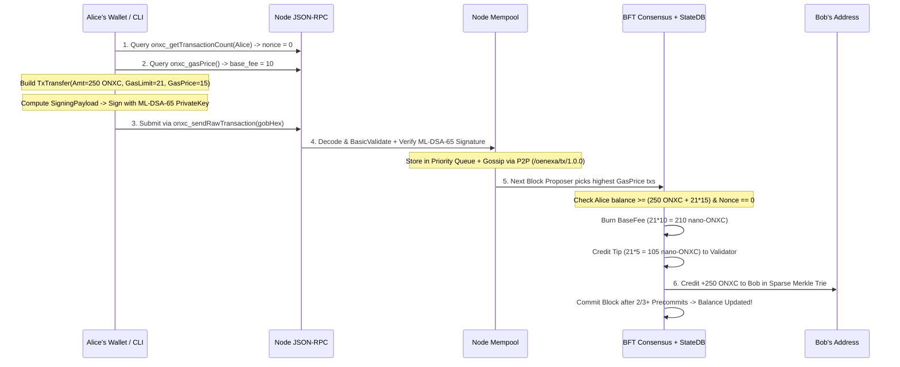

# Chapter 5: How Transactions Work Step-by-Step

## 1. What Is a Blockchain Transaction?

When you send money using a banking app, you submit a signed instruction saying: *"Move $250 from Account A to Account B."*

On OENEXA, a **Transaction** (`Transaction` in `internal/core/transaction.go`) is a cryptographically signed instruction requesting a permanent state transition on the blockchain.

Every transaction carries these exact fields:
- **`Version`**: Protocol format version (`1`).
- **`Type`**: One of the 8 native operations supported by OENEXA (`0x01`–`0x08`).
- **`Nonce`**: A sequential counter (`0, 1, 2, ...`) proving this transaction hasn't already been executed.
- **`From`**: Sender's `32`-byte address.
- **`To`**: Recipient's `32`-byte address (or smart contract address).
- **`Amount`**: Number of **`nano-ONXC`** to transfer (remember: $1\text{ ONXC} = 10^9\text{ nano-ONXC}$).
- **`GasLimit`**: Maximum compute units the sender agrees to pay for (`21` for a transfer).
- **`GasPrice`**: Price per unit of gas in `nano-ONXC` (must be $\ge \text{BaseFee}$ and $\ge 1$).
- **`Timestamp`**: Unix nanosecond timestamp when created.
- **`Data`**: Optional bytes (WASM bytecode for deploy, function arguments for call, or note commitment/encrypted note for privacy).
- **`PublicKey`**: Sender's `1,952`-byte `ML-DSA-65` public key.
- **`Signature`**: Sender's `3,309`-byte `ML-DSA-65` signature.
- **`Hash`**: Unique `SHA-3-256` transaction ID (`32` bytes).

---

## 2. The 8 Transaction Types on OENEXA

From `internal/core/types.go`, every action on the chain uses one of these native transaction codes:

| Code | Name | What It Does (In Plain English) | Default Gas |
| :--- | :--- | :--- | :--- |
| `0x01` | `TxTransfer` | Send ONXC from one transparent address to another. | `21` (`GasTransfer`) |
| `0x02` | `TxDeploy` | Upload and register a new WebAssembly smart contract (`Data` = WASM bytes). | `5,000` (`GasDeploy`) |
| `0x03` | `TxCall` | Run a function on an existing smart contract (`To` = contract, `Data` = call args). | `500` (`GasCall`) |
| `0x04` | `TxStake` | Lock ONXC to become a validator or delegate to a validator. | — |
| `0x05` | `TxUnstake` | Request withdrawal of staked ONXC after the unbonding period. | — |
| `0x06` | `TxShield` | Deposit public ONXC into the private **Shielded Pool** via a note commitment. | `50` (`GasShield`) |
| `0x07` | `TxUnshield` | Withdraw ONXC from the Shielded Pool back into a public address. | `100` (`GasUnshield`) |
| `0x08` | `TxShieldedTransfer` | Send ONXC privately inside the Shielded Pool (note to note). | `150` (`GasShieldedTransfer`) |

---

## 3. Why Do We Need a `Nonce`? (Preventing Replay Attacks)

Imagine Alice signs a transaction: *"Pay Bob `10 ONXC`."*

Without a **Nonce** (*"number used once"*), Bob could take a copy of Alice's valid signed message and keep re-broadcasting it 100 times until Alice's wallet hits `0`!

How OENEXA prevents replay attacks:
1. Every account starts at `Nonce = 0` in StateDB.
2. When Alice signs her very first transaction, it **must** say `Nonce = 0`.
3. Once Block 1 executes Alice's transaction, StateDB increments Alice's account nonce to **`1`**.
4. If anyone broadcasts the `Nonce = 0` transaction again, every node rejects it immediately because `tx.Nonce (0) != account.Nonce (1)`.
5. Alice's next transaction must use `Nonce = 1`, then `2`, then `3`, in exact order.

---

## 4. Walkthrough: Alice Sends `250 ONXC` to Bob

Let's follow every step inside `oenexa-node` when Alice sends `250 ONXC` (`250,000,000,000 nano-ONXC`) to Bob:

### Step-by-Step Math Check (At `InitialBaseFee = 10`, `Tip = 5`)
- **Transfer Amount**: `250 * 1,000,000,000 = 250,000,000,000 nano-ONXC`
- **Gas Used**: `21` (`GasTransfer`)
- **Total Fee Paid by Alice**: `21 * (10 + 5) = 315 nano-ONXC` (`0.000000315 ONXC`)
  - **Burned forever**: `21 * 10 = 210 nano-ONXC`
  - **Paid to Validator**: `21 * 5 = 105 nano-ONXC`
- **Alice's New Balance**: `oldBalance - 250,000,000,315 nano-ONXC`
- **Alice's New Nonce**: `0 -> 1`
- **Bob's New Balance**: `oldBobBalance + 250,000,000,000 nano-ONXC`

---

## 5. How `SigningPayload()` Prevents Tampering

Inside `internal/core/transaction.go`, `SigningPayload()` serializes `Version`, `Type`, `Nonce`, `From`, `To`, `Amount`, `GasLimit`, `GasPrice`, `Timestamp`, and `Data` into canonical Big-Endian binary bytes **before** signing.

Even changing 1 byte of `Amount`, swapping `To` to a hacker's address, or altering `GasLimit` after signing changes `SigningPayload()`, causing `crypto.Verify(tx.PublicKey, payload, tx.Signature)` to return `false` and the node to drop the tampered transaction. Additionally, the node verifies `SHA-3-256(tx.PublicKey) == tx.From` so nobody can pretend a different address signed it.

---

## Check Your Understanding

1. **Why can't Bob intercept Alice's signed transaction to Carol, swap `To` to Bob's address, and keep Alice's signature?**  
   *Answer:* The recipient address `To` is included inside `SigningPayload()`. Changing `To` changes the payload bytes, so `ML-DSA-65` `Verify()` immediately rejects the signature.

2. **Which transaction type moves transparent ONXC into the private Shielded Pool?**  
   *Answer:* `TxShield` (`0x06`, `GasShield = 50`).
