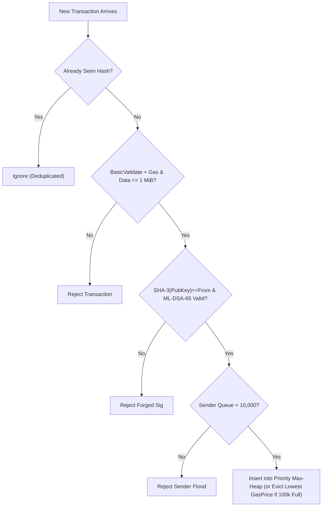
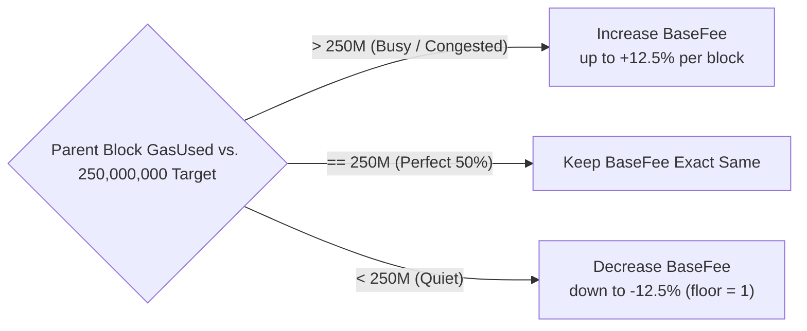

# Chapter 6: The Mempool (Waiting Room) & Dynamic Fees (EIP-1559)

> **Learning Objectives**
> By the end of this chapter, you will be able to:
> - Trace the **4-gate admission pipeline** inside `internal/mempool`.
> - Order transactions inside the **Priority Max-Heap** (including timestamp tie-breaking and `ReplaceByFee`).
> - Explain **Gas** and compute **`NextBaseFee(current, gasUsed)`** for busy, target, and quiet blocks.
> - Prove why sustained spam becomes **10x more expensive in 20 blocks** (`±12.5%` rule).
> - Compute transfer costs across all 3 wallet tiers (`UltraLow`, `Standard`, `Fast`).
>
> **Try It Visually:** Open [**Visual Lab Tab 3 — Mempool & Dynamic Gas Lab**](../visual-lab/index.html#fees) to experiment with queue sorting and `BaseFee` surges live!

---

## 1. Everyday Analogy: Airport Security + Priority Boarding Lounge

Think of the **Mempool** (`internal/mempool/`) as the **airport boarding lounge** before a flight (a Block) departs every `2 seconds`:
1. At the entrance gate, security checks your passport (`ML-DSA-65` signature), luggage weight (`Data <= 1 MiB`), and ticket minimum (`GasPrice >= 1`, `GasLimit >= minGas`).
2. Inside the lounge (cap: **`DefaultMaxSize = 100,000`** waiting transactions), flyers line up with **highest `GasPrice` boarding first**!
3. If two travelers paid the exact same `GasPrice`, whoever arrived earlier (**smallest `Timestamp`**) boards first (fair FIFO tie-breaking).
4. Nobody can flood the entire lounge by themselves — each sender address is capped at **`MaxSenderQueueLen = 10,000`** pending transactions.

---

## 2. Logic 1: The Mempool Admission & Ordering Rules

### Worked Example: How 4 Waiting Transactions Are Ordered
Suppose 4 valid transactions wait in the mempool:

| Tx | Sender | `GasPrice` (`nano-ONXC/gas`) | Arrival `Timestamp` | Boarding Position | Reason |
| :--- | :--- | :--- | :--- | :--- | :--- |
| **T1** | Bob | `12` | `t = 100 ns` | **#2** | Tied at `12` with Carol, arrived *earlier* (`100 < 300`) |
| **T2** | Alice | `20` | `t = 200 ns` | **#1 (First!)** | Highest `GasPrice = 20` |
| **T3** | Carol | `12` | `t = 300 ns` | **#3** | Tied at `12` with Bob, arrived *later* (`300 > 100`) |
| **T4** | Dave | `10` | `t = 50 ns` | **#4 (Last)** | Lowest `GasPrice = 10` (even though arrived first!) |

### Replace-By-Fee (Speeding Up a Stuck Transaction)
Suppose Dave later decides `GasPrice = 10` is too slow during heavy traffic and broadcasts an updated transaction with the **exact same `Nonce`**, higher `GasPrice`, and higher priority; or if the 100,000-slot mempool is full, any newcomer offering a **strictly higher `GasPrice`** than the cheapest item evicts that cheapest item cleanly.

---

## 3. Logic 2: Why Gas Exists & What Operations Cost

Without gas, an attacker could deploy an infinite `for {}` loop smart contract and freeze every validator on Earth forever! Gas puts a strict price tag on every unit of CPU/storage work (`internal/core/types.go`):

| Operation | Gas Cost | At Genesis (`BaseFee = 10`, Tip = `0`) | At Quiet Floor (`MinBaseFee = 1`, Tip = `0`) |
| :--- | :--- | :--- | :--- |
| **`TxTransfer`** (`0x01`) | **`21` gas** | `210 nano-ONXC` (`$0.00000021` @ `$1`/ONXC) | `21 nano-ONXC` (`$0.000000021`) |
| **`TxShield`** (`0x06`) | **`50` gas** | `500 nano-ONXC` | `50 nano-ONXC` |
| **`TxUnshield`** (`0x07`) | **`100` gas** | `1,000 nano-ONXC` | `100 nano-ONXC` |
| **`TxShieldedTransfer`** (`0x08`) | **`150` gas** | `1,500 nano-ONXC` | `150 nano-ONXC` |
| **`TxCall`** (`0x03`) | **`500` gas** (+ WASM step metering) | `5,000 nano-ONXC` | `500 nano-ONXC` |
| **`TxDeploy`** (`0x02`) | **`5,000` gas** | `50,000 nano-ONXC` | `5,000 nano-ONXC` |

---

## 4. Logic 3: Automatic Dynamic Base Fee (`NextBaseFee` — EIP-1559)

Instead of forcing users to guess chaotic fee auctions, OENEXA aims for every block to be **`50%` full** (`internal/core/fee.go`):
- **`BlockGasLimit`** = `500,000,000` gas
- **`TargetBlockGas()`** = `500,000,000 / 2 = 250,000,000` gas (`50%`)
- **`InitialBaseFee`** = `10` nano-ONXC/gas
- **`MinBaseFee`** = `1` nano-ONXC/gas (zero-cost spam is permanently impossible!)
- **`MaxBaseFeeChangeDenom`** = `8` $\implies$ changes by at most **`±12.5%` per block**

### 3 Worked Numeric Examples (`currentBaseFee = 16`)
Recall `delta = floor(current * |gasUsed - 250M| / (250M * 8))` (with min `+1` bump when over target):

1. **Case A — Totally Full Spam Block (`gasUsed = 500,000,000`, `100%` full):**
   - `over = 500M - 250M = 250M`
   - `delta = 16 * 250M / (250M * 8) = 16 / 8 = +2` (`+12.5%`)
   - **`NextBaseFee = 16 + 2 = 18 nano-ONXC/gas`**!
2. **Case B — Balanced Target Block (`gasUsed = 250,000,000`, `50%` full):**
   - `gasUsed == target` $\implies$ `delta = 0`
   - **`NextBaseFee = 16 nano-ONXC/gas`**!
3. **Case C — Empty Quiet Block (`gasUsed = 0`, `0%` full):**
   - `under = 250M - 0 = 250M`
   - `delta = 16 * 250M / (250M * 8) = -2` (`-12.5%`)
   - **`NextBaseFee = 16 - 2 = 14 nano-ONXC/gas`**!

### Mathematical Anti-Spam Proof (Why Attacks Bankrupt Themselves)
What if an attacker tries stuffing 100% full blocks (`500M` gas) over and over to freeze out real users?
Every full block multiplies `BaseFee` by $\frac{9}{8} = 1.125$:
$$f_{n+k} = f_n \times (1.125)^k$$
To make fees **10x higher**: $(1.125)^k \ge 10 \implies k = \lceil \ln(10)/\ln(1.125) \rceil = \mathbf{20\text{ blocks}}$ (~40 seconds at 2s/block)! In 80 seconds (40 full blocks), attack cost multiplies by over **100x** — destroying the attacker's budget while every `BaseFee` is permanently **burned**.

---

## 5. Logic 4: Wallet Fee Tiers (`onxc_feeEstimate`)

From `FeeEstimate(baseFee, tier)` in `internal/core/fee.go` (using `baseFee = 10` on a standard `21`-gas `TxTransfer`):

| Tier | Tip Rule | Per-Gas Price | Total `21`-Gas Transfer Cost | Burned vs. Validator Tip |
| :--- | :--- | :--- | :--- | :--- |
| **`FeeTierUltraLow`** | `tip = 0` | `10` | **`210 nano-ONXC`** | `210` burned / `0` tip |
| **`FeeTierStandard`** | `tip = max(1, baseFee / 10)` (`+10%`) | `10 + 1 = 11` | **`231 nano-ONXC`** | `210` burned / `21` tip |
| **`FeeTierFast`** | `tip = max(1, baseFee / 2)` (`+50%`) | `10 + 5 = 15` | **`315 nano-ONXC`** | `210` burned / `105` tip |

---

## Student Practice Exercises (With Answers)

1. **Exercise 1 (Mempool Capacity):** If one malfunctioning dApp loops and blasts `12,000` transactions from a single wallet address, what happens after the `10,000`th?  
   

Show Answer

   Transactions `#1` through `#10,000` fit (`MaxSenderQueueLen = 10,000`), and transactions `#10,001+` are rejected so one noisy sender cannot monopolize the `100,000`-slot mempool.
   

2. **Exercise 2 (Fee Tier Calculation):** If `baseFee = 20`, what is the total cost of a `TxTransfer` (`21` gas) using **`FeeTierFast`** (`tip = baseFee / 2`)?  
   

Show Answer

   `tip = 20 / 2 = 10`, so `effectivePrice = 20 + 10 = 30 nano-ONXC/gas`. Total = `21 * 30 = 630 nano-ONXC` (`420` burned + `210` validator tip).
   

