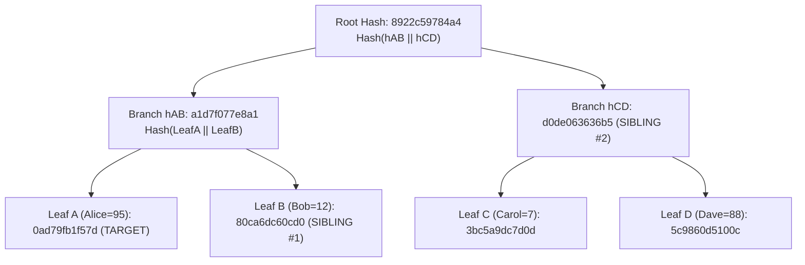

# Chapter 7: Global Account State & The Sparse Merkle Trie

> **Learning Objectives**
> By the end of this chapter, you will be able to:
> - Distinguish LevelDB's **Block Store** from its **State Store (`acc:` and `t:` prefixes)**.
> - Walk through a concrete **Merkle Proof** step by step to verify 1 account using only sibling hashes.
> - Explain how a **256-bit Sparse Merkle Trie (SMT)** uses address bits + `zeroHash` sentinels.
> - Prove why **order-independent `StateRoot`** convergence prevents validator disagreements.
>
> **Try It Visually:** Open [**Visual Lab Tab 4 — Sparse Merkle Trie Proof Lab**](../visual-lab/index.html#trie) to highlight sibling paths and run the order-independence test live!

---

## 1. Logic 1: Two Complementary Databases Inside Every Node

Imagine checking your library card balance if the librarian had to re-read **every receipt since Year 1** every single time you asked! That would take forever.

Instead, `internal/storage` stores two fast views in LevelDB:
1. **Block Store (`storage/blockchain.go`)**: Permanent archive of every historical block (`Height -> Block`), needed for catching up new peers and auditing history.
2. **State DB (`internal/state/statedb.go` + `internal/mpt/mpt.go`)**: Today's live snapshot of every account:
   - `"acc:<address>"` $\implies$ `Account{ Balance (uint64 nano-ONXC), Nonce (uint64), CodeHash, StorageRoot }`
   - `"t:<nodeHash>"` $\implies$ Sparse Merkle Trie leaf & branch nodes authenticating every account!

All dirty writes from one finalized block are flushed in **one atomic LevelDB batch** (`NewBatch() -> Write()`), so a power outage mid-block never leaves half-updated balances!

---

## 2. Logic 2: How a Merkle Proof Verifies 1 Balance Without Downloading Billions

Suppose a teacher wants to prove to a principal that **Alice's score is `95`** out of a 4-student class (`Alice=95`, `Bob=12`, `Carol=7`, `Dave=88`), **without sending Bob, Carol, or Dave's raw data**.

### Worked Example: Verifying Alice's Balance in 3 Tiny Steps
The principal only already knows the trusted **`Root Hash = 8922c59784a4`** from the Block Header. Alice sends only **1 leaf value (`"Alice=95"`) + 2 sibling hashes**:
1. Principal hashes Alice's value: `LeafA = SHA-3("Alice=95") = 0ad79fb1f57d`.
2. Principal combines `LeafA` with **Sibling #1 (`LeafB = 80ca6dc60cd0`)** $\implies h_{AB} = \texttt{a1d7f077e8a1}$.
3. Principal combines $h_{AB}$ with **Sibling #2 (`hCD = d0de063636b5`)** $\implies \text{ComputedRoot} = \texttt{8922c59784a4}$.
4. Does `ComputedRoot == Trusted Header StateRoot`? **YES!** Even if there were **4 billion** accounts instead of 4, Alice only needs **`32` hashes (~1 KB)** to prove her balance!

---

## 3. Logic 3: Why OENEXA Uses a *256-Bit Sparse* Merkle Trie (`internal/mpt`)

A regular Merkle tree has a tricky bug: if Node 1 inserts `[Alice, Bob]` while Node 2 iterates a map in order `[Bob, Alice]`, their tree shapes and `Root` hashes could differ!

OENEXA eliminates this completely using a **256-bit Sparse Merkle Trie (`trieDepth = 256`)**:
- Every OENEXA address is **`32 bytes = 256 bits`** (a sequence of 256 `0`s and `1`s).
- **The Bit-Routing Rule:** Read the address bits from bit `0` down to bit `255`:
  - **`0`** = turn **LEFT** child branch
  - **`1`** = turn **RIGHT** child branch
- Every possible address in the universe already owns a **permanent, fixed parking spot** at the bottom of the 256-level binary tree!

### Wait — Does That Take $2^{256}$ Leaves on Disk? No! (`zeroHash`)
Look at what "Sparse" means:
- Whenever an entire empty region contains zero accounts, we do **NOT** create millions of empty nodes on disk — we replace the whole empty branch with a single constant **`zeroHash`** (`[32]byte{0}`)!
- Only paths leading to real, non-zero accounts are materialized inside LevelDB:
  - **Leaf (`nodeTypeLeaf = 0x01`)**: `0x01 || address[32] || valueHash[32]`
  - **Branch (`nodeTypeBranch = 0x02`)**: `0x02 || leftChildHash[32] || rightChildHash[32]`

### Worked Bit-Routing Example (2 Accounts)
Suppose Alice's address starts with bits **`01...`** and Bob's starts with **`10...`**:
- Bit `0` of Alice is **`0`** $\implies$ Alice goes **Left** into `Branch_0`.
- Bit `0` of Bob is **`1`** $\implies$ Bob goes **Right** into `Branch_1`.
- Notice: Whether you insert **Alice first then Bob** OR **Bob first then Alice**, Alice ALWAYS lands in Left (`0...`) and Bob ALWAYS lands in Right (`1...`)! Every node computes the **exact same `StateRoot`** (order-independent convergence!).

### Non-Membership Proofs (Proving an Account Has `0` / Doesn't Exist)
Because unused branches deterministically hash down to **`zeroHash`**, a light wallet can prove an address has **no balance / does not exist** simply by showing the Merkle sibling path reaches `zeroHash` at that address's bit coordinate!

---

## Student Practice Exercises (With Answers)

1. **Exercise 1 (Bit-Path Routing):** Account X's first two address bits are `10...` and Account Y's are `11...`. At Depth `0` (top root), do X and Y take the same branch or opposite branches? When do they split?  
   

Show Answer

   Both X and Y start with bit `1`, so at Depth `0` both take the **Right** branch (`Branch_1`). At Depth `1`, X's second bit is `0` (Left) and Y's second bit is `1` (Right), so they split there.
   

2. **Exercise 2 (LevelDB Prefix):** How does `oenexa-node` stop Sparse Merkle Trie node keys from accidentally overwriting raw account records in LevelDB?  
   

Show Answer

   Account snapshots use key prefix `"acc:"` while trie nodes use prefix `"t:"` (`dbKeyPrefix = []byte("t:")`).
   

