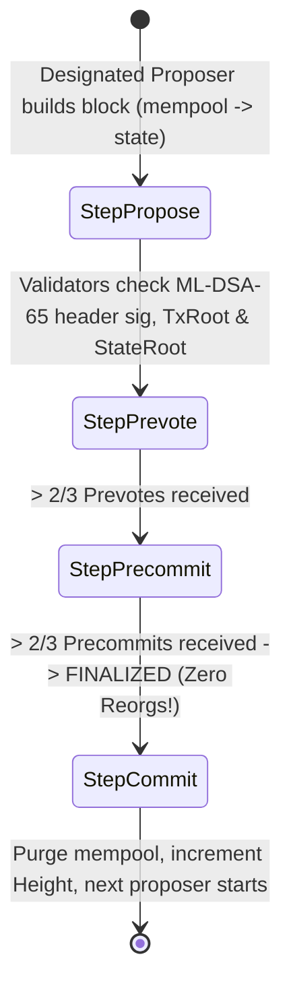

# Chapter 8: BFT Consensus & Instant Finality

## 1. The Agreement Problem (Byzantine Generals Analogy)

Imagine 4 army generals surrounding a castle over unreliable messengers. Some generals might be loyal, while one traitor sends *"Attack!"* to General 1 and *"Retreat!"* to General 2 to cause chaos.

In a blockchain network:
- **Generals** = **Validators** running `oenexa-node` across different countries.
- **Traitors / Crashed Servers** = **Byzantine Validators** (nodes that go offline, lag, or intentionally send conflicting votes).

**Consensus** is the protocol that ensures all honest validators agree on the **exact same next block at the exact same height**, even if up to almost $1/3$ of validator power crashes or acts maliciously!

---

## 2. How OENEXA BFT Works Every 2 Seconds

Unlike Proof-of-Work blockchains (where miners burn electricity racing puzzles and two blocks can accidentally tie and "fork" temporarily), OENEXA uses **Byzantine Fault Tolerant (BFT) Consensus** (`internal/consensus/engine.go`):

- **`BlockInterval`**: **`2` seconds**
- **`RoundTimeout`**: **`4` seconds** (if a proposer is offline, validators automatically move to the next round!)
- **Proposer Selection**: Deterministic round-robin (`height % |Validators|` weighted by active validators).
- **Quorum Threshold (`Q`)**: Strictly **more than two-thirds (`> 2/3`)** of total validator voting power:
  $$Q = \left\lfloor \frac{2N}{3} \right\rfloor + 1$$

### The 4 Steps to Finalize Every Block

1. **`StepPropose`**: The proposer for height `h` gathers up to `MaxTxPerBlock = 10,000` transactions from the mempool, executes them against a snapshot of StateDB, records the new `StateRoot` and `TxRoot`, and signs the block header with its post-quantum `ML-DSA-65` key.
2. **`StepPrevote`**: Each validator verifies the proposer's signature, parent `PrevHash` link, gas usage, and resulting `StateRoot`. If everything checks out, it broadcasts a signed **`Prevote`** for that block hash.
3. **`StepPrecommit`**: Once a validator sees **`> 2/3` of voting power** in `Prevote` messages for the same block, it locks onto that block and broadcasts a signed **`Precommit`**.
4. **`StepCommit`**: Once **`> 2/3` of voting power** signs `Precommit`, the block is **instantly finalized** to LevelDB! There is **never** a chain reorganization ("reorg") after commit.

---

## 3. Mathematical Proof: Why Two Conflicting Blocks Can NEVER Both Finalize

Students always ask: *"Could two sneaky validators trick half the network into accepting Block A and the other half into accepting Block B?"*

Let's prove from `internal/consensus/engine.go` why **forks are mathematically impossible** as long as fewer than $1/3$ of voting power cheats ($N \ge 3f + 1$, where $f$ is max malicious power and $Q = 2f + 1$):

1. Assume for contradiction that **both** distinct blocks $B_1$ and $B_2$ get committed at height $h$.
2. For $B_1$ to commit, it needed a set of precommits $S_1$ with voting power $|S_1| \ge 2f + 1$.
3. For $B_2$ to commit, it needed a set of precommits $S_2$ with voting power $|S_2| \ge 2f + 1$.
4. How much voting power voted for **both** $B_1$ and $B_2$ (the overlap $S_1 \cap S_2$)?
   $$|S_1 \cap S_2| \ge |S_1| + |S_2| - N \ge (2f + 1) + (2f + 1) - (3f + 1) = f + 1$$
5. Since there are at most **$f$** dishonest validators in the whole network, an overlap of **$f + 1$** means **at least one honest validator must be in BOTH sets!**
6. Wait — honest validators run the **Anti-Slashing High-Water Mark** (`LocalSigner.SignVote`), which strictly forbids ever signing a second vote for a different block at the same `(height, round)`!
7. Contradiction! Therefore, **two conflicting blocks can never both commit.** Every finalized ONXC payment is 100% irreversible after 2 seconds.

---

## Check Your Understanding

1. **If an OENEXA network has `N = 10` equal-stake validators (`1` vote each), how many validator precommits are needed to commit a block, and how many faulty validators can the network tolerate?**  
   *Answer:* Quorum $Q = \lfloor 20 / 3 \rfloor + 1 = 7$ validators. The network stays completely safe as long as Byzantine validators $f \le 3$ (since $3f + 1 = 10$).

2. **Why do you NOT need to wait "6 blocks" on OENEXA before trusting a payment?**  
   *Answer:* Unlike probabilistic chains, BFT precommit quorum provides **instant finality** in 1 block (~2 seconds); committed blocks can never fork or roll back.
