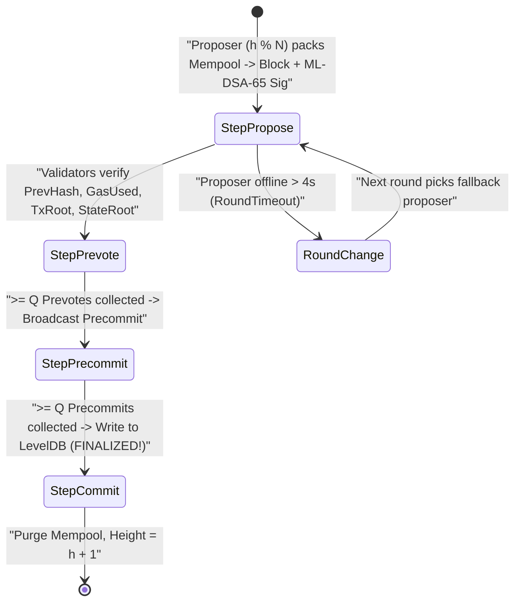

# Chapter 8: BFT Consensus & Instant Finality

> **Learning Objectives**
> By the end of this chapter, you will be able to:
> - Explain the **Byzantine Generals Problem** and compute the quorum formula $Q = \lfloor 2N/3 \rfloor + 1$.
> - Trace all **4 consensus steps** (`StepPropose` $\to$ `StepPrevote` $\to$ `StepPrecommit` $\to$ `StepCommit`).
> - Show how **`RoundTimeout = 4s`** recovers cleanly if the active proposer goes offline.
> - Walk through the **`N = 4` Validator Overlap Proof** showing why forks and double-finalized blocks are mathematically impossible.
>
> **Try It Visually:** Open [**Visual Lab Tab 5 — BFT Consensus & Slashing Simulator**](../visual-lab/index.html#bft) to toggle honest/offline/traitor validators live!

---

## 1. Everyday Analogy: Reaching Unbreakable Agreement With Unreliable Messengers

Imagine 4 army generals surrounding a castle. To win, the honest generals **must** agree on the exact same plan (`Attack at 08:00` vs `Wait`). **Catch:** Up to 1 general might be a traitor (sending *"Attack!"* to General A and *"Wait!"* to General B) or have a dead radio!

In OENEXA (`internal/consensus/engine.go`):
- **Generals** = **Active Validators** running `oenexa-node`.
- **Traitors / Crashed Servers** = **Byzantine Validators** ($f$ faulty nodes).
- **Supermajority Threshold (`Quorum`)**: Strictly more than two-thirds (`> 2/3`) of total validator voting power:
  $$Q = \left\lfloor \frac{2N}{3} \right\rfloor + 1 \quad \text{tolerable up to } f = \left\lfloor \frac{N - 1}{3} \right\rfloor$$

### Worked Quorum Reference Table

| Total Validators (`N`) | Max Faulty/Traitor (`f`) | Required Quorum (`Q = floor(2N/3) + 1`) | What Happens if `1` Extra Node Drops?                                               |
|:-----------------------|:-------------------------|:----------------------------------------|:------------------------------------------------------------------------------------|
| **`N = 4`**            | **`1`**                  | **`3`** votes (`75%`)                   | If `2` go offline, only `2` remain (`< 3`): chain pauses safely instead of forking! |
| **`N = 7`**            | **`2`**                  | **`5`** votes (`71%`)                   | Up to `2` offline/Byzantine nodes cannot stop blocks.                               |
| **`N = 10`**           | **`3`**                  | **`7`** votes (`70%`)                   | Tolerates `3` faulty validators completely safely.                                  |

---

## 2. Logic 1: Round-Robin Proposer & The 4-Step Block Loop (`2s`)

Every `BlockInterval = 2 seconds`, who builds the next candidate block at height `h`?
- **Proposer Rule**: `proposerIndex = height % len(validators)`.
  - *Example (`N = 4` validators: V0, V1, V2, V3)*: Height `10` $\implies 10 \bmod 4 = \mathbf{2}$ (`V2` proposes); Height `11` $\implies$ `V3`; Height `12` $\implies$ `V0`.

### Trace of One Healthy Round vs. Crashed Proposer
- **Healthy Round (`~2s` total):** At height `10`, `V2` builds Block `10`, signs its header with `ML-DSA-65`, and gossips it (`/oenexa/block/1.0.0`). `V0, V1, V2, V3` all validate it and broadcast **`Prevote`** (`/oenexa/vote/1.0.0`). Reaching `>= 3` Prevotes moves everyone to **`Precommit`**. Reaching `>= 3` Precommits commits Block `10` permanently!
- **Timeout Recovery (`RoundTimeout = 4s`):** Suppose `V2` unplugged its network cable at height `10`. After `4s` without a valid quorum, validators increment `Round: 0 -> 1` and elect the next validator (`V3`), keeping liveness alive automatically!

---

## 3. Logic 2: Concrete Overlap Proof — Why Forks Are Impossible!

On older Proof-of-Work chains, two blocks at the same height can temporarily tie, forcing shops to wait "6 confirmations" (`~60 minutes`) in case a reorganization reverses payment!

**On OENEXA, `1` committed block = permanent finality (`0` reorgs ever).** Let's prove it using **`N = 4` validators (`{V0, V1, V2, V3}`), max traitor `f = 1`, Quorum `Q = 3`**:

Suppose a traitor `V3` tries to trick the network into finalizing **both** conflicting blocks **$B_1$** and **$B_2$** at Height `10`:
1. To finalize $B_1$, it must collect `Precommits` from `Q = 3` validators — say set **$S_1 = \{V_0, V_1, V_3\}$**.
2. To finalize $B_2$, it must ALSO collect `Precommits` from `Q = 3` validators — say set **$S_2 = \{V_1, V_2, V_3\}$**.
3. Count how many validators appear in **BOTH** $S_1$ and $S_2$:
   $$|S_1 \cap S_2| \ge |S_1| + |S_2| - N = 3 + 3 - 4 = \mathbf{2\text{ validators}}$$
   Notice the exact overlap: **`{V1, V3}`**!
4. Since there is at most **`f = 1`** traitor (`V3`), **`V1` MUST BE HONEST!**
5. Every honest validator enforces the **Anti-Slashing High-Water Mark (`LocalSigner.SignVote`)**, which strictly refuses to sign two conflicting block hashes at the same `(height = 10, round = 0)`.
6. Therefore `V1` will NEVER sign both $B_1$ and $B_2$! **Only one block can ever reach `Q = 3` Precommits.** And if `V3` tries signing both anyway? `V3` leaves signed cryptographic evidence and loses **`10%` of its stake immediately**!

---

## Student Practice Exercises (With Answers)

1. **Exercise 1:** A testnet launches with `N = 6` equal-weight validators. What is `Quorum Q`, and how many simultaneous crashed validators `f` can the chain tolerate without halting?  
   

Show Answer

   `Q = floor(2 * 6 / 3) + 1 = 4 + 1 = 5` votes needed. Max faulty `f = floor((6 - 1) / 3) = 1` validator (`6 - 1 = 5 >= 5` keeps running; if 2 crash, `4 < 5` pauses safely).
   

2. **Exercise 2:** With `N = 5` validators (`V0..V4`), which validator proposes Block Height `23`?  
   

Show Answer

   `23 % 5 = 3` $\implies$ **`V3`** proposes Height `23`.
   

