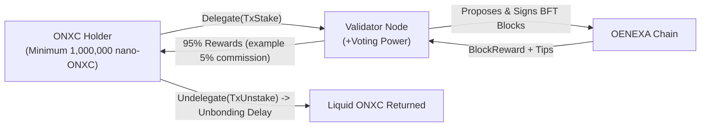

# Chapter 9: Staking, Delegation & Slashing

## 1. Security Through Skin in the Game

Why don't validators cheat by voting for fake blocks? Because to participate in BFT consensus, validators lock up real economic value (**ONXC Stake**).

- **Be Honest**: Earn block subsidies (`BlockReward` — `45 ONXC` in Era 0) plus user `PriorityTip` fees.
- **Cheat / Equivocate**: Get **slashed** — lose a permanent chunk of your staked ONXC and get removed from voting!

---

## 2. Validators vs. Delegators

Not everyone wants to run a 24/7 server in a data center. OENEXA (`internal/consensus/delegation.go`) supports **Delegated Staking** so ordinary ONXC holders can still help secure the network and earn yield:

- **Validator**: Operates an always-on `oenexa-node`, proposes blocks, signs BFT votes with an `ML-DSA-65` key, and sets a small **Commission** (default **`500 bps = 5%`**, configurable via `DefaultCommissionBps`).
- **Delegator**: Any ONXC holder who locks at least **`MinDelegationAmount = 1,000,000 nano-ONXC`** (`0.001 ONXC`) behind a trusted validator. The validator's voting power increases proportionally to the total delegated stake, and rewards flow back to delegators minus the validator's commission.

### How Delegation Flow Works

---

## 3. Why Is There an Unbonding Delay?

If a cheating validator could double-sign two conflicting blocks at 12:00:00 and withdraw 100% of their stake at 12:00:02 before anyone noticed, slashing would have no teeth!

Therefore, when you call `Undelegate` / `TxUnstake`, funds enter an **Unbonding Period** before becoming spendable again (`DefaultUnbondingDelayBlocks = 100` in the delegation manager test/core unit configuration, and `43,200` blocks $\approx 24\text{ hours}$ reported for mainnet RPC parameter in `onxc_getStakingInfo`):
- During unbonding, your stake **stops earning new rewards** and waits out the challenge window so any fraud evidence from prior blocks can still slash that stake.
- Once `currentHeight >= ReleaseHeight`, calling withdrawal moves the exact unlocked `nano-ONXC` back to your liquid balance.

---

## 4. Stake Conservation & Slashing Rules

From `internal/consensus/delegation.go` and `engine.go`:

1. **Exact Conservation Invariant**:
   $$\text{Validator.Stake} = \text{SelfStake} + \sum \text{ActiveDelegations}$$
   Delegated tokens are never duplicated or forged; `Stake` tracks the exact sum across every delegator entry.
2. **Equivocation Slashing (10% Penalty)**:
   If a validator signs two different blocks/votes at the exact same `(height, round)`:
   - The evidence triggers slashing inside `consensus/engine.go`: **10% of the validator's stake is deducted/slashed** (`slashAmount = val.Stake / 10`), and their voting power is updated/revoked so they cannot endanger the network.
   - Delegators share the slashing proportion with the validator they picked — which incentivizes students and investors to delegate to honest, well-secured validators!

---

## Check Your Understanding

1. **If a validator earns `100 ONXC` in rewards with `DefaultCommissionBps = 500` (`5%`), how much goes to the validator's commission and how much is distributed to the stake pool?**  
   *Answer:* `500 bps = 5%`, so `5 ONXC` is the validator's commission and `95 ONXC` is distributed proportionally across stakers.

2. **Why must unstaking wait for an unbonding delay instead of returning coins immediately?**  
   *Answer:* To prevent a malicious validator from double-signing an attack and withdrawing their collateral before the network processes the equivocation slashing proof.
