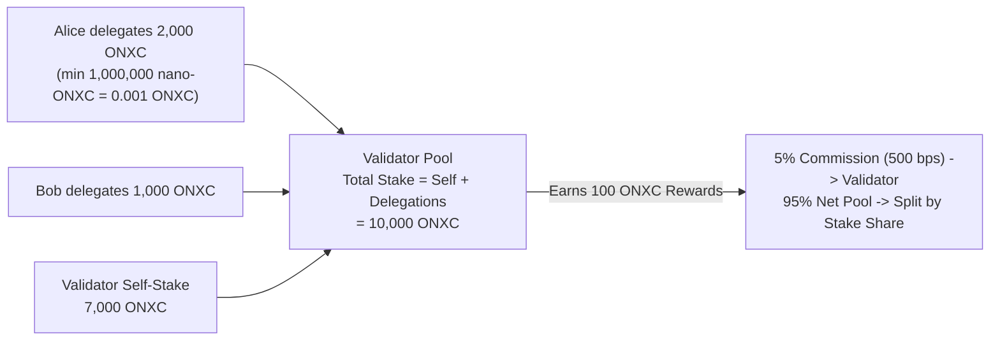

# Chapter 9: Staking, Delegation & Slashing

> **Learning Objectives**
> By the end of this chapter, you will be able to:
> - Explain why validators lock **ONXC collateral** ("skin in the game").
> - Distinguish **Validators** from everyday **Delegators** (`MinDelegationAmount = 0.001 ONXC`).
> - Compute **Commission + Pro-Rata Delegator Rewards** with exact numbers.
> - Trace the **Unbonding Queue** delay and why **`10%` Equivocation Slashing** applies to both self-stake and delegators.
>
> **Try It Visually:** Open [**Visual Lab Tab 5 — Delegated Staking & Slashing Calculator**](../visual-lab/index.html#bft) to split rewards and trigger 10% slashes live!

---

## 1. Everyday Analogy: Security Deposit for Honest Judges

Imagine hiring security guards for a vault: if a guard walks away empty-handed after robbing the vault, there is no financial deterrent. Instead, every guard deposits a big **security bond** inside a locked safe before putting on a uniform:
- **Guard does a great job:** Earns steady pay (`BlockReward` + `PriorityTip` fees).
- **Guard cheats (double-signs conflicting blocks):** The safe automatically burns **`10%` of their deposit** and revokes their badge!

---

## 2. Logic 1: Validators vs. Delegators (`internal/consensus/delegation.go`)

Not every ONXC holder wants to run a 24/7 server. OENEXA lets everyday users **delegate** ONXC to a validator and share rewards:

- **Minimum Delegation**: **`MinDelegationAmount = 1,000,000 nano-ONXC`** (`0.001 ONXC`). Trying to delegate `500,000 nano-ONXC` returns an error immediately.
- **Exact Conservation Invariant**:
  $$\text{Validator.TotalStake} \equiv \text{SelfStake} + \sum_{d} \text{Delegation}_d$$
  Staking never inflates or duplicates principal balances; delegated ONXC moves strictly from liquid balance into locked stake.

---

## 3. Logic 2: Worked Reward Split Example (Commission + Pro-Rata Payout)

Suppose a validator's pool totals **`10,000 ONXC`** and configures **`DefaultCommissionBps = 500`** (`500 / 10,000 = 5%` commission):
- Validator Self-Stake: **`7,000 ONXC`** (`70%` of pool)
- Alice's Delegation: **`2,000 ONXC`** (`20%` of pool)
- Bob's Delegation: **`1,000 ONXC`** (`10%` of pool)

Now suppose this pool earns **`100 ONXC`** in gross rewards:
1. **Step 1 — Validator Operator Commission (`5%` of `100 ONXC`)**:
   $$R_{\text{comm}} = \left\lfloor \frac{100 \times 500}{10,000} \right\rfloor = \mathbf{5\text{ ONXC}}$$
2. **Step 2 — Remaining Net Reward Pool (`100 - 5`)**:
   $$R_{\text{net}} = \mathbf{95\text{ ONXC}}$$
3. **Step 3 — Pro-Rata Share Based on Exact Pool Weight**:
   - Validator self-stake (`7,000 / 10,000 = 70%`): $\lfloor 95 \times 0.70 \rfloor = \mathbf{66.5\text{ ONXC}}$ (+ `5` commission = **`71.5 ONXC total`**)
   - Alice (`2,000 / 10,000 = 20%`): $95 \times 0.20 = \mathbf{19.0\text{ ONXC}}$
   - Bob (`1,000 / 10,000 = 10%`): $95 \times 0.10 = \mathbf{9.5\text{ ONXC}}$
4. **Solvency Check**: `71.5 + 19.0 + 9.5 = 100.0 ONXC` (zero extra inflation; any `1`-nano integer floor dust stays unminted!).

---

## 4. Logic 3: Unbonding Delay & `10%` Equivocation Slashing

### Why Cannot Stakers Withdraw Instantly? (Worked Unbonding Timeline)
Suppose Alice calls **`TxUnstake`** (`Undelegate`) for `2,000 ONXC` at Block Height `500`:
1. At Height `500`, Alice's `2,000 ONXC` **stops earning rewards** immediately and enters the **Unbonding Queue** with a target `ReleaseHeight` (`DefaultUnbondingDelayBlocks = 100` in core delegation unit config; `43,200` blocks $\approx 24\text{h}$ mainnet parameter reported by `onxc_getStakingInfo`).
2. Suppose at Height `510` (while Alice is still waiting in unbonding!), evidence arrives that the validator double-signed conflicting votes at Height `495`.
3. **Slashing fires!** Because of the unbonding delay, Alice couldn't sneak out at Height `501` before the fraud proof landed.

### Worked Slashing Calculation (`10%` Penalty)
Recall our `10,000 ONXC` pool (`7,000` Validator, `2,000` Alice, `1,000` Bob) when the validator signs two conflicting blocks at the exact same `(height, round)`:
- **Total Slashed (`val.Stake / 10`)**: `1,000 ONXC` permanently removed!
- Validator Self-Stake loses `10%`: `7,000 - 700` $\implies$ **`6,300 ONXC`**
- Alice loses `10%`: `2,000 - 200` $\implies$ **`1,800 ONXC`**
- Bob loses `10%`: `1,000 - 100` $\implies$ **`900 ONXC`**
- Validator's voting power is revoked/updated so the attacker cannot disrupt future rounds.

Notice **why delegators share slashing risk**: it forces delegators to pick honest, well-secured validators rather than blindly delegating to reckless operators!

---

## Student Practice Exercises (With Answers)

1. **Exercise 1 (Minimum Delegation Check):** Carol wants to test delegation using `500,000 nano-ONXC` (`0.0005 ONXC`). Will `Delegate` accept or reject it?  
   

Show Answer

   **Reject!** `MinDelegationAmount = 1,000,000 nano-ONXC` (`0.001 ONXC`), so `500,000` is below the minimum threshold.
   

2. **Exercise 2 (Reward Conservation):** If a validator sets `CommissionBps = 1000` (`10%`) and earns `200 ONXC` gross, how much goes directly to commission and how much enters the pro-rata pool?  
   

Show Answer

   Commission = `200 * 1000 / 10,000 = 20 ONXC`. Remaining net pool distributed pro-rata = `200 - 20 = 180 ONXC`.
   

