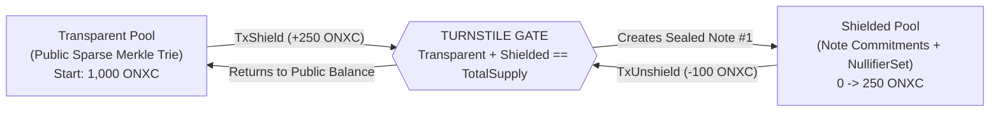

# Chapter 10: The Dual-Pool Privacy Engine (Shielded Pool & Turnstile)

> **Learning Objectives**
> By the end of this chapter, you will be able to:
> - Contrast **Transparent Accounts** vs. **Shielded Notes**.
> - Walk through concrete **`TxShield`**, **`TxShieldedTransfer`**, and **`TxUnshield`** examples.
> - Explain why random blinding (`Rcm`) protects note commitments and how **`NullifierSet`** blocks double-spending.
> - Trace how **Viewing Keys** let an auditor inspect payments without permission to spend.
> - Verify the **Turnstile Conservation Law** across multiple transfers.
>
> **Try It Visually:** Open [**Visual Lab Tab 6 — Turnstile Privacy Pool & Nullifier Lab**](../visual-lab/index.html#privacy) to mint notes, replay spent nullifiers, and watch the Turnstile check live!

---

## 1. Everyday Analogy: Transparent Glass Jar vs. Sealed Envelopes

Suppose your class shares a public cash register (`Transparent Pool`), where everyone can read every wallet balance. What if Alice wants to buy medicine or receive a scholarship stipend **privately**, without posting her life savings on a billboard?

On the other hand, how can exchanges and regulators prove nobody secretly exploited a software bug to print a million counterfeit ONXC inside a private pool?

**OENEXA (`internal/shielded/`) gives you BOTH using a Dual-Pool Turnstile:**

---

## 2. Logic 1: Sealed Notes & Commitments (`internal/shielded/note.go`)

Instead of writing `Alice: 250 ONXC` in plain view, the Shielded Pool stores cryptographic commitments to sealed **Notes**.

Every `Note` holds:
- `Value`: `250,000,000,000` (`250 ONXC` in `nano-ONXC`)
- `RecipientPK`: Receiver's public key
- `Rho`: Random 32-byte unique serial number
- `Rcm`: Random 32-byte secret blinding factor (trapdoor noise)
- `Memo`: Optional encrypted text message (encrypted with **NIST FIPS 203 `ML-KEM-768`** post-quantum key encapsulation!)

On-chain, nodes record ONLY the one-way `SHA-3-256` fingerprint (**Note Commitment `cm`**):
$$\text{cm} = \text{SHA-3-256}(\texttt{"OENEXA\_NOTE\_CM"} \parallel \text{Value} \parallel \text{RecipientPK} \parallel \text{Rho} \parallel \text{Rcm})$$

### Why `Rcm` Is Mandatory (Worked Guessing Attack Example)
Suppose Alice omitted `Rcm` and shielded `100 ONXC` (`100,000,000,000`). An outsider who guesses *"Maybe she sent 100 ONXC to Bob"* could just compute `SHA-3("OENEXA_NOTE_CM" || 100e9 || BobPK)` and check if it equals `cm`! Adding 256 random bits (`Rcm`) makes guessing impossible.

### Appending to the Note Commitment Tree
Every valid commitment `cm` gets appended into the **`NoteCommitmentTree`** (`TreeDepth = 32`, supporting $2^{32} \approx 4.29\text{ billion}$ historical notes, hashed with domain separator `"OENEXA_TREE_NODE"`).

---

## 3. Logic 2: Stopping Double Spends Privately (`NullifierSet`)

If `cm` never exposes who owns it or its amount, how does OENEXA stop Alice from spending the same sealed `250 ONXC` note twice?

When Alice wants to spend her note, she reveals a unique deterministic serial tag (**Nullifier `nf`**):
$$\text{nf} = \text{SHA-3-256}(\texttt{"OENEXA\_NULLIFIER"} \parallel \text{spendingKey} \parallel \text{Rho} \parallel \text{cm})$$

### Worked Trace Across 4 Step-by-Step Operations (`TotalSupply = 1,000 ONXC`)

| Step | Action | `NullifierSet` Check | Transparent Pool | Shielded Pool | Turnstile Sum |
| :--- | :--- | :--- | :--- | :--- | :--- |
| **0 (Start)** | Initial state | `{}` (empty) | `1,000 ONXC` | `0 ONXC` | `1,000 + 0 = 1,000` |
| **1 (`TxShield`)** | Alice shields `250 ONXC` -> creates `cm_1` (`Note #1`) | No nullifier spent | `750 ONXC` | `250 ONXC` | `750 + 250 = 1,000` |
| **2 (`TxShieldedTransfer`)** | Alice privately sends `250 ONXC` to Bob (`cm_2`) | Adds `nf_1` | `750 ONXC` | `250 ONXC` | `750 + 250 = 1,000` |
| **3 (Attack!)** | Alice tries re-spending `Note #1` (`nf_1` again!) | **`nf_1` EXISTS! BLOCKED!** | Unchanged | Unchanged | **`Err: double spend!`** |
| **4 (`TxUnshield`)** | Bob withdraws `Note #2` (`250 ONXC`) to public wallet | Adds `nf_2` | `1,000 ONXC` | `0 ONXC` | `1,000 + 0 = 1,000` |

Notice Step 3: the node immediately rejects `"double spend detected, nullifier already exists"` without any bystander knowing *which* historical commitment `cm` created `nf_1`!

---

## 4. Logic 3: Read-Only Viewing Keys & Live Turnstile Audits

- **Selective Compliance (`internal/shielded/viewingkey.go`)**: Using `oenexa-node wallet export-viewing-key`, you derive `SHA-3-256("OENEXA_VIEWING_KEY" || privKey)`. You can hand this key to an accountant so they can decrypt and audit incoming shielded payments **without any authority to spend funds**.
- **Public Supply Audit (`onxc_getTurnstileStatus`)**: Inside `internal/shielded/turnstile.go`, `Unshield(amount)` verifies `shieldedSupply >= amount` before moving a single `nano-ONXC` back out, guaranteeing `TransparentSupply + ShieldedSupply == TotalSupply` on every block.

---

## Student Practice Exercises (With Answers)

1. **Exercise 1:** Suppose `TransparentSupply = 8,000 ONXC` and `ShieldedSupply = 2,000 ONXC`. An exploit bug tries calling `Turnstile.Unshield(2,500 ONXC)`. What happens?  
   

Show Answer

   **Rejected immediately!** `Turnstile.Unshield` checks `t.shieldedSupply < amount` (`2,000 < 2,500`) and fails with `insufficient shielded supply to unshield`, protecting the total supply invariant.
   

2. **Exercise 2:** Why can you safely give a tax auditor your **Viewing Key** without fearing they will steal your ONXC?  
   

Show Answer

   The Viewing Key is derived via a one-way `SHA-3-256` hash (`"OENEXA_VIEWING_KEY" || privKey`), granting read-only inspection without exposing the private signing/spending key.
   

