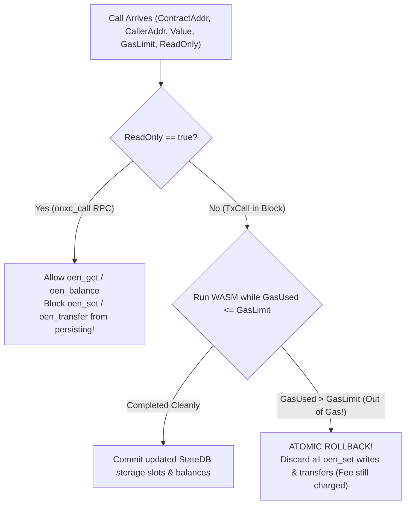

# Chapter 11: Smart Contracts & The OenexaVM WebAssembly Runtime

> **Learning Objectives**
> By the end of this chapter, you will be able to:
> - Understand smart contracts via the automated vending-machine analogy.
> - Explain why `OenexaVM` uses **pure-Go `wazero` WebAssembly** sandboxing.
> - Describe all **8 `env` host functions** and trace a counter contract execution.
> - Compare a **Read-Only `onxc_call` dry run**, a **`TxCall` write**, and an **Out-of-Gas atomic rollback**.
> - Read the exact binary byte layout of OENEXA's **Post-Quantum M-of-N Multisig** contract.
>
> **Try It Visually:** Open [**Visual Lab Tab 6 — OenexaVM Sandbox Stepper**](../visual-lab/index.html#privacy) to test ReadOnly vs. Write vs. Out-of-Gas rollbacks!

---

## 1. Everyday Analogy: The Unstoppable Glass Vending Machine

Think of a vending machine:
- Anyone can walk up, put `2 ONXC` in, and press `B4`.
- The machine's internal logic (`if paid >= 2 ONXC { dropSnack(); slotB4--; }`) runs **identically and automatically** without needing a human cashier.

A **smart contract** is simply verified WebAssembly program code stored at an OENEXA address (`TxDeploy`) whose rules execute deterministically on every validator whenever someone sends a **`TxCall`** transaction!

---

## 2. Logic 1: How `OenexaVM` (`internal/vm`) Sandboxes Contracts

Why doesn't OENEXA let smart contracts directly open your laptop's files or access the internet? Because a malicious contract could erase hard drives or diverge across different computers!

`OenexaVM` runs compiled **WebAssembly (WASM)** inside the pure-Go **`wazero`** runtime:
1. **Strict Sandbox**: WASM contracts have zero filesystem, zero network, and zero wall-clock randomness — they can *only* talk to the chain via **8 safe host functions** (`env` module).
2. **Module Caching (`SHA-3-256(code)`)**: On `Deploy()`, OENEXA validates the WASM module, hashes the bytecode, and caches the compiled machine code in memory for fast repeated calls.
3. **Zero-CGO Cross-Compilation**: Compiles cleanly anywhere Go compiles (Linux, Windows, macOS).
4. **Infinite Loop Protection**: Every execution enforces `GasLimit` (`WithCloseOnContextDone(true)` + fuel/gas metering).

---

## 3. Logic 2: The 8 Host ABI Functions (`env` Module)

Every WASM contract imports these 8 capabilities (`internal/vm/vm.go`, `host.go`):

| Host Function      | Signature                      | What It Does                                   | Concrete Use Example                  |
|:-------------------|:-------------------------------|:-----------------------------------------------|:--------------------------------------|
| `oen_get`          | `(slot i32) -> i64`            | Read `uint64` stored at contract `slot`        | Read current vote count from slot `0` |
| `oen_set`          | `(slot i32, val i64)`          | Store `uint64` at `slot` (reverts on failure!) | Save `voteCount + 1` into slot `0`    |
| `oen_transfer`     | `(to_ptr i32, amt i64) -> i64` | Send `nano-ONXC` from contract balance         | Release prize payout to winner        |
| `oen_balance`      | `(addr_ptr i32) -> i64`        | Query balance of any 32-byte address           | Check vault ONXC reserve              |
| `oen_log`          | `(ptr i32, len i32)`           | Emit structured event log from WASM RAM        | Emit `"VoteRecorded"` log             |
| `oen_caller`       | `() -> i64`                    | Inspect calling sender (`CallerAddr`)          | Verify caller is admin or club member |
| `oen_block_height` | `() -> i64`                    | Read current block number (`BlockHeight`)      | Check if election deadline passed     |
| `oen_value`        | `() -> i64`                    | Read `nano-ONXC` attached (`Tx.Amount`)        | Verify caller paid `>= 2 ONXC`        |

---

## 4. Logic 3: `ExecutionContext`, Read-Only Dry Runs & Atomic Rollback

### Worked Comparison (Starting State: `Slot #0 = 5`)
1. **Scenario A — Read-Only Query (`onxc_call`, `ReadOnly = true`)**:
   - Contract reads `oen_get(0) -> 5`. Even if its logic calls `oen_set(0, 6)`, StateDB stays untouched (**`Slot #0` remains `5`**) and you pay zero gas!
2. **Scenario B — Healthy Write (`TxCall`, `GasLimit = 1,000`, uses `450` gas)**:
   - Reads `5`, calls `oen_set(0, 6)` cleanly. **`Slot #0` commits as `6`!**
3. **Scenario C — Infinite Loop / Out-of-Gas (`TxCall`, `GasLimit = 1,000`, loop needs `1,500` gas)**:
   - Contract writes `oen_set(0, 99)` halfway through, then runs out of gas at step `1,001`.
   - **Atomic Rollback** restores **`Slot #0` cleanly back to `6`** (never half-written!), while the caller still pays for the consumed compute so validators aren't DoS'd for free.

---

## 5. Logic 4: Real-World Example — Post-Quantum M-of-N Multisig (`internal/contracts/multisig`)

Suppose 3 student officers (`Alice`, `Bob`, `Carol`) guard a `10,000 ONXC` club fund and want a **2-of-3 rule**: *"Any 2 officers must co-sign with `ML-DSA-65` before funds move!"*

Look at the exact binary payloads parsed in `internal/contracts/multisig/multisig.go`:
1. **`InitMultisig` Payload**:
   `[threshold (4B): 2] || [owner_count (4B): 3] || [AlicePubKey (1,952B)] || [BobPubKey (1,952B)] || [CarolPubKey (1,952B)]`
   - Total bytes checked cleanly: $8 + (3 \times 1,952) = \mathbf{5,864\text{ bytes}}$.
2. **`ExecuteTransfer` Payload (paying Dave `100 ONXC` with Alice + Carol signing)**:
   `[DaveAddr (32B)] || [Amount (8B)] || [num_sigs (4B): 2] || [AliceSig (3,309B)] || [CarolSig (3,309B)]`
   - Total bytes checked cleanly: $44 + (2 \times 3,309) = \mathbf{6,662\text{ bytes}}$.
   - Contract checks `num_sigs >= threshold` (`2 >= 2`), builds `msg = [DaveAddr || Amount]`, and verifies each distinct owner signature via `ML-DSA-65` before transferring!

---

## Student Practice Exercises (With Answers)

1. **Exercise 1 (Rollback Safety):** A smart contract executes `oen_transfer(Bob, 50 ONXC)`, then hits an infinite loop and exceeds `GasLimit`. Does Bob keep the `50 ONXC`?  
   

Show Answer

   **No!** An out-of-gas failure triggers atomic state rollback — both storage edits (`oen_set`) and internal transfers (`oen_transfer`) are completely reverted.
   

2. **Exercise 2 (Multisig Byte Sizing):** Using `InitMultisig`'s payload rule `8 + (ownerCount * 1952)`, how many bytes is a `3-of-5` multisig initialization payload?  
   

Show Answer

   `8 + (5 * 1,952) = 8 + 9,760 = 9,768 bytes`.
   

