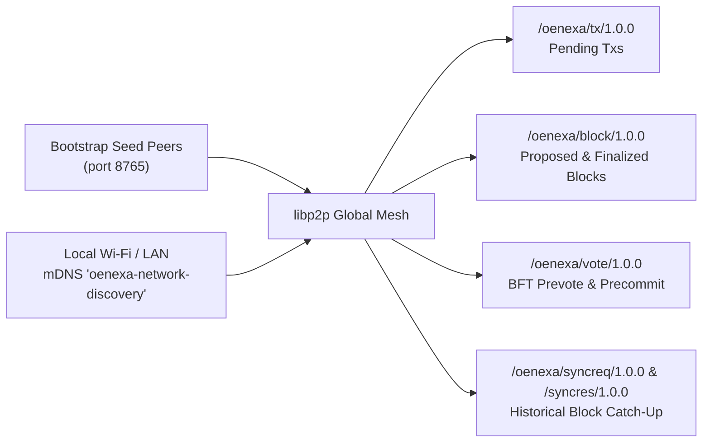

# Chapter 12: P2P Networking, Block Sync, Layer-2 Rollups, Oracles & Self-Upgrades

> **Learning Objectives**
> By the end of this chapter, you will be able to:
> - Trace all **5 `libp2p` gossip channels** and explain anti-echo deduplication + peer reputation scoring.
> - Compute how long **`Syncer` (`BatchSize = 64`, `SyncInterval = 5s`)** takes to catch up a node.
> - Explain how **L2 Rollup batches** (`PreRoot -> Txs -> PostRoot + Proof`) scale Layer-1 throughput.
> - Show with numbers why **Median Oracle Aggregation (`AggregateReports`)** ignores outlier price manipulation.
> - Explain how **`Manager`** & **`Scheduler`** upgrade validator nodes safely without splitting the chain.

---

## 1. Logic 1: Decentralized Peer-to-Peer Mesh (`internal/p2p`)

How do thousands of `oenexa-node` computers worldwide find each other without a central "master directory server"?

- **Anti-Echo Deduplication (`seenTxs`, `seenBlocks`)**: If Peer A gossips `Tx #77` to Peer B, and Peer B gossips it to Peer C, when Peer C echoes `Tx #77` back to Peer A, Peer A sees `Tx #77` inside `seenTxs` and drops the duplicate instead of looping forever!
- **Peer Reputation (`internal/p2p/reputation.go`)**: If a peer repeatedly sends invalid signatures or oversized spam, its reputation score drops and honest nodes disconnect/ban it automatically.

---

## 2. Logic 2: Catching Up Missing Blocks (`internal/sync`)

Suppose a student shuts down their laptop at Block `1,000`. One hour later (`3,600 seconds / 2s per block = 1,800` new blocks), the network is at Block `2,800` and they turn `oenexa-node` back on!

1. Every **`SyncInterval = 5 seconds`**, `Syncer` checks peer tips (`ObservePeerHeight` sees `2,800 > 1,000`).
2. `Syncer` sends `SyncReq{FromHeight: 1001, MaxCount: 64}` (`BatchSize = 64` blocks per request).
3. **Worked Catch-Up Count**: To download `1,800` blocks at `64` blocks per request takes $\lceil 1,800 / 64 \rceil = \mathbf{29\text{ batches}}$, validating every header's `ML-DSA-65` signature, `PrevHash`, and `StateRoot` before saving to LevelDB!

---

## 3. Logic 3: Layer-2 Rollup Sequencer (`internal/rollup`)

Even with fast `2`-second blocks and `500,000,000` block gas limits, gaming or high-frequency apps can demand extra capacity. OENEXA includes a built-in **Layer-2 Rollup** architecture (`sequencer.go`, `batch.go`, `l1_bridge.go`):

1. **Off-Chain Batching**: Users sign normal `ML-DSA-65` transactions and submit them to the L2 Sequencer.
2. **State Compression**: Every `2 seconds` (`batchInterval`), the Sequencer executes hundreds of L2 transactions against an L2 `StateDB` (`PreRoot -> PostRoot`).
3. **L1 Final Settlement**: Only the compressed `Batch{PreRoot, PostRoot, Txs, Proof}` posts back to OENEXA Layer-1 via `l1_bridge.go`, giving users Layer-1 finality security at a tiny fraction of on-chain space.

---

## 4. Logic 4: Byzantine-Safe Price Oracles (`internal/oracle/node.go`)

Smart contracts cannot run live `curl` HTTP requests on their own: if Validator 1 got `ONXC-USD = $1.012` and Validator 2 got `$1.013` two milliseconds later, their `StateRoot` hashes would fork!

**How OENEXA solves this (`SovereignValuationPairs` + `AggregateReports`):**
- Supported native sovereign pairs: `ONXC`, `ONXC-USD`, `ONXC-EUR`, `ONXC-GBP`, `ONXC-JPY`, `ONXC-CHF`, `ONXC-USDC` (stored in integer micro-units, e.g., `$1.00 = 1_000_000`).

### Worked Outlier-Resistance Example (`ONXC-USD`)
Suppose `5` staked `OracleNode` reporters submit signed `OracleReport` attestations for `ONXC-USD` in the same round:
- Reporter 1 (Honest): **`$1.02`** (`1_020_000`)
- Reporter 2 (Honest): **`$1.00`** (`1_000_000`)
- Reporter 3 (**Hacked/Lying!**): **`$9,999.00`** (`9_999_000_000`)
- Reporter 4 (Honest): **`$1.01`** (`1_010_000`)
- Reporter 5 (Honest): **`$1.03`** (`1_030_000`)

Now watch **Arithmetic Mean (bad)** vs. **Median `AggregateReports` (good)**:
- *Mean*: `(1.02 + 1.00 + 9999.00 + 1.01 + 1.03) / 5 = $2,000.61` — catastrophically manipulated!
- *OENEXA Median*: Sort `[1.00, 1.01, 1.02, 1.03, 9999.00]` $\implies$ middle value = **`$1.02`**! The single malicious outlier has **zero effect** on on-chain pricing!

---

## 5. Logic 5: Verified Self-Upgrades & Height Scheduling (`internal/upgrade`)

Upgrading a decentralized network without downtime requires two safety mechanisms:
1. **`ComputeFileHash` Verification**: Before `Manager` swaps any node binary downloaded from a release manifest (`CheckInterval = 1h`), it verifies its **`SHA-3-256` checksum** so corrupted or compromised downloads are rejected cleanly.
2. **Height-Scheduled Activation (`Scheduler`)**: New protocol rules activate at an exact agreed block height (e.g., `Height == 500,000`), ensuring all validators switch versions on the exact same block without splitting the network.

---

## Student Practice Exercises (With Answers)

1. **Exercise 1 (`Syncer` Batch Math):** Your node starts offline `320` blocks behind the network tip. How many `BatchSize = 64` sync batches will `Syncer` request to catch up?  
   

Show Answer

   `320 / 64 = 5` full batches.
   

2. **Exercise 2 (Oracle Resilience):** Out of `5` oracle reporters on `ONXC-EUR`, one buggy API reports `0.00` while the other four report `[0.92, 0.94, 0.93, 0.95]`. What does sorted median selection return?  
   

Show Answer

   Sorted list is `[0.00, 0.92, 0.93, 0.94, 0.95]`. The median (3rd value) is **`0.93`** — safely unaffected by the `0.00` outage.
   

