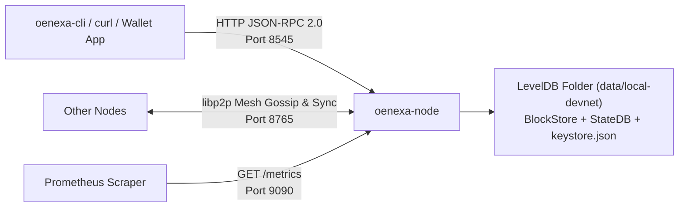

# Lab 1: Running Your First OENEXA Node & Using the CLI

> **Lab Goal**
> Build `oenexa-node` and `oenexa-cli` from source, create a post-quantum encrypted wallet (`keystore.json`), launch a local devnet, and watch a live ONXC transfer confirm in 2 seconds!
>
> **Companion Visual:** Open [**Visual Lab (`visual-lab/index.html`)**](../visual-lab/index.html) alongside your terminal to compare live CLI output against visual diagrams!

---

## 1. Visual Map of Your Running Local Node

When you launch a local OENEXA node, three network services listen locally on your machine:



---

## 2. Prerequisites

- **Go `1.22+`** (`go version`)
- **Git** (`git --version`)
- Optional: **Docker & Docker Compose** (for multi-node or containerized runs)

---

## 3. Step 1 — Compile `oenexa-node` and `oenexa-cli`

Open a terminal inside the sibling `oenexa-node` repository:

### Windows PowerShell
```powershell
mkdir -Force bin | Out-Null
go build -trimpath -o bin/oenexa-node.exe ./cmd/node
go build -trimpath -o bin/oenexa-cli.exe ./cmd/oenexa-cli
./bin/oenexa-node.exe version
```

### Linux / macOS (Bash)
```bash
make build build-cli
./bin/oenexa-node version
```

Look for these key confirmations in the output:
- `Chain ID: 1  (OENEXA Mainnet)`
- `Ticker  : ONXC  (Open Network for the Next Generation Coin)`
- `Crypto  : ML-DSA-65 (FIPS 204) | ML-KEM-768 (FIPS 203) | SHA-3-256 (FIPS 202)`

---

## 4. Step 2 — Create Your First Encrypted Post-Quantum Wallet

Always set your keystore password in **`ONXC_PASSWORD`** rather than typing `--password ...` on the command line (terminal history logs CLI flags!).

### PowerShell
```powershell
$env:ONXC_PASSWORD = "MyStudentLabPassword123!"
./bin/oenexa-node.exe wallet new --datadir ./my-student-node
./bin/oenexa-node.exe wallet show --datadir ./my-student-node
```

### Bash
```bash
export ONXC_PASSWORD="MyStudentLabPassword123!"
./bin/oenexa-node wallet new --datadir ./my-student-node
./bin/oenexa-node wallet show --datadir ./my-student-node
```

**What Happened Behind the Scenes?**
1. Generated a `4,032`-byte `ML-DSA-65` private key and `1,952`-byte public key.
2. Computed `SHA-3-256(publicKey)` to create your `32`-byte (`64`-hex-char) ONXC address.
3. Hardened your password via `Argon2id` (`64 MiB` RAM) and sealed the private key inside `./my-student-node/keystore.json` with `AES-256-GCM`.

---

## 5. Step 3 — Start a Clean Local Development Node (Terminal #1)

Use the built-in reset scripts inside `oenexa-node/scripts/` so you start freshly at Genesis Block `0`:

### PowerShell
```powershell
.\scripts\run-local.ps1 -Reset
```

### Bash
```bash
./scripts/run-local.sh --reset
```

Keep Terminal #1 running — you will see BFT blocks finalizing every 2 seconds (`BlockInterval = 2s`)!

---

## 6. Step 4 — Query Status & Send Your First `10 ONXC` (Terminal #2)

Open a **second terminal** in `oenexa-node` and run these commands step by step:

```bash
# 1. Inspect live network info (Height, Ticker = ONXC, BaseFee, Peers)
./bin/oenexa-node query chain --rpc http://127.0.0.1:8545

# 2. Verify Turnstile conservation (Transparent + Shielded == TotalSupply)
./bin/oenexa-node query turnstile --rpc http://127.0.0.1:8545

# 3. Inspect dynamic EIP-1559 fee tiers (UltraLow, Standard, Fast)
./bin/oenexa-node query fee --rpc http://127.0.0.1:8545

# 4. Create a second wallet ("Bob") to receive coins
./bin/oenexa-cli wallet new

# 5. Print the devnet validator's address & check its ONXC balance
./bin/oenexa-node wallet show --datadir data/local-devnet
./bin/oenexa-node query balance --address <VALIDATOR_ADDRESS_HEX>

# 6. Send 10 ONXC (= 10,000,000,000 nano-ONXC!) at Nonce 0
ONXC_PASSWORD=devpassword ./bin/oenexa-node tx send \
  --datadir data/local-devnet \
  --to <BOBS_ADDRESS_HEX> \
  --amount 10000000000 \
  --nonce 0
```

Wait just **2 seconds** for the next BFT block, then check Bob's balance:
```bash
./bin/oenexa-node query balance --address <BOBS_ADDRESS_HEX>
```
Bob now holds **`10.000000000 ONXC`** (`10000000000 nano-ONXC`) with permanent finality!

*(Quick tip: Why did we pass `--amount 10000000000` for `10 ONXC`? Remember Chapter 2: all on-chain amounts use `nano-ONXC`, where $1\text{ ONXC} = 10^9\text{ nano-ONXC}$!)*

---

## 7. Step 5 — Run the End-to-End Real Scenario Test Suite

To watch automated tests spin up wallets, build blocks, exercise `TxShield`/`TxUnshield`, check Turnstile supply invariants, and query RPC live, run:

```bash
go test -v ./test -run TestRealScenario
```
Or run every package test across the whole node:
```bash
go test -count=1 ./cmd/... ./internal/... ./test/...
```
