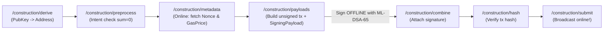

# Lab 2: Querying JSON-RPC (`onxc_*`) & Exchange Rosetta API

Every wallet app, mobile client, block explorer, and exchange communicates with `oenexa-node` over HTTP APIs. OENEXA exposes **two clean API interfaces**:
1. **JSON-RPC 2.0 (`onxc_*` + standard `eth_*` Web3 compatibility)** — for wallets, dApps, scripts, and explorers (`internal/rpc`).
2. **Rosetta API v1.4.14** — standardized REST interface designed specifically for cryptocurrency exchanges and custody providers (`internal/rosetta`).

---

## 1. JSON-RPC 2.0 Cheat Sheet (`http://127.0.0.1:8545`)

Every JSON-RPC call is an HTTP `POST` with `Content-Type: application/json` and body:
```json
{ "jsonrpc": "2.0", "id": 1, "method": "<METHOD_NAME>", "params": [...] }
```

### Core `onxc_*` Endpoints

| Method | Parameters | What It Returns |
| :--- | :--- | :--- |
| `onxc_chainInfo` | `[]` or `null` | `chain_id`, `height`, `tip_hash`, `peer_count`, `mempool_len`, `base_fee`, `gas_limit`, `ticker` (`"ONXC"`). |
| `onxc_blockHeight` | `null` | Current block height integer. |
| `onxc_blockByHeight` | `[height]` | Full block header + transactions at `height`. |
| `onxc_blockByHash` | `[blockHashHex]` | Block header + transactions by 32-byte block hash. |
| `onxc_recentBlocks` | `[count]` | Latest `count` blocks (also aliased as `onxc_getLatestBlocks`). |
| `onxc_getBalance` | `[addressHex]` | `balance_nano_onxc`, `balance_onxc` (decimal ONXC), `balance` (`nano-ONXC`). |
| `onxc_getTransactionCount` | `[addressHex]` | Account `nonce` required for the next outgoing transaction. |
| `onxc_sendRawTransaction` | `[gobEncodedTxHex]` | Submits signed `ML-DSA-65` transaction to mempool; returns `tx_hash`. |
| `onxc_getTransactionByHash` | `[txHashHex]` | Transaction lookup + inclusion status. |
| `onxc_getTransactionReceipt` | `[txHashHex]` | Execution receipt (`blockHash`, `blockNumber`, `gasUsed`, `status`). |
| `onxc_call` | `[callObject]` | Read-only smart contract execution dry run. |
| `onxc_gasPrice` | `null` | Current `base_fee` in `nano-ONXC/gas`. |
| `onxc_feeEstimate` | `null` | `base_fee`, tips, and `transfer_ultra_low_nano_onxc` / `transfer_standard_nano_onxc` / `transfer_fast_nano_onxc`. |
| `onxc_getShieldedBalance` | `null` | `shielded_balance_nano_onxc`, `tree_leaf_count`, `tree_root`. |
| `onxc_getTurnstileStatus` | `null` | Transparent supply, shielded supply, total supply, `invariant_preserved` boolean. |
| `onxc_getCirculatingSupply` | `null` | Circulating & max `100,000,000 ONXC` metrics with `ticker: "ONXC"`. |
| `onxc_getTotalSupply` | `null` | Total emitted supply, shielded supply, max supply. |
| `onxc_getTokenomics` | `null` | Block reward, halving era, halving countdown, genesis allocations, estimated APY. |
| `onxc_getStakingInfo` | `null` | Bonded target ratio (`0.67`), estimated APY at 50%/67%/80%, unbonding blocks. |
| `onxc_getDelegations` | `[addressHex]` | Active delegations belonging to `addressHex`. |
| `onxc_getTotalDelegated` | `[]` | `total_delegated` (`nano-ONXC`) and `total_delegated_onxc`. |

> **Web3 Compatibility (`eth_*`, `net_*`, `web3_*`):** Existing Web3 libraries can also call `net_version`, `web3_clientVersion`, `eth_chainId`, `eth_blockNumber`, `eth_getBlockByNumber`, `eth_getBalance`, `eth_getTransactionCount`, `eth_sendRawTransaction`, `eth_call`, `eth_getTransactionReceipt`, `eth_getTransactionByHash`, and `eth_gasPrice`.

### Try It Live (Bash / `curl` & PowerShell)

**Bash:**
```bash
curl -s -X POST http://127.0.0.1:8545/ \
  -H "Content-Type: application/json" \
  -d '{"jsonrpc":"2.0","id":1,"method":"onxc_getTokenomics","params":[]}' | jq .
```

**Windows PowerShell:**
```powershell
$body = '{"jsonrpc":"2.0","id":1,"method":"onxc_getTokenomics","params":[]}'
Invoke-RestMethod -Method Post -Uri "http://127.0.0.1:8545/" -ContentType "application/json" -Body $body | ConvertTo-Json -Depth 5
```

---

## 2. Rosetta API v1.4.14 (For Exchanges & Institutional Custody)

Why did the blockchain industry invent **Rosetta**? Without a standard, an exchange had to write completely custom integration code for every new blockchain. Rosetta defines a clean, universal REST specification that OENEXA implements natively in `internal/rosetta/handler.go` (`CurrencySymbol = "ONXC"`, `CurrencyDecimals = 9`):

### Data Endpoints (Reading Balances & History)
- `POST /network/list`: Lists `{"blockchain": "oenexa", "network": "mainnet"}`.
- `POST /network/status`: Current block height, genesis identifier, sync status, peer count.
- `POST /network/options`: Rosetta `1.4.14`, allowed operation types, and structured errors.
- `POST /account/balance`: Account balance in atomic `nano-ONXC` (`decimals: 9`).
- `POST /block` & `POST /block/transaction`: Inspect committed blocks and bilateral balance-changing operations (`sender -A`, `recipient +A`, guaranteeing $\sum \text{ops} = 0$).
- `POST /mempool` & `POST /mempool/transaction`: View pending mempool transaction IDs.

### Construction Pipeline (Air-Gapped Cold-Wallet Signing!)
Notice how Rosetta's 7-step Construction API keeps private keys **100% offline**:



Exchanges can keep their `4,032`-byte `ML-DSA-65` private keys inside an air-gapped vault that only sees Step 4's `SigningPayload` bytes and outputs the signature for Step 5!
