# Lab 2: Querying JSON-RPC (`onxc_*`) & Exchange Rosetta API

> **Lab Goal**
> Learn how wallets, block explorers, Python/JavaScript apps, and exchanges talk to `oenexa-node` via **JSON-RPC 2.0 (`onxc_*`)** and **Rosetta API v1.4.14** — complete with sample request/response payloads!

---

## 1. JSON-RPC 2.0 API (`http://127.0.0.1:8545`)

Every JSON-RPC call sends an HTTP `POST` with `Content-Type: application/json`:
```json
{ "jsonrpc": "2.0", "id": 1, "method": "<METHOD_NAME>", "params": [...] }
```

### Complete `onxc_*` Reference Table

| Method | Parameters | Purpose & Key Returned Fields |
| :--- | :--- | :--- |
| `onxc_chainInfo` | `[]` | `chain_id` (`1`), `height`, `tip_hash`, `peer_count`, `mempool_len`, `base_fee`, `gas_limit`, `ticker` (`"ONXC"`). |
| `onxc_blockHeight` | `null` | Latest finalized block height integer. |
| `onxc_blockByHeight` | `[height]` | Full block header + transactions at `height`. |
| `onxc_blockByHash` | `[blockHashHex]` | Block header + transactions by 32-byte block hash. |
| `onxc_recentBlocks` | `[count]` | Latest `count` blocks (also aliased as `onxc_getLatestBlocks`). |
| `onxc_getBalance` | `[addressHex]` | `balance_nano_onxc`, `balance_onxc`, `balance` (`nano-ONXC`). |
| `onxc_getTransactionCount` | `[addressHex]` | Current `nonce` needed for your next transaction. |
| `onxc_sendRawTransaction` | `[gobEncodedTxHex]` | Broadcasts a signed `ML-DSA-65` transaction; returns `tx_hash`. |
| `onxc_getTransactionByHash` | `[txHashHex]` | Transaction metadata + block inclusion status. |
| `onxc_getTransactionReceipt` | `[txHashHex]` | Execution receipt (`blockHash`, `blockNumber`, `gasUsed`, `status`). |
| `onxc_call` | `[callObject]` | Read-only dry-run call to a WASM smart contract (no state writes). |
| `onxc_gasPrice` | `null` | Current `base_fee` in `nano-ONXC/gas`. |
| `onxc_feeEstimate` | `null` | `base_fee` + `transfer_ultra_low_nano_onxc`, `transfer_standard_nano_onxc`, `transfer_fast_nano_onxc`. |
| `onxc_getShieldedBalance` | `null` | `shielded_balance_nano_onxc`, `tree_leaf_count`, `tree_root`. |
| `onxc_getTurnstileStatus` | `null` | Transparent supply, shielded supply, total supply, and `invariant_preserved`. |
| `onxc_getCirculatingSupply` | `null` | Current circulating supply & `100,000,000 ONXC` cap (`ticker: "ONXC"`). |
| `onxc_getTotalSupply` | `null` | Total emitted, shielded pool, and hard cap metrics. |
| `onxc_getTokenomics` | `null` | Current `BlockReward`, Halving Era, countdown, genesis allocations, and APY. |
| `onxc_getStakingInfo` | `null` | Target bonded ratio (`0.67`), APY estimates at `50%`/`67%`/`80%`, unbonding period. |
| `onxc_getDelegations` | `[addressHex]` | Delegations belonging to `addressHex`. |
| `onxc_getTotalDelegated` | `[]` | `total_delegated` (`nano-ONXC`) and `total_delegated_onxc`. |

> **Web3 Client Compatibility:** Standard tools that expect `eth_*` RPC calls can also call `net_version`, `web3_clientVersion`, `eth_chainId`, `eth_blockNumber`, `eth_getBlockByNumber`, `eth_getBalance`, `eth_getTransactionCount`, `eth_sendRawTransaction`, `eth_call`, `eth_getTransactionReceipt`, `eth_getTransactionByHash`, and `eth_gasPrice`.

### Worked Example 1: Checking Balance & Chain Info via `curl` / PowerShell

**Request (`onxc_chainInfo`):**
```bash
# Bash
curl -s -X POST http://127.0.0.1:8545/ \
  -H "Content-Type: application/json" \
  -d '{"jsonrpc":"2.0","id":1,"method":"onxc_chainInfo","params":[]}'
```
```powershell
# Windows PowerShell
$body = '{"jsonrpc":"2.0","id":1,"method":"onxc_chainInfo","params":[]}'
Invoke-RestMethod -Method Post -Uri "http://127.0.0.1:8545/" -ContentType "application/json" -Body $body | ConvertTo-Json -Depth 5
```

**Sample Response:**
```json
{
  "jsonrpc": "2.0",
  "id": 1,
  "result": {
    "chain_id": 1,
    "height": 42,
    "peer_count": 0,
    "mempool_len": 0,
    "base_fee": 10,
    "gas_limit": 500000000,
    "ticker": "ONXC"
  }
}
```

---

## 2. Rosetta API v1.4.14 (Exchange & Custody Standard)

When an exchange supports `50+` blockchains, writing custom integration code per chain is risky and slow. **Rosetta** (`internal/rosetta/handler.go`) provides one uniform REST standard (`CurrencySymbol = "ONXC"`, `CurrencyDecimals = 9`).

### Double-Entry Balance Example in `/block`
When Alice sends `250 ONXC` (`250,000,000,000 nano-ONXC`) to Bob, Rosetta reports balanced accounting operations so exchanges verify $\sum \text{Amount} = 0$:
```json
[
  { "operation_identifier": { "index": 0 }, "type": "TRANSFER", "account": { "address": "Alice..." }, "amount": { "value": "-250000000000", "currency": { "symbol": "ONXC", "decimals": 9 } } },
  { "operation_identifier": { "index": 1 }, "type": "TRANSFER", "account": { "address": "Bob..." },   "amount": { "value": "+250000000000", "currency": { "symbol": "ONXC", "decimals": 9 } } }
]
```

### Air-Gapped Cold-Wallet Construction Flow (Private Keys Never Touch the Internet!)

```mermaid
flowchart LR
    S1["1. /construction/derive\n(PubKey -> Address)"] --> S2["2. /construction/preprocess\n(Validate ops sum = 0)"]
    S2 --> S3["3. /construction/metadata\n(ONLINE: Fetch Nonce + GasPrice)"]
    S3 --> S4["4. /construction/payloads\n(Build unsigned SigningPayload)"]
    S4 -->|"Move bytes via USB/QR to OFFLINE Vault\nSign with 4,032B ML-DSA-65 Key"| S5["5. /construction/combine\n(Attach Signature)"]
    S5 --> S6["6. /construction/hash\n(Compute expected TxHash)"]
    S6 --> S7["7. /construction/submit\n(ONLINE: Broadcast!)"]
```



Notice how **Steps 1, 2, 4, 5, and Signing** can all execute inside a completely disconnected **air-gapped vault**, while only **Step 3** (read Nonce/Gas) and **Step 7** (broadcast finished bytes) ever touch an online node!
