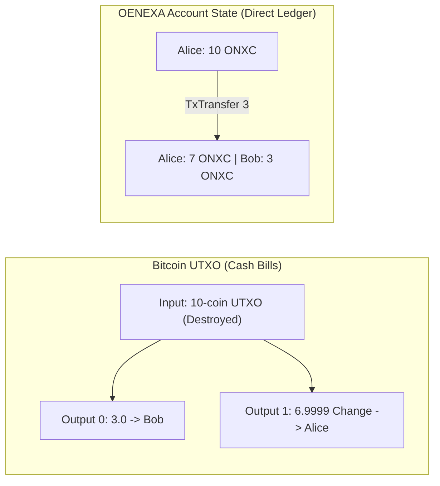

# Stage 3: Bitcoin Basics & UTXO vs. Account Models

> **Where You Are in the Blockchain Developer Path**
> Programming Languages $\to$ Cryptography $\to$ **`[3. Bitcoin Basics]`** $\to$ Ethereum $\to$ Solidity $\to$ Smart Contracts $\to$ Web3 Projects $\to$ Security $\to$ DeFi $\to$ Blockchain Core $\to$ Build Your Own Blockchain

---

## 1. Why Every Blockchain Developer Starts With Bitcoin

Before Bitcoin (launched in 2009), digital money always failed the **Double-Spend Problem**: copying an MP3 file or PDF costs zero, so without a central bank, what stopped Alice from copying the same digital coin and spending it at two shops?

Bitcoin combined **cryptographic signatures**, **Merkle trees**, and **Proof-of-Work (Nakamoto Consensus)** to solve double-spending globally without a bank. Understanding Bitcoin makes every modern design choice inside **OENEXA** immediately clear!

---

## 2. Logic 1: The UTXO Model (Cash Bills) vs. OENEXA's Account Model (Bank Ledger)

Bitcoin does **not** store `"Alice Balance = 10"`. Instead, Bitcoin works like **physical cash bills in your pocket** called **UTXOs** (*Unspent Transaction Outputs*).

### Worked Example: Paying `3` Coins When You Only Hold a `10`-Coin UTXO
Suppose Alice wants to pay Bob **`3` coins**:
- **In Bitcoin (UTXO Model):**
  1. Alice holds one unspent `10`-coin bill (`UTXO #1`). You **cannot tear a `$10` bill into a `$3` piece**!
  2. Alice creates a transaction that **destroys** `UTXO #1` (`Input: 10`) and prints **two brand-new UTXOs**:
     - `Output 0`: **`3.0` coins to Bob**
     - `Output 1`: **`6.9999` coins back to Alice** (**Change Output**!)
     - Remaining `0.0001` = miner fee.
  3. Notice: If Alice forgot the Change Output, the miner keeps all `7` coins as fee!
- **In OENEXA (Account Model inside Sparse Merkle Trie):**
  1. `StateDB` stores directly: `Alice.Balance = 10 ONXC`, `Bob.Balance = 0 ONXC`.
  2. `TxTransfer(From: Alice, To: Bob, Amount: 3 ONXC)` updates integers directly:
     - `Alice.Balance`: `10 -> 7` (minus `210` nano-ONXC fee)
     - `Bob.Balance`: `0 -> 3`
  3. No "change outputs" required — much cleaner for **smart contracts** (`OenexaVM`) and **DeFi**!

*(Bonus engineering insight: Notice how **OENEXA's Shielded Pool** in Chapter 10 combines the best of BOTH worlds! Public accounts use the simple **Account model**, while private shielded transfers use **Note Commitments + Nullifiers**, which behave like privacy-preserving UTXOs!)*

---

## 3. Logic 2: Proof-of-Work (Mining Race) vs. OENEXA BFT Consensus

How does Bitcoin pick who writes the next block?
1. Miners bundle transactions and repeatedly hash the block header while changing a random `nonce` number until the hash starts with many leading zeros (for example `0000000000000000000abc...`).
2. **Target Block Time:** `~10 minutes` (`600` seconds).
3. **Probabilistic Finality & Temporary Forks:** If two miners solve a puzzle across the ocean at the same second, the network temporarily splits into two competing tips until one grows longer (**Longest Chain Rule**). Merchants must wait **`~6` blocks (`~60 minutes`)** before trusting a large payment!

Compare that to **OENEXA BFT**:
- No wasteful puzzle racing — designated staked validators take turns (`height % N`) every **`2 seconds`**.
- When `> 2/3` of voting power signs `Precommit`, the block hits **100% irreversible instant finality** in ~2 seconds with zero forks!

---

## 4. Quick Comparison Matrix for Developers

| Concept             | Bitcoin (Gen-1)                       | OENEXA (Post-Quantum L1)                                            |
|:--------------------|:--------------------------------------|:--------------------------------------------------------------------|
| **State Model**     | UTXO set (outputs consumed once)      | Accounts (`Sparse Merkle Trie`) + Private `Notes` (`Shielded Pool`) |
| **Signatures**      | Classical `secp256k1` ECDSA / Schnorr | Post-Quantum NIST **`ML-DSA-65`** (FIPS 204)                        |
| **Hash Function**   | Double `SHA-256`                      | FIPS 202 **`SHA-3-256`**                                            |
| **Consensus**       | Proof-of-Work (`~10 min` blocks)      | BFT Proof-of-Stake (`2s` blocks)                                    |
| **Finality**        | Probabilistic (`~6 confirmations`)    | Instant (`1 block`, zero reorgs)                                    |
| **Programmability** | Limited non-Turing `Script` stack     | Turing-complete **`OenexaVM`** (`wazero` WebAssembly)               |

---

## Student Practice Exercises (With Answers)

1. **Exercise 1 (Change Output Mistake):** In a UTXO chain, Alice owns one `5`-coin UTXO, spends it to pay Bob `2` coins, and creates only ONE output (`2 -> Bob`). Where do the missing `3` coins go?  
   

Show Answer

   All `3` unallocated coins become the **transaction fee** claimed by the block miner! UTXO transactions must explicitly include a Change Output back to the sender.
   

2. **Exercise 2 (Why Accounts for Smart Contracts):** Why did OENEXA and Ethereum adopt an Account model instead of pure UTXO for general smart contracts?  
   

Show Answer

   Smart contracts (like lending pools, AMMs, or multisig vaults) need persistent shared global storage slots (`onxc_get` / `onxc_set`) updated by many concurrent users cleanly without chasing fragmented UTXO bills.
   

