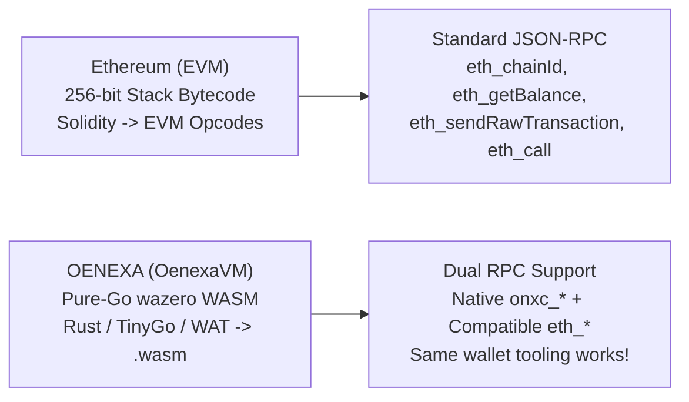

# Stage 4: Ethereum, the EVM World Computer & Web3 Compatibility

> **Where You Are in the Blockchain Developer Path**
> Programming Languages $\to$ Cryptography $\to$ Bitcoin Basics $\to$ **`[4. Ethereum]`** $\to$ Solidity $\to$ Smart Contracts $\to$ Web3 Projects $\to$ Security $\to$ DeFi $\to$ Blockchain Core $\to$ Build Your Own Blockchain

---

## 1. Everyday Analogy: From Shared Calculator to Shared World Computer

Bitcoin proved a decentralized network can track *money* safely. **Ethereum** asked the next big question in 2015:
*"What if every node runs the same **shared virtual computer** so developers can deploy any unstoppable program — tokens, voting systems, decentralized exchanges, or vaults — right onto the ledger?"*

---

## 2. Core Concepts Every Ethereum & OENEXA Developer Must Know

### Concept A: Two Types of Accounts
In Ethereum and Account-based Layer-1s like OENEXA (`Account` in `internal/state/statedb.go`), every `Address` behaves as either:
1. **Externally Owned Account (EOA)**: Controlled by a human/bot with a private key (`CodeHash` is empty). Sends transfers and initiates calls.
2. **Contract Account**: Controlled strictly by its immutable stored bytecode (`CodeHash` points to deployed contract code, `StorageRoot` commits its persistent storage slots). Executes automatically whenever called by a transaction!

### Concept B: The World State Transition Function
At every block, the chain behaves like one deterministic math function:
$$\text{State}_{n+1} = \Upsilon(\text{State}_n, \text{Block}_{n+1})$$
- **`Nonce`**: Stops replay attacks (`0, 1, 2...`).
- **`Balance`**: Held in smallest integer unit (`wei` = $10^{-18}$ on Ethereum; **`nano-ONXC` = $10^{-9}$** on OENEXA).
- **`Gas` & EIP-1559 Fees**: Prevents infinite loops (`GasLimit`, burned `BaseFee` targeting `50%` block utilization, plus `PriorityTip` — which OENEXA directly implements in `internal/core/fee.go`!).

### Concept C: EVM Stack Architecture vs. `OenexaVM` WebAssembly

---

## 3. How OENEXA Bridges Web3 & Ethereum Developer Workflows (`internal/rpc/api.go`)

Notice how thoughtful OENEXA's RPC layer is for Web3 engineers:
If you already know Ethereum JSON-RPC (`eth_getBalance`, `eth_getTransactionCount`, `eth_sendRawTransaction`, `eth_call`, `eth_getTransactionReceipt`, `eth_gasPrice`, `eth_blockNumber`, `eth_chainId`), **`oenexa-node` supports BOTH**:
1. **Native sovereign `onxc_*` methods** (`onxc_chainInfo`, `onxc_getTokenomics`, `onxc_getTurnstileStatus`, `onxc_getShieldedBalance`).
2. **Web3-compatible `eth_*` / `net_*` / `web3_*` aliases** (even normalizing 20-byte `0x...` addresses right-aligned inside `HexToAddress`!).

### Worked Example: Same Concept Across Ethereum Tools & OENEXA
- **Query balance:** `eth_getBalance(["0x1122...3344"])` OR `onxc_getBalance(["onxca1b2..."])`
- **Dry-run contract view:** `eth_call` OR `onxc_call` (runs `ExecutionContext{ReadOnly: true}`!)
- **Dynamic fee check:** `eth_gasPrice` OR `onxc_gasPrice` / `onxc_feeEstimate`

---

## 4. Key Improvements OENEXA Adds Beyond Classical Ethereum

| Area | Legacy EVM Chain | OENEXA Design |
| :--- | :--- | :--- |
| **Quantum Resistance** | `secp256k1` ECDSA (vulnerable to Shor's algorithm) | Post-quantum **`ML-DSA-65`** signatures + **`ML-KEM-768`** encryption |
| **Hash & Trie** | `Keccak-256` / MPT hex nibbles | FIPS 202 **`SHA-3-256`** / Fixed `256`-bit binary **Sparse Merkle Trie** |
| **Native Privacy** | All EOA balances public | Dual-Pool **Shielded Notes + Nullifiers + Turnstile** |
| **VM Portability** | Custom EVM opcodes | Standard **WebAssembly (`wazero`)** |
| **Block Finality** | `12s` slots + epoch finality delay | **`2s`** instant BFT finality |

---

## Student Practice Exercises (With Answers)

1. **Exercise 1 (Dry-Run vs. On-Chain Tx):** Why does calling a `view` contract method via `eth_call` / `onxc_call` cost **zero gas fees** on-chain?  
   

Show Answer

   Because your local RPC node runs the contract in `ReadOnly = true` mode against its current state snapshot without broadcasting a signed transaction or changing `StateRoot`.
   

2. **Exercise 2 (Compatibility):** How can a 20-byte Web3 wallet address (`40` hex characters) be queried on OENEXA (`32`-byte addresses)?  
   

Show Answer

   `crypto.HexToAddress` automatically strips `"0x"` and right-aligns 20-byte addresses into the lower 20 bytes (`addr[12:32]`) of the 32-byte address.
   

