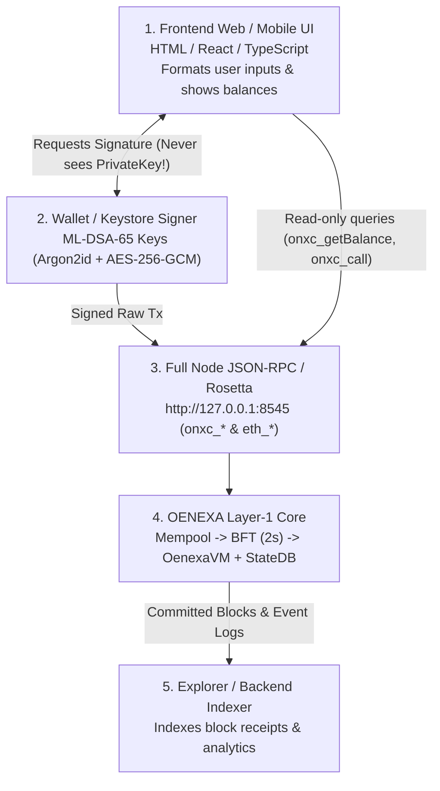

# Stage 7: Web3 Projects — End-to-End dApp & Integration Blueprint

> **Where You Are in the Blockchain Developer Path**
> Programming Languages $\to$ Cryptography $\to$ Bitcoin Basics $\to$ Ethereum $\to$ Solidity $\to$ Smart Contracts $\to$ **`[7. Web3 Projects]`** $\to$ Security $\to$ DeFi $\to$ Blockchain Core $\to$ Build Your Own Blockchain

---

## 1. How a Real Web3 Application Fits Together (Full Stack Picture)

Beginners often ask: *"Does my whole website live inside the blockchain?"*
**No!** Storing photos, CSS, and buttons on-chain would be wildly slow and expensive. Instead, a clean Web3 project separates **UI/Off-Chain Rendering** from **On-Chain Verifiable Rules**:



---

## 2. Worked Project Blueprint 1: Campus ONXC Balance Checker + Faucet UI

**Goal:** Build a 1-page dashboard where students paste their `onxc...` address, view their live balance (`nano-ONXC` + `ONXC`), current network `BaseFee`, and `BlockHeight`.

### Exact Frontend Fetch Logic (JavaScript)
```javascript
async function callOenexaRPC(method, params = []) {
  const res = await fetch("http://127.0.0.1:8545/", {
    method: "POST",
    headers: { "Content-Type": "application/json" },
    body: JSON.stringify({ jsonrpc: "2.0", id: 1, method, params }),
  });
  const payload = await res.json();
  if (payload.error) throw new Error(payload.error.message);
  return payload.result;
}

// Worked Student Query Flow:
const chain = await callOenexaRPC("onxc_chainInfo");
const bal   = await callOenexaRPC("onxc_getBalance", [studentAddress]);
const fees  = await callOenexaRPC("onxc_feeEstimate");
// Display: `${bal.balance_onxc} ONXC | BaseFee: ${fees.base_fee} nano-ONXC`
```

Notice how your app handles precision safely: always do transfer math in **BigInt `nano-ONXC`**, and divide by `1_000_000_000` *only at the very last step* when rendering text on screen!

---

## 3. Worked Project Blueprint 2: Post-Quantum Club Treasury Multisig

**Goal:** Manage a `10,000 ONXC` hackathon prize pool so no single officer can run away with funds.
- **Smart Contract Layer:** Use `oenexa-node/internal/contracts/multisig/multisig.go` deployed via `TxDeploy`.
- **Step 1 (Setup):** President collects `Alice`, `Bob`, `Carol`'s `1,952`-byte `ML-DSA-65` public keys and sends `InitMultisig(threshold = 2, ownerCount = 3, pubkeys...)`.
- **Step 2 (Proposal & Offline Co-Signing):** To award `500 ONXC` to the winning team (`WinnerAddr`):
  1. App constructs `[WinnerAddr (32B) || 500e9 (8B)]`.
  2. `Alice` signs with her `keystore.json` -> `3,309`-byte `sigA`.
  3. `Carol` signs independently -> `3,309`-byte `sigC`.
- **Step 3 (On-Chain Execution):** App sends `TxCall` carrying `[WinnerAddr || 500e9 || 2 || sigA || sigC]` (`6,662` bytes). `OenexaVM` verifies both signatures and emits the `500 ONXC` payout!

---

## 4. Worked Project Blueprint 3: Exchange Deposit Watcher (`Rosetta API`)

When building an exchange backend that accepts ONXC deposits cleanly without reorg risk:
1. Poll `POST /network/status` on Rosetta (`internal/rosetta`) to learn latest committed `current_block_identifier.index`.
2. Because OENEXA BFT finality is **instant in 1 block (`2s`)**, every committed block at `height` can be processed **once** cleanly (`POST /block` with `height`), checking `TRANSFER` operations targeting customer deposit addresses!
3. For cold-storage withdrawals, build payloads via `/construction/payloads`, move bytes to an offline hardware signer for `ML-DSA-65` signing, combine via `/construction/combine`, and broadcast via `/construction/submit`.

---

## 5. Production Web3 Developer Checklist

- [ ] Validate `HexToAddress` format (strip `onxc` or `0x`, enforce `32` or `20` bytes) *before* sending a transaction!
- [ ] Always query `onxc_getTransactionCount` for fresh `Nonce` and `onxc_feeEstimate` for safe `GasPrice`.
- [ ] Handle `TxReceipt` confirmation checks cleanly (`status` check after `2s` block interval).
- [ ] Keep private keys inside encrypted keystores / signers — **never** embed private keys inside frontend JavaScript!

---

## Student Practice Exercises (With Answers)

1. **Exercise 1 (Transaction Precision):** A student writes a React input box where a user types `0.15 ONXC`. What integer value should your Web3 frontend send inside `Transaction.Amount`?  
   <details><summary>Show Answer</summary>
   `150_000_000` (`0.15 * 1_000_000_000` `nano-ONXC`), computed using integer string/BigInt decimal parsing so floating point error never sneaks in!
   </details>

2. **Exercise 2 (Receipt Verification):** After submitting `onxc_sendRawTransaction` and receiving a `tx_hash`, why should your dApp check `onxc_getTransactionReceipt(tx_hash)` before telling the user *"Vote counted!"*?  
   <details><summary>Show Answer</summary>
   `sendRawTransaction` only proves the tx entered the Mempool; checking `getTransactionReceipt` proves it was actually mined into a finalized block AND succeeded without running out of gas or reverting!
   </details>
