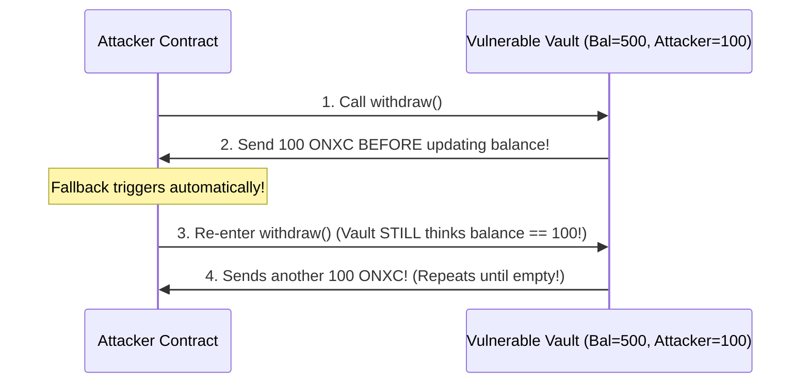

# Stage 8: Blockchain & Smart Contract Security (Attacks & Defenses)

> **Where You Are in the Blockchain Developer Path**
> Programming Languages $\to$ Cryptography $\to$ Bitcoin Basics $\to$ Ethereum $\to$ Solidity $\to$ Smart Contracts $\to$ Web3 Projects $\to$ **`[8. Security]`** $\to$ DeFi $\to$ Blockchain Core $\to$ Build Your Own Blockchain

---

## 1. Why Security Comes Before DeFi & Mainnet Code

In traditional web apps, if a bug leaks `$100,000`, support freezes an account and reverses the database. **On an immutable blockchain, exploits execute permanently in 2 seconds!** Every blockchain engineer must think like an attacker *first* so they can build unbreakable defenses.

---

## 2. Attack #1: Reentrancy (The Classic Recursive Drain)

### How the Attack Works (Everyday Analogy)
Imagine walking up to an ATM with `$100` in your account:
1. You withdraw `$100`.
2. **Bug:** The ATM hands you the `$100` cash *before* subtracting `$100` from your account balance!
3. Before the ATM finishes updating your ledger, you smash "Withdraw `$100`" again — and again — draining the entire ATM!



### Vulnerable vs. Fixed Code (**Checks-Effects-Interactions Pattern**)

**VULNERABLE:**
```solidity
function withdraw() external {
    uint256 bal = balances[msg.sender];
    require(bal > 0, "Zero");
    // BUG: Interaction BEFORE Effect!
    (bool ok, ) = msg.sender.call{value: bal}("");
    require(ok);
    balances[msg.sender] = 0; // Too late!
}
```

**SECURE (Checks $\to$ Effects $\to$ Interactions):**
```solidity
function withdraw() external {
    uint256 bal = balances[msg.sender]; // 1. CHECK
    require(bal > 0, "Zero");
    balances[msg.sender] = 0;           // 2. EFFECT (Update state FIRST!)
    (bool ok, ) = msg.sender.call{value: bal}(""); // 3. INTERACTION (Send coin LAST!)
    require(ok);
}
```
Notice the difference: if the attacker tries re-entering at Step 3, `balances[msg.sender]` is **already `0`**, so `require(bal > 0)` reverts cleanly!

---

## 3. Attack #2: Integer Overflow & Underflow

Imagine an old 8-bit car odometer at `000`: subtracting `1` wraps around backwards to **`999` (`max uint`)**!
- **In older Solidity (`< 0.8.0`)**: `uint8(0) - 1 == 255` — giving an attacker massive fake balances!
- **Defenses:**
  1. Solidity `0.8+` automatically reverts on overflow/underflow.
  2. In Go (`oenexa-node`), always check **explicitly before subtracting or adding**! Look at `internal/shielded/turnstile.go`:
     ```go
     if t.shieldedSupply < amount {
         return fmt.Errorf("shielded: insufficient shielded supply to unshield...")
     }
     t.shieldedSupply -= amount
     ```
     Because `uint64` never goes negative cleanly, checking `< amount` *first* stops underflow exploits cold!

---

## 4. Attack #3: Access Control Missing (`onlyOwner` Forgot Check)

**Bug:** Writing `function emergencyWithdraw() public` without verifying `require(msg.sender == owner)`. Anyone monitoring the mempool calls it and steals everything in 1 block.  
**OENEXA Defense:** Both explicit caller checks (`env.oen_caller()`) and **M-of-N `ML-DSA-65` Multisig** (`internal/contracts/multisig`) prevent any single key or unauthorized caller from moving club/treasury funds.

---

## 5. Attack #4: Protocol & Wallet Level Threats (How OENEXA Blocks Them)

| Attack Vector | How Attacker Tries to Cheat | Built-In Defense Inside `oenexa-node` |
| :--- | :--- | :--- |
| **Replay Attack** | Re-broadcast Alice's signed `TxTransfer` 10 times | `Nonce` checked strictly equal to `account.Nonce` and incremented atomically (`Ch. 5`). |
| **Double-Spend (Privacy)** | Spend the same Shielded Pool Note twice | `NullifierSet` rejects any repeated `nf` with `"double spend detected"` (`Ch. 10`). |
| **Validator Double-Sign** | Sign conflicting blocks $B_1, B_2$ at `(h, r)` | High-water mark (`LocalSigner.SignVote`) + **10% Equivocation Slashing** (`Ch. 8–9`). |
| **Password Brute-Force** | Crack stolen `keystore.json` on GPUs | `Argon2id` (`64 MiB` RAM/guess) + `AES-256-GCM` AEAD integrity (`Ch. 4`). |
| **CLI Password Leak** | Steal `--password=...` from `ps aux` or shell history | Pass secrets via **`ONXC_PASSWORD`** env variable instead of CLI args (`Lab 1`). |
| **Quantum Key Cracking** | Future Shor's algorithm deriving PrivKey from PubKey | NIST FIPS 204 **`ML-DSA-65`** signatures & FIPS 203 **`ML-KEM-768`** from Day 1! |
| **Out-of-Gas Half-State** | Drain gas mid-contract after half-updating storage | `OenexaVM` executes **atomic rollback** whenever execution aborts/exceeds `GasLimit`. |

---

## Student Practice Exercises (With Answers)

1. **Exercise 1 (Security Order):** You are reviewing a classmate's smart contract. Line 10 checks `amount <= stake[user]`, Line 11 transfers `amount` ONXC to `user`, and Line 12 executes `stake[user] -= amount`. Which vulnerability is present and how do you fix it?  
   <details><summary>Show Answer</summary>
   **Reentrancy!** Move Line 12 (`stake[user] -= amount`) *before* Line 11 (transferring ONXC), following **Checks $\to$ Effects $\to$ Interactions**.
   </details>

2. **Exercise 2 (Underflow Check):** In Go, `var bal uint64 = 5`. If code blindly runs `bal -= 10` without checking `bal >= 10`, what happens?  
   <details><summary>Show Answer</summary>
   Unsigned integer underflow wraps `5 - 10` around `2^64` to **`18,446,744,073,709,551,611`**! Always validate `if bal < amount { return err }` beforehand.
   </details>
