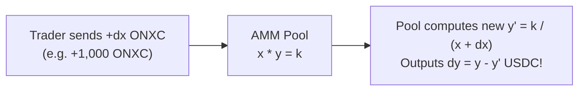

# Stage 9: DeFi Primitives (AMMs, Lending, Oracles & Staking)

> **Where You Are in the Blockchain Developer Path**
> Programming Languages $\to$ Cryptography $\to$ Bitcoin Basics $\to$ Ethereum $\to$ Solidity $\to$ Smart Contracts $\to$ Web3 Projects $\to$ Security $\to$ **`[9. DeFi]`** $\to$ Blockchain Core $\to$ Build Your Own Blockchain
>
> **Try It Visually:** Open [**Visual Lab Tab 7 — DeFi AMM & Dev Lab**](../visual-lab/index.html#devlab) to swap ONXC inside a live `x * y = k` liquidity pool and watch price slippage calculate!

---

## 1. Everyday Analogy: Automated Financial Machines Without Middlemen

**DeFi (*Decentralized Finance*)** replaces traditional banks, stock-order books, and currency-exchange counters with transparent smart contracts and native protocol engines:
1. **Swapping Coins** $\implies$ **Automated Market Maker (`AMM`)**
2. **Borrowing / Lending** $\implies$ **Over-Collateralized Lending Pool + Oracle Price Feeds**
3. **Earning Network Yield** $\implies$ **Delegated Proof-of-Stake (`ONXC` Staking)**

---

## 2. Primitive 1: Automated Market Maker (`x · y = k`)

Instead of waiting for another human buyer/seller to match your order, an **AMM** holds two token reserves inside one pool (`x = ONXC Reserve`, `y = USDC Reserve`) obeying one simple rule (**Constant Product Formula**):

$$x \times y = k \quad (\text{constant before and after every swap!})$$

### Worked Example: Swapping `1,000 ONXC` in a Pool (`0%` fee for clean intuition)
Suppose the liquidity pool currently holds:
- $x = 10,000\text{ ONXC}$
- $y = 20,000\text{ USDC}$
- **Spot Price:** `$20,000 / 10,000 = $2.00 per ONXC`
- **Constant Product $k$:** $10,000 \times 20,000 = \mathbf{200,000,000}$

Now Alice swaps **$\Delta x = 1,000\text{ ONXC}$** into the pool:
1. **New ONXC Reserve ($x'$):** $10,000 + 1,000 = \mathbf{11,000\text{ ONXC}}$
2. **New USDC Reserve ($y'$):** Must keep $x' \times y' = k$:
   $$y' = \frac{200,000,000}{11,000} \approx \mathbf{18,181.82\text{ USDC}}$$
3. **USDC Paid to Alice ($\Delta y = y - y'$):**
   $$20,000 - 18,181.82 = \mathbf{1,818.18\text{ USDC}}$$
4. **Effective Price & Slippage!**
   - Alice bought at `$1,818.18 / 1,000 = $1.818 per ONXC` instead of `$2.00` (**`~9.1%` price impact / slippage** because her trade equaled `10%` of the pool!).
   - *Key DeFi Insight:* Deeper pools (`$10M` reserve) suffer much tiny slippage (`< 0.1%`), whereas shallow pools move price sharply! (Real AMMs also deduct e.g. `0.3%` trading fee added into reserves for Liquidity Providers!)

---

## 3. Primitive 2: Over-Collateralized Lending & Median Oracles

Unlike bank loans that check your credit score, anonymous DeFi lending requires locking **more collateral than you borrow** (**Over-Collateralization**) — monitored continuously using OENEXA's **Byzantine-safe Price Oracles** (`internal/oracle/node.go`)!

### Worked Borrowing & Liquidation Example
Suppose a lending protocol sets **Max Loan-to-Value (`LTV`) = `60%`** and **Liquidation Threshold = `80%`**:
1. **Deposit:** Alice deposits **`1,000 ONXC`**.
2. **Oracle Price (`ONXC-USD`):** 5 staked `OracleNode` validators attest prices `[1.98, 2.00, 2.00, 2.01, 99.00]`. `AggregateReports` takes the **median = `$2.00`** (`2_000_000` micro-USD), ignoring the outlier!
   - Alice's collateral worth: $1,000 \times \$2.00 = \mathbf{\$2,000}$.
3. **Borrow:** At `60%` max LTV, Alice safely borrows up to **`$1,200`**. She borrows **`$1,000`** (`50%` LTV).
4. **Market Drop Simulation:** Suppose `ONXC-USD` falls to **`$1.20`**:
   - Collateral worth drops to $1,000 \times \$1.20 = \mathbf{\$1,200}$.
   - Debt / Collateral ratio hits $\$1,000 / \$1,200 = \mathbf{83.3\%} > 80\%$ threshold!
   - **Liquidation triggers automatically:** Liquidators repay part of Alice's `$1,000` debt and claim collateral at a small liquidation bonus, keeping the lending pool 100% solvent!

---

## 4. Primitive 3: Native Protocol Yield (Delegated Staking on OENEXA)

Unlike synthetic yields funded by risky leverage, OENEXA staking yield comes natively from protocol `BlockReward` issuance + `PriorityTip` fees (`internal/core/tokenomics.go`, `internal/consensus/delegation.go`):
- Minimum delegation: `0.001 ONXC` (`1,000,000 nano-ONXC`).
- Yield formula (`StakingYieldEstimate`):
  $$\text{APY (\%)} = \frac{\text{BlockReward}(h) \times 15,778,800}{\text{CirculatingSupply}(h) \times \text{stakedRatio}} \times 100$$
- Delegators pick reliable validators (`5%` default commission) to share block subsidies while risking proportional `10%` slashing if their validator double-signs.

---

## Student Practice Exercises (With Answers)

1. **Exercise 1 (`x * y = k` Calculation):** An AMM pool holds `5,000 ONXC` and `5,000 USDC` ($k = 25,000,000$). Ignoring fees, if Bob adds `5,000 ONXC` into the pool (`x' = 10,000`), how many `USDC` does Bob receive?  
   

Show Answer

   `y' = 25,000,000 / 10,000 = 2,500 USDC`. Bob receives `5,000 - 2,500 = 2,500 USDC`! Notice doubling pool `x` halves `y` (`50%` slippage!).
   

2. **Exercise 2 (Oracle Safety):** Why must DeFi lending pools read `ONXC-USD` using OENEXA's multi-reporter **median oracle** rather than reading spot ratio `y / x` from a tiny single AMM pool?  
   

Show Answer

   A single small AMM pool's spot price can be temporarily manipulated inside 1 transaction/flash-swap to trigger fake liquidations or inflated borrows, whereas multi-node median oracle aggregation resists single-source price spikes!
   

