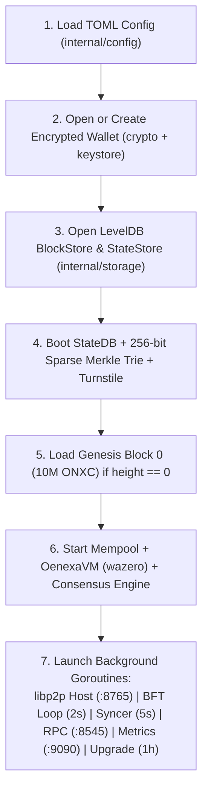

# Stage 10: Blockchain Core — Deep Inside `oenexa-node` Internals

> **Where You Are in the Blockchain Developer Path**
> Programming Languages $\to$ Cryptography $\to$ Bitcoin Basics $\to$ Ethereum $\to$ Solidity $\to$ Smart Contracts $\to$ Web3 Projects $\to$ Security $\to$ DeFi $\to$ **`[10. Blockchain Core]`** $\to$ Build Your Own Blockchain

---

## 1. How a Full Node Boots (`node.New` in `internal/node/node.go`)

When you run `oenexa-node start`, the node wires all subsystems in strict dependency order so consensus never starts before databases and keys exist:

---

## 2. Package-by-Package Map of `oenexa-node`

Every directory inside `oenexa-node` follows **strict Layer-1 blockchain-only boundaries** (no Exchange UIs, no KYC/identity UIs, no off-chain business bloat):

| Package                                | Core Responsibilities                   | Key Types & Guarantees                                                                                                       |
|:---------------------------------------|:----------------------------------------|:-----------------------------------------------------------------------------------------------------------------------------|
| `internal/core`                        | Blocks, Transactions, Fees, Tokenomics  | `Block`, `Transaction`, `NextBaseFee`, `BlockReward`, `MaxSupply = 100M ONXC`.                                               |
| `internal/crypto`                      | Quantum-safe Keys, Hashes, Addresses    | `Wallet`, `ML-DSA-65`, `SHA-3-256` (`Hash256`, `HashMany`), `HexToAddress`.                                                  |
| `internal/keystore`                    | On-disk Password Encryption             | `Argon2id` (`64 MiB`) + `AES-256-GCM` `keystore.json`.                                                                       |
| `internal/mempool`                     | Priority Waiting Room & Flood Caps      | Max-heap by `GasPrice` desc + `Timestamp` asc; `DefaultMaxSize = 100k`, `MaxSenderQueueLen = 10k`.                           |
| `internal/mpt`                         | Authenticated Account State Tree        | `256`-bit Sparse Merkle Trie, `zeroHash` compression, `"t:"` DB prefix, order-independent `StateRoot`.                       |
| `internal/state`                       | Transaction Execution & Block Processor | Balance updates, `Nonce` verification, `BaseFee` burn, `PriorityTip` payout, atomic state commits.                           |
| `internal/shielded`                    | Dual-Pool Privacy Engine                | `Note`, `"OENEXA_NOTE_CM"`, `"OENEXA_NULLIFIER"`, `NullifierSet`, `ML-KEM-768`, `ViewingKey`, `Turnstile`.                   |
| `internal/vm`                          | Sandboxed Smart Contract Runtime        | Pure-Go `wazero` WebAssembly, compiled module cache, `ExecutionContext` (`ReadOnly` + GasLimit), 8 `env.oen_*` ABI calls.    |
| `internal/consensus`                   | BFT Engine, Staking & Slashing          | `StepPropose -> Prevote -> Precommit -> Commit`, `LocalSigner` anti-slashing, `10%` equivocation slash, `DelegationManager`. |
| `internal/storage`                     | Persistent Key-Value Storage            | LevelDB `BlockStore` & `StateStore` with atomic write batches (`NewBatch() -> Write()`).                                     |
| `internal/p2p`                         | Peer Mesh & Anti-Spam                   | `libp2p` host, mDNS discovery, 5 gossip topics (`/oenexa/tx`, `block`, `vote`, `syncreq`, `syncres`), peer reputation.       |
| `internal/sync`                        | Automatic Block Catch-Up                | `Syncer` polling every `5s` in `64`-block verified batches.                                                                  |
| `internal/rpc` & `rosetta`             | External APIs                           | JSON-RPC 2.0 (`onxc_*` + `eth_*`), Rosetta v1.4.14 REST + air-gapped construction.                                           |
| `internal/rollup`, `oracle`, `upgrade` | L2 Bridge, Valuation & Upgrades         | L2 batch sequencer, median `ONXC-*` oracles, `SHA-3-256`-verified binary upgrades + `Scheduler`.                             |

---

## 3. End-to-End Block Production Pipeline (Every 2 Seconds)

Trace what happens inside the core engine during a single `2`-second block tick:
1. **Mempool Fetch:** Proposer `h % |Validators|` calls `mempool.PopBatch(MaxTxPerBlock, BlockGasLimit)`.
2. **Pre-Execution Snapshot:** Clone/snapshot StateDB + Turnstile in memory so invalid blocks never corrupt committed disk data.
3. **Sequential Execution:** For each transaction `tx`:
   - Check `tx.Nonce == sender.Nonce` and `sender.Balance >= tx.Amount + tx.GasLimit * tx.GasPrice`.
   - Deduct `gasUsed * BaseFee` (**burn!**), credit `gasUsed * tip` to validator reward pool.
   - Dispatch `TxType` (`0x01` transfer, `0x02`/`0x03` `OenexaVM`, `0x04`/`0x05` staking, `0x06`–`0x08` Shielded Pool + `Turnstile`).
   - Increment `sender.Nonce++`.
4. **Root Computation:** Flush updated accounts into the `256`-bit **Sparse Merkle Trie** $\implies$ canonical 32-byte **`StateRoot`**. Verify `Turnstile.VerifyInvariant(expectedTotal)`.
5. **BFT Agreement:** Sign header (`ML-DSA-65`), collect `>= floor(2N/3) + 1` `Prevotes` and `Precommits`.
6. **Atomic Commit:** Write `Block`, `Receipts`, `"acc:"`, and `"t:"` trie nodes to LevelDB in one atomic batch, then purge mined transactions from Mempool!

---

## Student Practice Exercises (With Answers)

1. **Exercise 1 (Crash Safety):** Suppose a validator node loses wall power 90% of the way through updating `100` accounts inside Block `42`. Why won't LevelDB wake up with 90 updated accounts and 10 un-updated ones?  
   

Show Answer

   Dirty updates accumulate inside an in-memory batch (`NewBatch()`) during execution and flush to LevelDB in one atomic `Write()` operation only after BFT consensus commits the block.
   

2. **Exercise 2 (Repository Boundaries):** Should an exchange order-matching UI or KYC form live inside `oenexa-node`?  
   

Show Answer

   No! `oenexa-node` is strictly Layer-1 blockchain-only (consensus, state, cryptography, VM, storage, P2P, RPC/Rosetta). UIs, exchange engines, and identity platforms belong in separate specialized ecosystem repositories.
   

