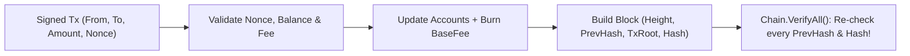

# Stage 11: Build Your Own Blockchain (Complete Hands-On Go Project)

> **Where You Are in the Blockchain Developer Path**
> Programming Languages $\to$ Cryptography $\to$ Bitcoin Basics $\to$ Ethereum $\to$ Solidity $\to$ Smart Contracts $\to$ Web3 Projects $\to$ Security $\to$ DeFi $\to$ Blockchain Core $\to$ **`[11. Build Your Own Blockchain]`**

---

## 1. The Best Way to Truly Master Blockchains: Build One!

Reading diagrams teaches *what* a blockchain does. Writing a real working blockchain in ~120 lines of Go teaches *every mechanical gear* — and mirrors the exact core ideas inside `oenexa-node` (`SHA-3-256` hashing, `PrevHash` linking, `uint64` atomic balances, `Nonce` anti-replay protection, `BaseFee` burning, and tamper verification!).

---

## 2. Architecture of Our Mini-OENEXA Blockchain (`mini_chain.go`)



Notice the **6 real blockchain guarantees** our tiny program implements:
1. Genuine **FIPS 202 `SHA-3-256`** hashes (`golang.org/x/crypto/sha3`, the exact algorithm in `oenexa-node/internal/crypto`).
2. Integer **`uint64` balances** (`1 ONXC = 1_000_000_000 nano-ONXC`).
3. **`Nonce`** anti-replay enforcement (`tx.Nonce == account.Nonce`).
4. **EIP-1559 BaseFee Burning** (`21 * 10 = 210 nano-ONXC` burned per transfer!).
5. **Cryptographic Block Linking (`PrevHash` + `Hash`)**.
6. **Live Tamper Detection** (`VerifyChain()` immediately catches modifying an old block!).

---

## 3. Complete Runnable Code (`mini_chain.go`)

Create a new folder anywhere (for example `mkdir mini-chain && cd mini-chain`), initialize Go (`go mod init mini-chain && go get golang.org/x/crypto/sha3`), and save this file as `main.go`:

```go
package main

import (
	"encoding/binary"
	"encoding/hex"
	"fmt"
	"time"

	"golang.org/x/crypto/sha3"
)

const (
	OneONXC     uint64 = 1_000_000_000
	GasTransfer uint64 = 21
	BaseFee     uint64 = 10 // 10 nano-ONXC/gas -> 210 nano-ONXC transfer fee
)

// Account tracks integer nano-ONXC balance and anti-replay Nonce.
type Account struct {
	Balance uint64
	Nonce   uint64
}

// Tx is an instruction transferring nano-ONXC from one address to another.
type Tx struct {
	From   string
	To     string
	Amount uint64 // nano-ONXC
	Nonce  uint64
}

// Block groups transactions and links cryptographically to PrevHash.
type Block struct {
	Height    uint64
	Timestamp int64
	PrevHash  [32]byte
	Txs       []Tx
	Burned    uint64
	Hash      [32]byte
}

func sha3Sum(data []byte) [32]byte {
	return sha3.Sum256(data)
}

func computeBlockHash(b *Block) [32]byte {
	var buf []byte
	var num [8]byte
	binary.BigEndian.PutUint64(num[:], b.Height)
	buf = append(buf, num[:]...)
	binary.BigEndian.PutUint64(num[:], uint64(b.Timestamp))
	buf = append(buf, num[:]...)
	buf = append(buf, b.PrevHash[:]...)
	for _, tx := range b.Txs {
		buf = append(buf, []byte(tx.From+"->"+tx.To)...)
		binary.BigEndian.PutUint64(num[:], tx.Amount)
		buf = append(buf, num[:]...)
		binary.BigEndian.PutUint64(num[:], tx.Nonce)
		buf = append(buf, num[:]...)
	}
	return sha3Sum(buf)
}

// MiniChain holds blocks, global account state, and total burned supply.
type MiniChain struct {
	Blocks      []*Block
	State       map[string]*Account
	TotalBurned uint64
}

func NewMiniChain() *MiniChain {
	genesis := &Block{
		Height:    0,
		Timestamp: time.Now().Unix(),
	}
	genesis.Hash = computeBlockHash(genesis)
	return &MiniChain{
		Blocks: []*Block{genesis},
		State: map[string]*Account{
			"Alice": {Balance: 1_000 * OneONXC, Nonce: 0},
			"Bob":   {Balance: 10 * OneONXC, Nonce: 0},
		},
	}
}

func (c *MiniChain) ProduceBlock(pending []Tx) error {
	fee := GasTransfer * BaseFee // 210 nano-ONXC burned per tx
	var executed []Tx
	var blockBurn uint64

	for _, tx := range pending {
		sender, ok := c.State[tx.From]
		if !ok {
			return fmt.Errorf("unknown sender %s", tx.From)
		}
		if tx.Nonce != sender.Nonce {
			return fmt.Errorf("invalid nonce for %s: got %d want %d", tx.From, tx.Nonce, sender.Nonce)
		}
		totalNeeded := tx.Amount + fee
		if sender.Balance < totalNeeded {
			return fmt.Errorf("insufficient funds for %s", tx.From)
		}
		if _, exists := c.State[tx.To]; !exists {
			c.State[tx.To] = &Account{}
		}
		// Apply atomic state updates
		sender.Balance -= totalNeeded
		sender.Nonce++
		c.State[tx.To].Balance += tx.Amount
		blockBurn += fee
		executed = append(executed, tx)
	}

	tip := c.Blocks[len(c.Blocks)-1]
	blk := &Block{
		Height:    tip.Height + 1,
		Timestamp: time.Now().Unix(),
		PrevHash:  tip.Hash,
		Txs:       executed,
		Burned:    blockBurn,
	}
	blk.Hash = computeBlockHash(blk)
	c.Blocks = append(c.Blocks, blk)
	c.TotalBurned += blockBurn
	return nil
}

func (c *MiniChain) VerifyChain() error {
	for i := 0; i < len(c.Blocks); i++ {
		blk := c.Blocks[i]
		if computeBlockHash(blk) != blk.Hash {
			return fmt.Errorf("block #%d hash mismatch (tampered data!)", blk.Height)
		}
		if i > 0 && blk.PrevHash != c.Blocks[i-1].Hash {
			return fmt.Errorf("block #%d PrevHash broken link!", blk.Height)
		}
	}
	return nil
}

func main() {
	chain := NewMiniChain()

	// Block 1: Alice sends 250 ONXC to Bob (Nonce 0)
	if err := chain.ProduceBlock([]Tx{
		{From: "Alice", To: "Bob", Amount: 250 * OneONXC, Nonce: 0},
	}); err != nil {
		panic(err)
	}

	// Block 2: Bob sends 50 ONXC to Carol (Nonce 0)
	if err := chain.ProduceBlock([]Tx{
		{From: "Bob", To: "Carol", Amount: 50 * OneONXC, Nonce: 0},
	}); err != nil {
		panic(err)
	}

	fmt.Println("Chain valid?:", chain.VerifyChain() == nil)
	fmt.Printf("Block #2 Hash: %s\n", hex.EncodeToString(chain.Blocks[2].Hash[:8]))
	fmt.Printf("Alice: %d nano-ONXC (Nonce=%d)\n", chain.State["Alice"].Balance, chain.State["Alice"].Nonce)
	fmt.Printf("Bob  : %d nano-ONXC (Nonce=%d)\n", chain.State["Bob"].Balance, chain.State["Bob"].Nonce)
	fmt.Printf("Carol: %d nano-ONXC (Nonce=%d)\n", chain.State["Carol"].Balance, chain.State["Carol"].Nonce)
	fmt.Printf("Total Burned Fees: %d nano-ONXC\n", chain.TotalBurned)

	// Demonstrate Replay Attack Rejection!
	errReplay := chain.ProduceBlock([]Tx{
		{From: "Alice", To: "Bob", Amount: 250 * OneONXC, Nonce: 0}, // Re-using Nonce 0!
	})
	fmt.Println("Replay attack blocked?:", errReplay != nil, "->", errReplay)

	// Demonstrate Tamper Detection on Block #1!
	chain.Blocks[1].Txs[0].Amount = 999 * OneONXC
	fmt.Println("After tampering Block #1 -> VerifyChain:", chain.VerifyChain())
}
```

---

## 4. Challenge Upgrades: Turn Your Mini-Chain Into Full Layer-1!

Once `go run main.go` works on your machine, try implementing the next 5 upgrades one by one — referencing how **`oenexa-node`** implements each one in production:

1. **Add Real Signatures (`ML-DSA-65`)**: Import `github.com/cloudflare/circl/sign/mldsa/mldsa65`, store `[1952]byte` PublicKey + `[3309]byte` Signature inside `Tx`, and reject unsigned transactions! *(See `oenexa-node/internal/crypto/wallet.go`.)*
2. **Add a Priority Mempool**: Buffer unmined transactions in a queue ordered by highest `GasPrice` instead of running `pending` immediately. *(See `oenexa-node/internal/mempool/`.)*
3. **Add Sparse Merkle Trie `StateRoot`**: Put `State` into a 256-bit binary trie and store `StateRoot` inside every `Block` header! *(See `oenexa-node/internal/mpt/`.)*
4. **Add LevelDB Persistence**: Save blocks and state to disk instead of RAM so restarting the process keeps your chain! *(See `oenexa-node/internal/storage/`.)*
5. **Add HTTP JSON-RPC + P2P**: Expose `onxc_getBalance` over `net/http` (`:8545`) and gossip blocks with `libp2p`! *(See `oenexa-node/internal/rpc/` and `internal/p2p/`.)*

Congratulations — you just completed the entire path from **Programming Languages** to **Building Your Own Post-Quantum Layer-1 Blockchain**!
