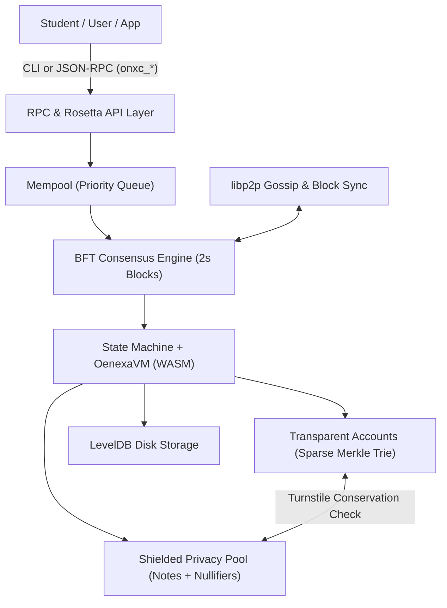

# OENEXA Blockchain & ONXC Coin — Beginner's Complete Academy

Welcome to the official **OENEXA Blockchain & ONXC Coin Documentation**.

This repository is designed specifically for **students, first-time blockchain builders, and curious learners**. You do **not** need prior blockchain or advanced cryptography experience to read this guide. Every chapter starts with a clear everyday analogy, builds the intuition step by step, shows visual diagrams, walks through concrete math examples, and connects directly to the real working Go code inside `oenexa-node`.

> **Core Names to Remember**
> - **OENEXA** — The sovereign, quantum-resistant **Layer-1 Blockchain Network**.
> - **ONXC** — **Open Network for the Next Generation Coin**, the native digital currency of OENEXA.
> - **nano-ONXC** — The smallest indivisible unit of ONXC ($1\text{ ONXC} = 1,000,000,000\text{ nano-ONXC}$).

---

## Learning Roadmap (Step-by-Step Curriculum)

Read the chapters in order from **Module 1** to **Module 6**, or jump directly to the topic you want to learn.

### Module 1: Foundations — How Blockchain & ONXC Money Work
1. [**What Is a Blockchain & What Is OENEXA?**](./01-foundations/01_what_is_blockchain_and_oenexa.md)  
   *Centralized vs. decentralized notebooks, blocks, cryptographic chains, and OENEXA's 2-second Layer-1 architecture.*
2. [**What Is ONXC Coin & Tokenomics?**](./01-foundations/02_what_is_onxc_coin_and_tokenomics.md)  
   *ONXC & nano-ONXC units, the 100 million hard supply cap, genesis allocations, block rewards, halving eras every 1,000,000 blocks, and proof of finite supply.*

### Module 2: Cryptography — How Security & Wallets Work Without Banks
3. [**Digital Fingerprints (Hashing) & Wallet Addresses**](./02-cryptography/01_hashing_and_addresses.md)  
   *How FIPS 202 `SHA-3-256` creates tamper-proof fingerprints and 32-byte `onxc...` addresses.*
4. [**Post-Quantum Signatures (`ML-DSA-65`) & Encrypted Keystores**](./02-cryptography/02_post_quantum_signatures_mldsa65.md)  
   *Why future quantum computers threaten legacy signatures, how NIST `ML-DSA-65` lattice math protects ONXC, and how `Argon2id` + `AES-256-GCM` lock your private key on disk.*

### Module 3: Transactions, Fees & Network State
5. [**How Transactions Work Step-by-Step**](./03-transactions-and-state/01_how_transactions_work.md)  
   *The 8 ONXC transaction types, nonces against replay attacks, signing payloads, and tracing a 250 ONXC transfer end to end.*
6. [**The Mempool (Waiting Room) & Dynamic Fees (EIP-1559)**](./03-transactions-and-state/02_mempool_and_dynamic_fees.md)  
   *How pending transactions queue in a max-heap, why a simple transfer costs just 210 nano-ONXC (`$0.00000021` at `$1`/ONXC), base-fee burning, and validator priority tips.*
7. [**Global Account State & The Sparse Merkle Trie**](./03-transactions-and-state/03_state_and_sparse_merkle_trie.md)  
   *How LevelDB stores balances and how a 256-bit Sparse Merkle Trie lets anyone verify any balance using a ~1 KB cryptographic proof.*

### Module 4: Consensus, Validators & Staking
8. [**BFT Consensus & Instant Finality**](./04-consensus-and-validators/01_bft_consensus_and_finality.md)  
   *Solving the Byzantine Generals Problem with round-robin proposers, `Prevote` -> `Precommit` -> `Commit` rounds, and the mathematical proof that forks are impossible.*
9. [**Staking, Delegation & Slashing**](./04-consensus-and-validators/02_staking_delegation_and_slashing.md)  
   *How validators secure the chain, how everyday users delegate ONXC to earn staking rewards, unbonding delays, and 10% equivocation penalties.*

### Module 5: Privacy, Smart Contracts, P2P & Scaling
10. [**The Dual-Pool Privacy Engine (Shielded Pool & Turnstile)**](./05-privacy-contracts-and-scaling/01_shielded_privacy_pool.md)  
    *Public vs. private balances, `ML-KEM-768` encrypted notes, nullifiers preventing double-spending, selective viewing keys for audits, and the Turnstile conservation law.*
11. [**Smart Contracts & The OenexaVM WebAssembly Runtime**](./05-privacy-contracts-and-scaling/02_smart_contracts_wasm_vm.md)  
    *Running sandboxed WebAssembly (`wazero`) programs with deterministic gas metering, host ABI functions, and post-quantum M-of-N multisig wallets.*
12. [**P2P Networking, Block Sync, L2 Rollups, Oracles & Upgrades**](./05-privacy-contracts-and-scaling/03_p2p_sync_rollups_oracles_and_upgrades.md)  
    *How nodes discover peers via `libp2p`, catch up missing blocks, scale throughput with Layer-2 rollups, read sovereign ONXC price feeds, and safely upgrade binaries.*

### Module 6: Hands-On Student Labs
13. [**Lab 1: Running Your First OENEXA Node & Using the CLI**](./06-hands-on-guides/01_run_a_node_and_cli_tutorial.md)  
    *Compile `oenexa-node` and `oenexa-cli`, create an encrypted wallet, start a local devnet, and send your first ONXC.*
14. [**Lab 2: Querying JSON-RPC (`onxc_*`) & Exchange Rosetta API**](./06-hands-on-guides/02_rpc_and_rosetta_api_guide.md)  
    *Make real API requests with `curl` or PowerShell and learn how exchanges use Rosetta v1.4.14.*

### Reference
- [**A-to-Z Blockchain & ONXC Student Glossary**](./GLOSSARY.md)

---

## The Entire OENEXA Stack in One Picture

---

## Source Code Companion

Every technical value, formula, and protocol rule in these lessons corresponds directly to the reference Go implementation in the sibling **`oenexa-node`** repository (`cmd/node`, `cmd/oenexa-cli`, `internal/core`, `internal/crypto`, `internal/consensus`, `internal/mpt`, `internal/shielded`, `internal/vm`, `internal/rpc`, `internal/rosetta`).
