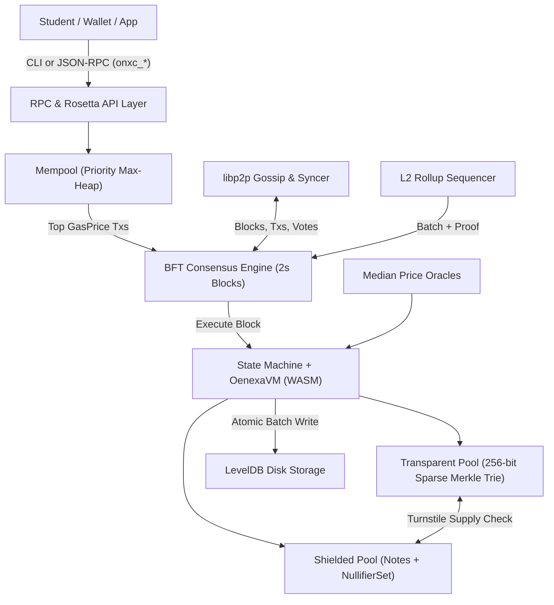

# OENEXA Blockchain & ONXC Coin — Beginner's Visual Academy

Welcome to the official **OENEXA Blockchain & ONXC Coin Visual Learning System**.

This repository is written from scratch for **students, first-time blockchain learners, and visual thinkers**. Every single protocol rule ("logic") is taught in four clear layers:
1. **Everyday Analogy** — zero jargon at the start.
2. **Visual Diagram** — see how the pieces connect using diagrams and step-by-step layouts.
3. **Worked Concrete Example** — real numbers, valid flows, and error/attack cases traced step by step.
4. **Interactive Visual Studio** — open [`visual-lab/index.html`](./visual-lab/index.html) offline in any web browser to test hashing, halvings, dynamic fees, Merkle proofs, BFT voting, slashing, the privacy Turnstile, and WASM contracts with your own inputs!

> **Core Names to Remember**
> - **OENEXA** — The sovereign, quantum-resistant **Layer-1 Blockchain Network** (`ChainID = 1`).
> - **ONXC** — **Open Network for the Next Generation Coin**, the native currency of OENEXA.
> - **nano-ONXC** — The smallest indivisible unit ($1\text{ ONXC} = 1,000,000,000\text{ nano-ONXC}$).

---

## Interactive Visual Learning Studio (Open in Any Browser!)

Launch **[`visual-lab/index.html`](./visual-lab/index.html)** directly in Chrome, Edge, Firefox, or Safari (works 100% offline with real `SHA-3-256` math!):

| Interactive Lab Tab | What You Can Experiment With Visually | Related Chapters |
| :--- | :--- | :--- |
| [**1. Blockchain & Hash Lab**](./visual-lab/index.html#blockchain) | Edit Block 1 transactions to see chain links break red, inspect 256-bit `SHA-3-256` avalanche bit-flips, and derive `onxc...` addresses live. | Ch. 1, Ch. 3 |
| [**2. ONXC Tokenomics Lab**](./visual-lab/index.html#tokenomics) | Scrub across Block Heights `0` to `8,000,000+`, watch the supply curve approach the `100,000,000 ONXC` hard cap, convert `nano-ONXC`, and calculate staking APY. | Ch. 2 |
| [**3. Mempool & Gas Lab**](./visual-lab/index.html#fees) | Drag block fullness (`0%` to `100%`) to watch EIP-1559 `BaseFee` surge/cool, pack priority-queue transactions, and see burned vs. validator tip fees. | Ch. 5, Ch. 6 |
| [**4. Merkle Trie Proof Lab**](./visual-lab/index.html#trie) | Change Alice/Bob/Carol/Dave balances, highlight exact Merkle sibling proof paths, prove empty accounts via `zeroHash`, and verify order independence. | Ch. 7 |
| [**5. BFT & Slashing Lab**](./visual-lab/index.html#bft) | Toggle validators (`Honest`, `Offline`, `Double-Sign`), step through `Propose -> Prevote -> Precommit -> Commit`, watch `10%` slashing fire, and split staking rewards. | Ch. 8, Ch. 9 |
| [**6. Privacy Turnstile & VM Lab**](./visual-lab/index.html#privacy) | Shield and unshield ONXC notes, trigger a live double-spend nullifier rejection, inspect `Transparent + Shielded == TotalSupply`, and trace OenexaVM gas rollbacks. | Ch. 10, Ch. 11 |
| [**7. Dev Path & DeFi AMM Lab**](./visual-lab/index.html#devlab) | Swap ONXC inside a live `x * y = k` DeFi pool, compare UTXO bills vs. OENEXA accounts, and simulate a Reentrancy attack vs. Checks-Effects-Interactions defense. | Developer Mastery |

---

## Complete 11-Stage Blockchain Developer Learning Path

Follow this end-to-end engineering progression to go from programming fundamentals all the way to building your own post-quantum Layer-1 blockchain:

```mermaid
flowchart LR
    P1["1. Languages\n(Go & WASM)"] --> P2["2. Cryptography\n(SHA-3 & ML-DSA-65)"]
    P2 --> P3["3. Bitcoin Basics\n(UTXO & PoW)"]
    P3 --> P4["4. Ethereum\n(World Computer)"]
    P4 --> P5["5. Solidity\n(Contract Logic)"]
    P5 --> P6["6. Smart Contracts\n(OenexaVM WASM)"]
    P6 --> P7["7. Web3 Projects\n(RPC & dApps)"]
    P7 --> P8["8. Security\n(Attacks & Fixes)"]
    P8 --> P9["9. DeFi\n(AMMs & Oracles)"]
    P9 --> P10["10. Blockchain Core\n(oenexa-node)"]
    P10 --> P11["11. Build Your Own\nMini Blockchain"]
```

| Stage | Topic | Guide |
| :--- | :--- | :--- |
| **1** | **Programming Languages In-Depth (Go, WASM, Rust, JS, Solidity & `oenexa-node`)** | [**00-developer-roadmap/01_programming_languages_and_oenexa_depth.md**](./00-developer-roadmap/01_programming_languages_and_oenexa_depth.md) |
| **2** | **Cryptography (`SHA-3-256`, `ML-DSA-65`, `Argon2id` + `AES-256-GCM`)** | [**Ch. 3**](./02-cryptography/01_hashing_and_addresses.md) & [**Ch. 4**](./02-cryptography/02_post_quantum_signatures_mldsa65.md) |
| **3** | **Bitcoin Basics (UTXO Bills vs. Accounts, PoW vs. BFT)** | [**07-developer-mastery/01_bitcoin_basics_and_utxo_vs_accounts.md**](./07-developer-mastery/01_bitcoin_basics_and_utxo_vs_accounts.md) |
| **4** | **Ethereum (Accounts, World State, EIP-1559 & Web3 Compatibility)** | [**07-developer-mastery/02_ethereum_evm_and_web3_concepts.md**](./07-developer-mastery/02_ethereum_evm_and_web3_concepts.md) |
| **5** | **Solidity (State, Modifiers, Events & Mapping to `OenexaVM`)** | [**07-developer-mastery/03_solidity_basics_and_wasm_bridge.md**](./07-developer-mastery/03_solidity_basics_and_wasm_bridge.md) |
| **6** | **Smart Contracts (`OenexaVM` WASM Runtime & M-of-N Multisig)** | [**Ch. 11**](./05-privacy-contracts-and-scaling/02_smart_contracts_wasm_vm.md) |
| **7** | **Web3 Projects (Full-Stack dApp, Treasury & Rosetta Architecture)** | [**07-developer-mastery/04_web3_projects_and_dapp_architecture.md**](./07-developer-mastery/04_web3_projects_and_dapp_architecture.md) |
| **8** | **Security (Reentrancy, Overflow, Replay, Double-Sign & Nullifiers)** | [**07-developer-mastery/05_blockchain_and_contract_security.md**](./07-developer-mastery/05_blockchain_and_contract_security.md) |
| **9** | **DeFi (`x*y=k` AMMs, Lending LTV, Median Oracles & Staking Yield)** | [**07-developer-mastery/06_defi_primitives_amm_oracles_staking.md**](./07-developer-mastery/06_defi_primitives_amm_oracles_staking.md) |
| **10** | **Blockchain Core (Inside `oenexa-node` Architecture & Block Pipeline)** | [**07-developer-mastery/07_blockchain_core_oenexa_internals.md**](./07-developer-mastery/07_blockchain_core_oenexa_internals.md) |
| **11** | **Build Your Own Blockchain (Complete Runnable Go Project)** | [**07-developer-mastery/08_build_your_own_blockchain.md**](./07-developer-mastery/08_build_your_own_blockchain.md) |

---

## Step-by-Step Learning Curriculum

### Module 1: Foundations — How Blockchain & ONXC Money Work
1. [**Chapter 1: What Is a Blockchain & What Is OENEXA?**](./01-foundations/01_what_is_blockchain_and_oenexa.md)  
   *Shared notebooks vs. banks, block headers, cryptographic hash linking (with a real tamper example), L1 vs. L2, and OENEXA's node architecture.*
2. [**Chapter 2: What Is ONXC Coin & Tokenomics?**](./01-foundations/02_what_is_onxc_coin_and_tokenomics.md)  
   *Why `nano-ONXC` integers prevent rounding bugs, genesis allocations (`5M + 3M + 2M`), bit-shift halvings every 1M blocks, geometric-series `100M` cap proof, fee burns, and staking APY math.*

### Module 2: Cryptography — How Security & Wallets Work Without Banks
3. [**Chapter 3: Digital Fingerprints (`SHA-3-256`) & Wallet Addresses**](./02-cryptography/01_hashing_and_addresses.md)  
   *Irreversible blending analogy, real 53.1% avalanche bit-flip example, `PublicKey -> SHA-3-256 -> Address`, and `HexToAddress` format normalization.*
4. [**Chapter 4: Post-Quantum Signatures (`ML-DSA-65`) & Encrypted Keystores**](./02-cryptography/02_post_quantum_signatures_mldsa65.md)  
   *Why Shor's algorithm threatens old chains, lattice math security, exact byte sizes (`1,952 B / 4,032 B / 3,309 B`), RAM zeroization, and `Argon2id` + `AES-256-GCM` `keystore.json` walkthrough.*

### Module 3: Transactions, Fees & Network State
5. [**Chapter 5: How Transactions Work Step-by-Step**](./03-transactions-and-state/01_how_transactions_work.md)  
   *All 8 native `TxType` operations (`0x01`–`0x08`) each with a concrete scenario, Nonce replay protection examples, `SigningPayload()` byte layout, and tracing a `250 ONXC` payment end to end.*
6. [**Chapter 6: The Mempool (Waiting Room) & Dynamic Fees (EIP-1559)**](./03-transactions-and-state/02_mempool_and_dynamic_fees.md)  
   *Admission checks, priority max-heap tie-breaking & sender flood caps, dynamic `NextBaseFee` busy/target/quiet numeric cases, `$0.00000021` transfers, and 3 `onxc_feeEstimate` tiers.*
7. [**Chapter 7: Global Account State & The Sparse Merkle Trie**](./03-transactions-and-state/03_state_and_sparse_merkle_trie.md)  
   *Block Store vs. State Store in LevelDB, Merkle proof walkthrough, `256`-bit binary routing, `zeroHash` compression, order-independent `StateRoot`, and non-membership proofs.*

### Module 4: Consensus, Validators & Staking
8. [**Chapter 8: BFT Consensus & Instant Finality**](./04-consensus-and-validators/01_bft_consensus_and_finality.md)  
   *Byzantine Generals worked quorum tables (`N=4, 7, 10`), round-robin proposers, `Propose -> Prevote -> Precommit -> Commit` state machine, timeout recovery, and concrete `N=4` no-fork overlap proof.*
9. [**Chapter 9: Staking, Delegation & Slashing**](./04-consensus-and-validators/02_staking_delegation_and_slashing.md)  
   *Minimum `0.001 ONXC` delegation, commission & pro-rata payout worked example, unbonding delay timeline, stake conservation, and `10%` equivocation slashing across validator + delegators.*

### Module 5: Privacy, Smart Contracts, P2P & Scaling
10. [**Chapter 10: The Dual-Pool Privacy Engine (Shielded Pool & Turnstile)**](./05-privacy-contracts-and-scaling/01_shielded_privacy_pool.md)  
    *Public vs. private balances, `ML-KEM-768` encrypted notes, note commitments, `NullifierSet` double-spend blocking example, read-only Viewing Keys, and Turnstile `Transparent + Shielded == TotalSupply` trace.*
11. [**Chapter 11: Smart Contracts & The OenexaVM WebAssembly Runtime**](./05-privacy-contracts-and-scaling/02_smart_contracts_wasm_vm.md)  
    *Vending machine model, `wazero` sandboxing, all 8 `env.oen_*` host functions with a worked counter contract, out-of-gas atomic rollback, read-only `onxc_call`, and M-of-N `ML-DSA-65` multisig walkthrough.*
12. [**Chapter 12: P2P Networking, Block Sync, L2 Rollups, Oracles & Self-Upgrades**](./05-privacy-contracts-and-scaling/03_p2p_sync_rollups_oracles_and_upgrades.md)  
    *5 `libp2p` gossip topics & peer reputation, `64`-block catch-up sync, L2 rollup batching (`PreRoot -> PostRoot`), median oracle outlier filtering (`ONXC-USD`), and `SHA-3-256` height-scheduled upgrades.*

### Module 6: Hands-On Student Labs & Reference
13. [**Lab 1: Running Your First OENEXA Node & Using the CLI**](./06-hands-on-guides/01_run_a_node_and_cli_tutorial.md)
14. [**Lab 2: Querying JSON-RPC (`onxc_*`) & Exchange Rosetta API**](./06-hands-on-guides/02_rpc_and_rosetta_api_guide.md)
15. [**A-to-Z Blockchain & ONXC Student Glossary**](./GLOSSARY.md)

---

## Big-Picture Visual Map of `oenexa-node`

