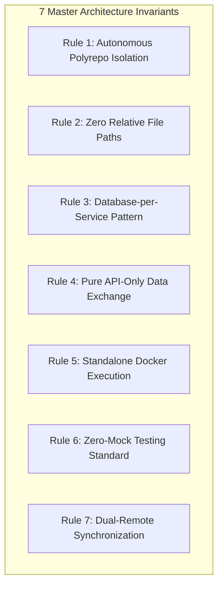

# OENEXA Developer & AI Agent Architecture Governance Standard
**Document Code:** STD-ARC-2026-004  
**Classification:** Enterprise Engineering Standard (Mandatory for Human Engineers & AI Agents)  
**Effective Date:** 2026-11-16  

---

## 1. Golden Architectural Principles

All human developers and autonomous AI agents working in the Oenexa ecosystem must strictly adhere to these seven fundamental architectural axioms. Any PR or automated code generation violating these rules will fail CI and be rejected.

---

## 2. Detailed Rule Specifications

### Rule 1: Workspace Root Isolation (`oenexarepo`)
* The parent directory `C:\workspace\oenexarepo` is strictly a workspace container for the 30 Git repositories.
* **Prohibited:** Never place scripts, orchestrators, markdown notes, environment files, or build artifacts directly in the parent directory.
* **Enforcement:** Master compose files belong in `oenexa-devops/compose/`, edge reverse proxies belong in `oenexa-infra/caddy/`, and documentation belongs in `oenexa-docs/` or `oenexa-architecture/`.

### Rule 2: Zero Cross-Repository File Dependencies
* **Prohibited:** Never use relative paths like `"file:../oenexa-platform/..."` in `package.json`, Gradle, Go modules, or TypeScript/JavaScript imports.
* **Standard:** Every microservice must contain its own self-contained domain contracts and CloudEvent models (`src/domain/events.ts`).

### Rule 3: Database-per-Service (Zero Shared Persistence)
* **Prohibited:** Never connect multiple microservices to the same PostgreSQL database, schema, or persistent volume.
* **Standard:**
  * `oenexa-ai-core` $\rightarrow$ `oenexa-ai-postgres` (`oenexa_ai_db`) & `oenexa-ai-redis`
  * `oengo-api` $\rightarrow$ `oengo-postgres` (`oengo_commerce_db`)
  * `oenexa-node` $\rightarrow$ LevelDB (`onxc-chain-data`)
* Direct cross-database SQL queries are forbidden.

### Rule 4: Pure API-Only Communication
* If Service A requires data or capabilities from Service B, Service A must make a network call:
  * **HTTP REST API:** JSON payloads over HTTP/2.
  * **Web3 JSON-RPC:** Standard Ethereum / ONXC JSON-RPC over port 8545.
  * **WebSocket:** Real-time event and orderbook streaming.

### Rule 5: Standalone Execution Standard
Every runnable service repository must maintain:
1. `Dockerfile`: Multi-stage production container image.
2. `docker-compose.yml`: Standalone local development stack running on its dedicated port.
3. `.env.example`: Complete environment variable template.
4. Standalone test suite: Runnable with `npm test`, `./gradlew test`, or `go test ./...`.

### Rule 6: Zero-Mock Testing Standard
* All test suites must exercise real domain models, real business services, and memory buffers.
* Mock frameworks (such as Mockito, Jest mocks, or synthetic stubs) are strictly prohibited.

### Rule 7: Single Responsibility Limit & Dual-Remote Push
* **Line Ceiling:** Every source code file must remain strictly under **385 lines**.
* **Dual-Remote Push:** Every commit must be pushed to both **GitHub (`origin`)** and the **Production VPS (`server` at `62.210.92.60`)**.
