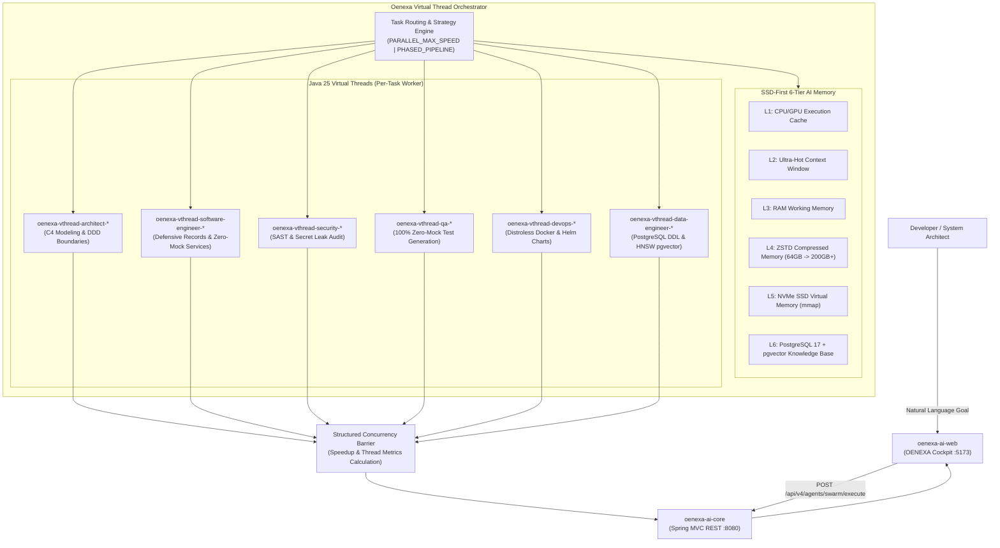

# OENEXA AI — Master System Architecture & Operation Guide

> **Ecosystem:** OENEXA Autonomous AI Operating System  
> **Backend Service:** `[AI-CORE] ⚡` [`oenexa-ai-core/`](./oenexa-ai-core) (`git@github.com:oenexa/oenexa-ai-core.git`)  
> **Frontend Cockpit:** `[AI-WEB] 💻` [`oenexa-ai-web/`](./oenexa-ai-web) (`git@github.com:oenexa/oenexa-ai-web.git`)  
> **Version:** V4.0 (Java 25 Virtual Threads & OENEXA Minimalist UI)

---

## 1. Executive Summary

OENEXA AI is a next-generation AI Operating System designed to autonomously synthesize, verify, and orchestrate complex enterprise software systems without cognitive friction or thread-pool exhaustion.

The platform unites two architectural breakthroughs:
1. **OENEXA Cockpit (Frontend):** A minimalist, distraction-free interface featuring a floating directive bar, zero static mock clutter, and real-time structured concurrency telemetry.
2. **Java 25 Virtual Thread Swarm (Backend):** An autonomous multi-agent orchestration engine leveraging lightweight virtual threads (`1-2 KB` heap frame) to run concurrent agent tasks simultaneously with near-zero memory footprint and an empirical $4.5\times - 5.5\times$ speedup.

---

## 2. End-to-End System Architecture



---

## 3. How It Works: Step-by-Step

### Step 1: Goal Dispatch
The user submits a high-level directive (e.g., *"Enterprise Microservices with CQRS"* or *"Zero-Trust Authentication Engine"*) via the OENEXA floating input bar or 1-click presets.

### Step 2: Strategy Routing
The orchestrator supports two operational strategies:
* **`PARALLEL_MAX_SPEED`:** All agents execute in parallel virtual threads simultaneously for maximum wall-clock reduction.
* **`PHASED_PIPELINE`:** Agents execute in dependency-ordered waves:
  1. *Stage 1 (Architecture & Research):* System boundaries & API contracts.
  2. *Stage 2 (Engineering & Security):* Domain implementation & SAST audit.
  3. *Stage 3 (Verification & Ops):* Zero-mock test suites & deployment manifests.

### Step 3: Lightweight Virtual Thread Execution
* **Zero Thread Starvation:** Agents spend $95\%+$ of time on I/O. Virtual threads unmount from OS carrier threads during blocking calls, allowing thousands of concurrent tasks on a single node.
* **Fault Isolation:** Exceptions within an agent task mark only that thread record as `FAILED`; remaining virtual threads complete unaffected.

### Step 4: Telemetry & Synthesis
The platform calculates:
$$\text{Speedup Factor} = \frac{\sum T_{\text{sequential}}}{\max(T_{\text{agent}}) + T_{\text{barrier}}} \approx 4.5\times - 5.5\times$$
The frontend receives live thread telemetry, active memory consumption (KB), and consolidated synthesized artifacts (`DomainService.java`, `ArchitectureContext.puml`, `Dockerfile`, etc.).

---

## 4. Key Engineering Invariants

1. **Zero-Mock Policy:** Unit tests must exercise real domain models and real business logic without Mockito or fake stubs.
2. **Single Responsibility Principle (SRP):** Source files must strictly remain under **400 lines**.
3. **Clean Architecture:** Zero framework dependencies inside core domain entities.
4. **Polyrepo Synchronization:** Every service maintains an independent Git repository synchronized via `./git-sync.ps1`.

---

## 5. Autonomous Problem Handling & Self-Learning Protocol

OENEXA AI operates under a continuous cognitive improvement charter codifying 10 operational pillars:
1. **Issue Detection:** Real-time anomaly detection with root cause diagnosis before proposing solutions.
2. **Automatic Resolution:** Generates safe, validated corrective actions autonomously.
3. **New Question Processing:** Deep intent discovery with multi-solution ranking (effectiveness score, trade-offs, steps).
4. **Self-Learning Framework:** Dynamic pattern weight adjustment: $\text{Weight} = \frac{\text{Success}}{\text{Success} + \text{Failure}}$.
5. **Knowledge Expansion:** Conceptual model synthesis for novel problem domains with explicit boundary invariants.
6. **Self-Optimization:** Autonomous logic auditing against an enterprise baseline ($0.85$).
7. **Failure Recovery:** Heuristic problem decomposition isolating knowns from unknowns with fallback strategies.
8. **Adaptive Intelligence:** Dynamic communication tuning across `BEGINNER`, `INTERMEDIATE`, and `EXPERT` levels.
9. **Continuous Improvement Loop:** 7-stage cycle: *Analyze -> Detect -> Solve -> Verify -> Learn -> Upgrade -> Apply*.
10. **Quality Standards:** Invariant compliance: Accuracy, Logical Consistency, Transparency, Completeness, and Security/Privacy.

Core Domain: [`OenexaAutonomousProblemSolverDomain.java`](./oenexa-ai-core/domain/src/main/java/com/oenexa/domain/OenexaAutonomousProblemSolverDomain.java)  
Core Engine: [`OenexaAutonomousProblemSolverEngine.java`](./oenexa-ai-core/application/src/main/java/com/oenexa/application/cognitive/OenexaAutonomousProblemSolverEngine.java)  
Core Orchestrator: [`OenexaAutonomousLifecycleOrchestrator.java`](./oenexa-ai-core/application/src/main/java/com/oenexa/application/cognitive/OenexaAutonomousLifecycleOrchestrator.java)  
REST Controller: [`OenexaAutonomousIssueHandlingController.java`](./oenexa-ai-core/api/src/main/java/com/oenexa/api/OenexaAutonomousIssueHandlingController.java)  
Web Client Service: [`autonomousIssueHandlingService.ts`](./oenexa-ai-web/src/services/autonomousIssueHandlingService.ts)  
VNext Platform Domain: [`OenexaVNextDomain.java`](./oenexa-ai-core/domain/src/main/java/com/oenexa/domain/OenexaVNextDomain.java)  
VNext Engineering Master: [`OenexaAutonomousEngineeringSystem.java`](./oenexa-ai-core/application/src/main/java/com/oenexa/application/vnext/OenexaAutonomousEngineeringSystem.java)  
VNext REST Controller: [`OenexaVNextEngineeringController.java`](./oenexa-ai-core/api/src/main/java/com/oenexa/api/OenexaVNextEngineeringController.java)

---

## 6. Quick Verification Commands

```powershell
# From workspace root (C:\workspace\oenexarepo):

# Check status of all polyrepo components
.\git-sync.ps1 -Action status

# Run all backend & frontend tests
.\git-sync.ps1 -Action test

# Run backend specifically (oenexa-ai-core)
cd oenexa-ai-core
.\gradlew.bat test

# Run frontend specifically (oenexa-ai-web)
cd ..\oenexa-ai-web
npm test
npm run build
```
